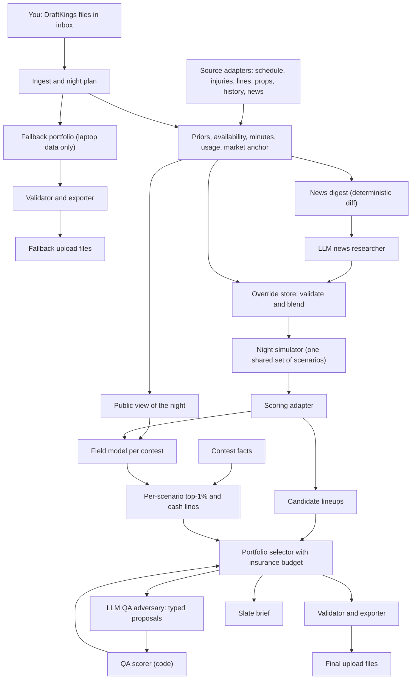
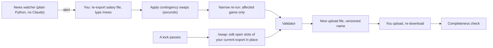
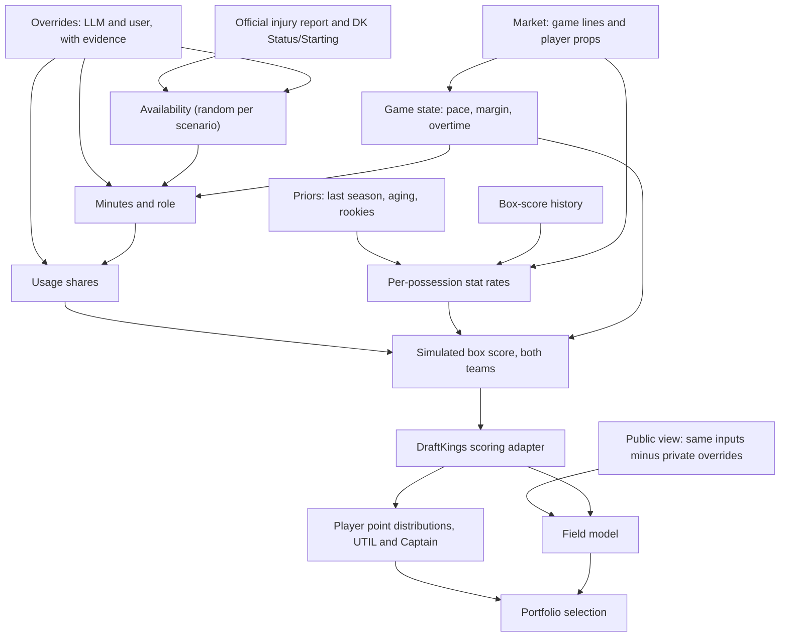

# NBA DFS Engine: Architecture

**Status:** draft for approval. Design only; no engine code exists yet. **Date:** 2026-10-13. **Go-live:** NBA opening night, Tuesday 2026-10-20.

**How to read this:** every section stands alone. Evidence labels: **VERIFIED** means we ran it or read it in a primary source and the evidence is cited; **SUPPORTED** means a credible source says so but we did not observe it ourselves; **BET** means our judgment, to be tested. Research memos live in `docs/research/` (R1 to R9, RR1 to RR4, S1, S2) and decision records in `docs/adr/`.

---

## 1. Summary in plain English

### What the engine does

Each night it builds lineups for every DraftKings NBA entry you hold, Classic and Showdown Captain Mode, so that each contest has the best chance of a top-1% finish and the night as a whole rarely ends with zero cashes. It simulates the whole night tens of thousands of times (every game, every player, with blowouts, overtime, injuries and late scratches drawn at random), simulates the opponents you will face in each contest, and picks the set of lineups that wins in the most different versions of the night. It hands you one validated upload file per slate and a two-minute brief.

### How a night runs (typical main slate, first tip 6:00 pm CT)

1. **Afternoon, about 10 minutes of your time.** Enter contests as usual. Download the entries file for each slate (Classic main plus each Showdown) and the matching salary export into the `inbox` folder. Type `/night` in Claude Code.
2. **Within about 10 minutes** the engine has a valid fallback upload for every slate, built from data on your laptop only. You can upload it right away as insurance.
3. **About 30 to 45 minutes later** it has the full build: research on injuries and roles, the simulation, the opponent model, lineup selection, an independent QA review, and the brief. You upload one file per slate (about a minute each) and re-download once so the engine can confirm every entry is filled.
4. **About 30 minutes before each lock wave**, you re-export the salary file (it carries DraftKings' own `Status` and `Starting` columns) and type `/news`. If anything changed, you get a new file in under 10 minutes, end to end. Without any change, nothing happens.
5. **After a lock**, if games remain, `/swap` edits the open slots of your current DraftKings export in place.
6. **Next morning, about 3 minutes.** Download the contest standings and type `/results`. The engine scores every layer of its own work (projections, ownership, opponent model, LLM overrides, QA changes) so it learns from dense signals instead of a few contest results.

### What it is built from

- **Deterministic Python on your laptop** does all arithmetic: parsing DraftKings files, projections, simulation, opponent fields, lineup selection, validation, export, and learning. It runs with or without Claude.
- **Claude Code** is the judgment layer, and it runs only when you type a command. A news researcher turns injury and role news into structured, evidence-backed records. An independent QA agent proposes changes that code then scores. Claude never writes lineups or touches upload files.
- **Free data only.** All DraftKings data comes from files you download by hand, because DraftKings' terms bar automated access to its site (VERIFIED, terms dated 06/30/2026). Third-party data follows the posture you choose (Decision D1).

### Where this departs from your vision, and why

| Your step | What changed | Why, in terms of the two goals |
|---|---|---|
| 1. Upload the salary file and the entries file | You upload **one entries file per slate** (each already contains its slate's full player list with IDs) plus the salary export, which adds DraftKings' `Status` and `Starting` columns. | A night has 3 to 5 slates, each with its own player IDs; reading IDs only from the files for that slate removes the most common cause of invalid uploads. |
| 2. Project median, top-1% outcome, boom/bust, and ownership | Projections are **full distributions from a simulation of the whole night**. Ownership is **read off a simulated field of opponents** instead of projected on its own. | Both goals depend on the joint outcome of every contest in the same simulated night; ownership that comes from simulated opponents reacts to news by construction. |
| 3. The LLM removes players, overrides roles, and assigns players to lineups | The LLM files **structured beliefs with evidence** (probability of playing, minutes range, usage shift). **Code assigns players to lineups.** | Lineup choice is a probability over thousands of scenarios and opponents; only code can compare candidates on that objective, and keeping the LLM's contribution structured makes it measurable. |
| 4. Adversarial QA, up to three iterations | QA proposals are **typed and scored by code**. Belief changes must clear an evidence bar computed from our own past errors; construction changes must improve the goals in simulation. An argument alone never changes the portfolio. | QA changes that cannot show evidence or improvement are noise that moves every lineup. |
| 5. Present the upload file | A **valid fallback file exists before any LLM step**, every slate is planned in lock order, and only DraftKings validity can block a file. A completeness check runs after every upload. | Your prior engines lost more to blank or late entries than to bad models (RR1 to RR4, VERIFIED); a blank entry has zero chance at either goal. |
| 6. Post-contest analysis | The morning step **scores every layer separately** against its own baseline (projections before overrides, portfolio before QA, a simple control portfolio) and only adopts model changes that win on held-out nights with your sign-off. | A few contests a night are mostly noise; thousands of player and opponent observations a night are signal. |
| New | **Insurance budget** (one setting that trades top-1% odds for washout protection), **contingency swaps** precomputed for questionable players, and **lock-wave late swap**. | These are the direct levers on Goal 2 and on late news. |

### What we learned from your prior engines (and built in)

None of your five engines, nor dfs-os, dfs-architect, the NBA repo, or nba-betting-system, showed a measurable edge, and most of the money lost was lost at lock time: entries locked blank in slates nobody built, a stale lock list, a check that changed no number but blocked a file, a late file refused after first tip (RR1 to RR4, VERIFIED in those repos' own records). Process also grew faster than results (MLB about 100,000 lines with about 80% of pull requests on records and plumbing; NHL 106 open decisions and an 18 to 35 minute test suite). This design therefore puts delivery first, keeps Phase 1 thin, requires every piece of sophistication to beat a simpler version on scorecards, and writes limits on its own process into the design (section 13).

---

## 2. Goals as math

### The short version

- **Goal 1** for each contest is the probability that our best entry finishes in the top 1%, counted at the share of prize money it keeps after ties with opponents who hold the same lineup.
- **Goal 2** is the probability that, across every contest tonight, no entry cashes.
- Both are computed on **one shared simulation of the whole night**, so a bad game hurts every Classic and Showdown entry that leaned on it in the same scenario.
- **One setting, the insurance budget**, says how much of each contest's top-1% odds you will give up to lower washout risk. Default 5%.

### Notation

- A **slate** is a DraftKings draft group: the Classic main slate, an early or late Classic slate, or one Showdown game. A night has several.
- For contest `c`: `N_c` is the field size, `n_c` our entries, `N'_c = N_c - n_c` the opponents.
- **Top-1% places:** `k_c = max(1, floor(0.01 x N_c))`. A rank counts as top 1% when it is within the first 1% of the field. Fields under 200 entries therefore have one top-1% place, which is first place (this covers your rule for fields under 100 and makes 100 to 199 explicit). Note: research memo R2 used a ceiling instead of a floor; this document's floor rule governs.
- **Paid places:** `m_c`, from the contest's payout table (exact when known, otherwise the contest family's default, about 23% of the field for NBA GPPs, VERIFIED on your 394 past NBA Classic entries, R8).
- A **scenario** `s` is one simulated night: every player's box score and DraftKings points at UTIL and at Captain (1.5x the bonus-inclusive total). We draw `S` scenarios: 10,000 to screen, 30,000 to finalize.
- `X_L(s)` is lineup `L`'s score in scenario `s`; `B_c(s)` is our best entry's score in contest `c` in that scenario.
- `F_{c,s}(x)` is the probability that one simulated opponent in contest `c` scores at most `x` in scenario `s`, estimated by scoring a large weighted sample of simulated opponent lineups in every scenario.

### Goal 1: top-1% probability per contest

Our best entry is top 1% when fewer than `k_c` opponents beat it. Given the scenario, opponents' lineups are independent draws from the field model, so the count that beats score `x` is binomial:

```
P(top 1% in c | s) = BinomCDF( k_c - 1 ;  N'_c ,  1 - F_{c,s}( B_c(s) ) )

G1_c = average over scenarios of  P(top 1% in c | s) x share_c(s)
```

- One formula covers single-entry, 3-max, 20-max and 150-max contests and fields of any size. For multi-entry contests it is exactly "the probability at least one of our entries is top 1%", because only our best entry decides that event.
- **Duplication (ADR-009, Decision D2):** `share_c(s)` is the fraction of the prize we keep. DraftKings pools the prizes of tied places and splits them evenly (terms, VERIFIED). A five-way tie for first in a top-heavy contest keeps roughly a fifth of first-place money and counts as about 0.2; a tie deep in the top 1%, where neighboring prizes are nearly equal, counts as nearly 1. The raw, unadjusted probability is reported beside it. This matters most in Showdown: in your NFL engine's data, 83% to 98% of top-1% Showdown entries were shared by six or more players, and a 23-way tie for first paid each entry 5.4% of the advertised prize (RR2, VERIFIED).
- **Big-field first place:** a sampled field resolves the top 1% well (thousands of samples above the line) but not first place in a 35,000-entry contest. P(first) and P(top 0.1%) are reported beside Goal 1 using a fitted upper tail of the field's score distribution, because your NFL engine overpriced first place by 18x to 280x from a raw sample (RR2, VERIFIED).

### Goal 2: probability of a total washout

Our best entry in a contest cashes when fewer than `m_c` opponents beat it:

```
P(no cash in c | s) = 1 - BinomCDF( m_c - 1 ;  N'_c ,  1 - F_{c,s}( B_c(s) ) )

P(W) = average over scenarios of  product over contests c of  P(no cash in c | s)
```

- The product sits inside each scenario. Contests are independent only after conditioning on the simulated night, which keeps the dependence that drives washouts: one game script sinks the Showdown on that game and every Classic lineup that leaned on it.
- **Delivery is part of Goal 2.** A blank entry cannot cash. The brief reports unfilled entries next to `P(W)`, and the night plan builds every slate's baseline file before improving any of them.

### How the goals trade off, and the hunch test

Both goals are functions of the same object, the per-contest best scores `B_c(s)` across scenarios.

- Goal 1 wants `B_c(s)` above the **top-1% line** of each contest in as many scenarios as possible, which in a multi-entry contest means different entries winning in different scenarios.
- Goal 2 wants, in **every** scenario, at least one contest where `B_c(s)` clears the much lower **min-cash line**.

Both reward covering different ways the night can unfold, which is your hunch. They disagree in three places: (1) target height, since a ceiling build gives up some floor and in a single-entry contest that cost is direct; (2) cross-contest concentration, since Goal 1 scores each contest alone and does not care whether every contest leans on the same game, while Goal 2 does; (3) night composition, since Showdowns depend on one game each.

**What the evidence says so far.** The math in the literature agrees with the hunch between lineups: lowering the correlation among our own entries raises the chance at least one is top 1% and lowers the washout chance (Hunter, Vielma and Zaman; Haugh and Singal; R2, R5). Concentration is a measured washout cause: across 8,007 field portfolios in your NFL data, putting 85% or more of entries on one player raised the zero-paid rate 1.4x to 12x (RR2, VERIFIED). On a synthetic night shaped like your volume, TODO-R9 (frontier numbers and verdict from the night benchmark, R9). Status: BET until measured on real slates.

**The ongoing test.** Each night the engine computes the frontier (below). If washout falls steeply for a small Goal 1 cost, the hunch holds that night. The slope is tracked and reviewed after 20 nights.

### The control: the insurance budget

```
For each contest c, let G1*_c be the best Goal 1 the engine finds for c alone.
Choose the night's portfolio that minimizes P(W)
subject to G1_c >= (1 - epsilon) x G1*_c for every contest c.
```

- In words: "I'll give up at most epsilon of my top-1% odds, in every contest, to lower the chance of a night with zero cashes." At 0% the engine maximizes top-1% odds and uses washout only to break ties.
- Each contest keeps its own guarantee, so no contest is quietly sacrificed for another and no weighting between contests of different sizes or fees is needed. The setting means the same thing on a 3-contest night and a 12-contest night; a fixed washout target would be impossible on some nights and meaningless on others (ADR-001).
- **Implementation:** lazy greedy selection on `sum_c G1_c / G1*_c + lambda x (1 - P(W))`, sweeping `lambda` upward and keeping the largest value for which every contest still meets its guarantee. Weighted sums of coverage objectives keep the greedy method's quality guarantee (R2, SUPPORTED).
- **Default 5%, with the frontier shown every night** at epsilon = 0, 2, 5, 10 and 20%. You prefer large prizes (your NFL instruction was to "err on side of trying to win large prizes", RR2), so Decision D3 asks whether to start lower.

### How each goal is estimated, and how precise it is

- **Monte Carlo** on `S` scenarios. With 30,000 scenarios, a 1% probability has a standard error of about 0.06 percentage points and a 5% washout probability about 0.13 (VERIFIED arithmetic, `sqrt(p(1-p)/S)`).
- **Common random numbers:** every comparison (portfolio A against B, before QA against after) uses the same scenarios, which cut comparison noise 1.6x in a toy test (R3, VERIFIED) and more when lineups overlap.
- **Separate selection and reporting scenarios:** the portfolio is chosen on one scenario set and its reported probabilities come from a fresh set, so selection cannot flatter the numbers (lesson from your MLB engine, RR1).
- **Precision is not accuracy.** If player distributions are too narrow or correlations too weak, `P(W)` will be too low. The learning loop checks this with dense signals: predicted cash probability per entry against realized cashes (50 to 200 entries a night) and the predicted top-1% and min-cash lines against the actual lines in every standings file.

---

## 3. System overview

### The boundary in one sentence

Claude sets beliefs about the world (who plays, for how long, in what role) as validated records; deterministic code does everything after that, including every lineup and every file you upload.

### Components

| # | Component (deterministic unless marked LLM) | Job | What it means for you |
|---|---|---|---|
| 1 | **Inbox and ingest** | Parse your DraftKings files (entries per slate, salary exports, payout pastes, standings, entry history), detect encodings, identify each slate from its embedded player list, and fail closed with plain-language errors. | You drop files in one folder; the engine tells you what is missing. |
| 2 | **Night plan** | Order slates by lock time, track every entry's state (empty, fallback, full build, uploaded, confirmed). | No slate is forgotten; the brief shows what still needs action. |
| 3 | **Clock, identity and team map** | One lock clock read from each file's Game Info; one identity rule (person plus role, per slate, because DraftKings IDs change between slates); one team-code map; reviewed name matches persist. | Removes the drifted-copy bugs that were the top root cause in your MLB engine. |
| 4 | **Source adapters** | Schedule, injury report, lines, props, history, news, under the data posture you choose; rate limited; every response snapshotted with a timestamp and hash. | Data failures degrade the build instead of stopping it; every input is replayable. |
| 5 | **Priors and rates** | Per-possession stat rates with shrinkage, per-stat recency decay, aging, rookie priors, early-season variance inflation. | Sensible projections from opening night with no current-season data. |
| 6 | **Availability, minutes and usage** | Probability of playing; minutes distributions by role; redistribution when teammates sit; usage shares that sum to 100%. | Captures the most common NBA edge: a cheap player stepping into a starter's role, with honest uncertainty. |
| 7 | **Market anchor** | Game lines give team totals and pace; player props pull stat means toward the market when available. | Situational effects (rest, travel, matchup) are priced once, by the most efficient source. |
| 8 | **Override store** (fed by the LLM and by you) | Validate overrides, blend them by precision weighting, keep the before and after. | You can veto or add an override; every one is scored later. |
| 9 | **Night simulator** | Stat-level joint simulation with game, team and player factors; blowouts, overtime and availability drawn per scenario. | Correlation, Captain math, and double-double odds come out right instead of being assumed. |
| 10 | **Scoring adapter** | Versioned DraftKings scoring with nightly self-checks against standings. | A rule change is caught the morning after it happens. |
| 11 | **Field model** | Simulated opponents per contest type, built from a public view of the night; ownership and duplicate counts are read off it. | Top-1% and min-cash lines reflect the field you actually face. |
| 12 | **Contest facts** | Field size, paid places and payout curve per contest, from your entry-history export, pastes, or family defaults. | Better thresholds with near-zero effort from you. |
| 13 | **Candidate generator** | Classic: thousands of lineups from an optimizer run on simulated outcomes and leverage-adjusted means. Showdown: every legal lineup, screened. | A wide pool of lineups that each win some plausible version of the night. |
| 14 | **Portfolio selector** | Greedy coverage per contest, insurance-budget control across the night, concentration guardrails, late-swap-friendly slot assignment, scenario labels. | Optimizes your two goals directly instead of hand-set exposure rules. |
| 15 | **Validator and exporter** | Every DraftKings rule, checked against the downloaded files; the only writer of upload files; re-reads its own output. | You never receive an invalid file. |
| 16 | **Late swap** | Pin locked players, treat finished games as known, edit open slots of your current export in place, apply precomputed contingency swaps. | Late scratches become low-owned pivots instead of zeros. |
| 17 | **Brief** | Two-minute slate brief: thesis, assumptions, exposures, risks, what news would change the build, what was skipped, input freshness. | One page tells you what the engine believes and why. |
| 18 | **Run store and replay** | Manifest per run: inputs, snapshots, versions, seeds, LLM decision records, outputs. | Any night can be replayed exactly. |
| 19 | **Learning** | Standings and box-score ingest, per-layer scorecards, shadow challengers, adoption workflow. | The engine improves only on evidence, with your sign-off. |
| 20 | **LLM: news researcher** | Reads a deterministic news digest, searches sparingly, files override records with evidence. | News faster and more complete than any free feed, in a form code can use. |
| 21 | **LLM: QA adversary** | Independent review; files typed proposals with evidence; code scores them. | A second opinion that must earn its changes. |
| 22 | **LLM: results analyst** (weekly) | Reads the scorecards, writes the weekly review, drafts challenger proposals. | You approve or reject model changes once a week. |

### Night data flow



### Late news and lock waves



### The deterministic and LLM boundary

| Decision | Who decides | How it is checked |
|---|---|---|
| Who is in the player pool | Code, from the downloaded file; LLM may propose an exclusion with a reason | Validator; exclusion logged and scored |
| Probability a questionable player plays | Code maps official status; LLM may file an availability record with evidence | Schema validation; Brier score afterward |
| Minutes, role and usage shifts | Code model; LLM files ranges with evidence | Precision-weighted blend; coverage of stated ranges tracked |
| Player stat distributions, correlation, Captain points | Code only | Calibration tests against box scores |
| Ownership, opponent lineups, thresholds | Code only (public view) | Nightly comparison with standings |
| Which lineups to enter, in which slots | Code only | Validator; frontier and scorecards |
| Changes after review | LLM proposes typed changes; code scores and accepts | Evidence bar and simulation test |
| What goes in the upload file | Code only; a hook blocks the LLM from writing there | Validator re-reads the file |
| Whether a model change is adopted | You, after a held-out comparison | Weekly review |

---

## 4. Projections

### The short version

Every player gets a full distribution of DraftKings points from a simulation of the whole night, not a single number. The simulation draws who plays, how many minutes each player gets (including blowouts and overtime), how the team's possessions are shared, and each counting stat, then scores the line with DraftKings' exact rules. Medians, top-1% outcomes, boom and bust rates, and Captain values are summaries of that simulation. What it means for results: the tails that decide tournaments (blowouts, overtime, a backup who starts) come out of the same simulated games that set everyone else's scores, so correlation is real rather than assumed.

### The projection graph, as implemented

The attached blueprint's graph was a good start; this version fixes its gaps (R3 critique): minutes now depend on game state (blowouts, overtime), availability is a random draw, priors and news are explicit inputs, and the field has its own inputs.



### Minutes and role come first

- **Base distribution:** each player's minutes have a role-specific center and spread (a truncated normal core on 0 to 48), built from season-long and recent minutes with per-stat recency decay rather than a fixed 10-game window. A practitioner baseline (75% season plus 25% last five games) is the benchmark to beat (R3, VERIFIED source).
- **Game state:** in each scenario the final margin is drawn around the spread; when it exceeds about 15 points, starters lose minutes and the bench gains them. Calibration target: the margin varies around the spread with a standard deviation of 13.2 points, and 18.6% of games are decided by 20 or more (RR4, VERIFIED arithmetic on a historical lines file of unknown provenance; R3 had assumed 12). Overtime (5.4% of games in the same file; 6.2% to 6.4% in RotoGrinders data, R5) adds 5 minutes for players on the floor.
- **Early exits:** a small probability of injury or foul trouble cuts a player's minutes in a scenario, which creates the left tail that independent draws miss.
- **Reconciliation:** each team's minutes sum to 240 (plus 25 per overtime) in every scenario.
- **Restrictions:** a return-from-injury minutes cap enters as an override with a hard cap.
- What it means for results: minutes are where every vendor says NBA slates are decided (R1, VERIFIED); DARKO's own test against DFS sites found minutes was the only stat it lost on.

### Minutes and usage when a player sits

- **Share model:** each team's possessions used are a fixed pool; each active player's share is base usage x a per-scenario multiplier x minutes, renormalized to 100%. When a player sits, his share and minutes are redistributed automatically (R3 section 2).
- **Where the freed share goes:** a position-similarity prior (a guard's absence lifts guards most), updated by with-or-without-you evidence in proportion to how many minutes of "without" data exist (shrinkage constant about 300 minutes, BET to be fitted), plus any redistribution hint from an override. The number of games the absent player has already missed is an input, because rotations settle after the first few games (RR4, BET).
- **Efficiency cost:** shooting efficiency drops about 1 point per 100 possessions per extra 1% of usage (midpoint of Oliver and Witus, R3, SUPPORTED).
- **Uncertainty:** the redistribution weights are drawn per scenario, so the beneficiary's distribution is wide when the evidence is thin.
- **The LLM interface:** the news researcher expresses role changes as an override record (section 7): probability of playing and starting, minutes as 10th/50th/90th percentiles with an optional hard cap, usage and per-stat multipliers as percentiles, redistribution hints, and a condition such as "only if player Y is out". Code converts the percentiles to distributions, inflates the LLM's stated uncertainty by a coverage factor fitted from its track record (starting at 1.5), blends by precision weighting, and renormalizes the team. Official OUT designations override everything; your overrides beat the LLM's.

### Rates and early-season priors

- **Rates per possession,** shrunk toward a role and position prior with empirical Bayes (the regressed rate is a weighted average of prior and observed, with the weight set by how many possessions the player has), with a separate recency decay per stat, in the spirit of DARKO's published method (R3, VERIFIED source).
- **Opening night has no current-season data.** Priors are last season's per-possession rates adjusted for age, team change and role; rookies get a prior from draft slot, age and height; team changes move through the usage share model rather than edited raw rates; coaching changes shrink pace toward league average. The early-season variance multiplier widens every player's uncertainty and decays as minutes accumulate. Recompute nightly; the shrinkage makes the transition automatic.
- **The market carries the most current information.** Team totals and spreads set each team's efficiency and pace; player props, when available under the data posture, pull stat means toward the market (R5: betting markets price rest and travel; DraftKings salaries lag).
- **Never used:** DraftKings' `AvgPointsPerGame` column (0.0 for players with no history, RR4).

### Distributions and definitions

All values come from the simulation's scenarios for that player.

| Term | Definition | Why it matters |
|---|---|---|
| **Median** | 50th percentile of simulated DraftKings points | The typical night, robust to blowout tails |
| **Mean** | Average simulated points | Used for salary value and as an optimizer input |
| **Top-1% outcome** | 99th percentile of simulated points: the score the player beats in only 1 of 100 simulated nights | Tournament ceiling; what a top-1% lineup needs from him |
| **Ceiling** | 90th percentile | A more stable upside measure for the brief |
| **Boom rate** | Probability of at least 6 x salary/$1,000 points (Captain: the same multiple of Captain salary, since both points and salary are 1.5x) | Chance he returns tournament value |
| **Bust rate** | Probability of fewer than 4 x salary/$1,000 points | Chance he sinks a lineup |
| **P(double-double), P(triple-double)** | Share of scenarios with the milestone | Bonuses come from each simulated line, never from averages |
| **P(active)** | Share of scenarios in which he plays | Questionable players stay random until news |
| **Optimal rate** (Phase 2) | Share of scenarios in which he is in that scenario's best possible lineup | The simulation's own measure of how often he wins a slate |

The boom and bust multiples are settings, revisited once real distributions exist (BET defaults).

### The simulator

Per scenario (R3 section 4, stat-level with shared factors):

1. **Game:** a pace factor shared by both teams; the final margin around the spread; overtime more likely when the margin is small.
2. **Team:** an offensive efficiency factor centered on the market's implied team total.
3. **Availability and minutes:** draw who plays, apply blowout trims and early exits, reconcile to 240 minutes.
4. **Player:** a shared "big night" multiplier across his stats, plus stat-specific overdispersion (negative binomial counts).
5. **Usage stats:** shot attempts, free throws and turnovers from team possessions x usage share; makes from shrunk percentages; points follow.
6. **Rebounds:** team rebound chances follow from both teams' misses and are shared among active players, which creates the negative correlation between same-team bigs.
7. **Assists:** a share of the team's made shots.
8. **Steals and blocks:** counts on opponent possessions and attempts.
9. **Scoring:** the versioned DraftKings adapter (triple-double +4.5; Captain 1.5x the bonus-inclusive total, ADR-020).

Not chosen: a possession-by-possession game simulator (far more parameters to calibrate, each a place to drift; a later upgrade only if scorecards justify it) and fantasy points drawn from a multivariate normal (thins the upper tail that tournaments are decided in, and cannot produce double-double logic; R3 spike, VERIFIED direction). What it means for cost: days of build time rather than weeks, and every parameter is checkable against free box scores.

**Determinism:** every random draw is keyed by (run seed, scenario index, game, person, stat) with a counter-based generator, so adding or removing a player never changes anyone else's draws, and the same inputs always give the same scenarios. Your NHL and golf engines produced different lineups from the same inputs because of solver time limits and row-order noise (RR3, VERIFIED); neither is allowed here.

**Runtime:** TODO-R9 (simulation time for 10,000 and 30,000 scenarios on this laptop).

### Correlation, and what it means for Classic and Showdown

NBA correlation is small and mostly comes from the game, not from player pairs (R3, R5):

- **Positive, game-wide:** pace and overtime lift everyone in the game, both teams.
- **Positive, within a team:** the team efficiency factor (a hot shooting night).
- **Negative, within a team:** fixed usage shares, shared rebounds, and minutes redistribution after an early exit or blowout. A team's PG and SG totals correlated at -0.38 in one older FanDuel-scored study (R5, VERIFIED source, 2012 to 2016).
- **Negative, starters against bench:** blowouts move minutes from starters to the bench.

The simulator's output correlations are checked against correlations measured from last season's box scores, by role pair, before any slate is played (section 11).

- **Classic:** stacking teammates is a weak lever; what matters is shared game environment (close, fast games and overtime) and shared downside (blowouts, injuries). The selector discovers when a game stack pays instead of following a stacking rule.
- **Showdown:** the game script dominates everything. Close games and overtime reward stars at Captain; blowouts move fourth-quarter minutes to both benches, which is when cheap bench players and lopsided team splits win. The both-teams rule forces at least one player from the losing side.

### Captain handling

- Captain points are 1.5x the same scenario's bonus-inclusive total, and Captain salary is 1.5x UTIL salary (VERIFIED on 189 historical NBA pairs; always a whole $100, R6).
- Captain and UTIL are two roles of one person with different DraftKings IDs; the engine pairs them by name and team, never by ID arithmetic, and reads the slot label (UTIL in NBA, FLEX in NFL and NHL) from the file header.
- Points per dollar are the same at Captain; the Captain question is whether that player's extra half-score in the scenarios that win the contest is worth what the higher salary forces out. Every legal Showdown lineup is enumerated (about 440,000 for a 22-player pool, in 0.015 seconds, R2, VERIFIED), so that tradeoff is computed exactly rather than approximated.

---

## 5. Ownership and the field

### The short version

Ownership (how often each player is picked) is read off a simulated field of opponents rather than projected by itself. The simulated opponents build lineups from a **public view** of the night, the information any DraftKings player can see, never from our private research. Ownership, duplicate counts, and each contest's top-1% and min-cash lines all come from that field. What it means for results: when news breaks, the simulated field reacts the way the real one does, and our private findings stay private.

### Two views of the night

| View | Built from | Used for |
|---|---|---|
| **Engine view** | Everything: our model, the market, official news, and private overrides from the news researcher and from you | Our lineups |
| **Public view** | Our baseline model plus public information only: official injury statuses, DraftKings `Status` and `Starting` columns, betting lines, and, where the data posture allows, free consensus projections. No private overrides. | The simulated field |

- **Why two views:** the field must react to public news (your NHL engine missed news-driven chalk by about 10x, 50.7% actual against 4.7% predicted, because news never reached its field model, RR3, VERIFIED), and it must not react to what only we know. If the field saw our private overrides, our edge would disappear inside the simulation.
- **Tests in both directions (section 11):** a public scratch must raise the beneficiary's simulated ownership; a private override must leave simulated ownership unchanged.

### Who the simulated opponents are

A mixture whose weights depend on the contest type (stake, field size, entry limit), following Haugh and Singal's opponent model and the open-source simulators (R2, R3):

1. **Optimizer-like entrants:** each solves the lineup problem on public-view projections plus personal noise, under typical construction habits (salary near the cap).
2. **Casual entrants:** pick players in proportion to public popularity (projection, value, name recognition), subject to a salary floor.
3. **Chalk duplicators:** copies of the handful of most obvious lineups; small in Classic, large in Showdown.
4. **Stale entrants:** lineups built before late news that never update, so a fraction of the field still holds a player ruled out after they entered.

High-stakes fields are sharper but more alike; low-stakes fields are softer and chalkier (Stokastic and SaberSim both separate them, R1, VERIFIED). The weights are settings per contest family.

### Ownership itself

- Read off the field: the share of simulated lineups holding each player, by slot type.
- **One unit, checked nightly:** fractions summing to 8.0 in Classic (800%) and 1.0 Captain plus 5.0 UTIL in Showdown (RR4 lesson).
- **Captain and UTIL are separate.** The field over-captains the obvious star (one documented slate, R5, SUPPORTED); the casual entrants' Captain choice is sharper than their UTIL choice, and the optimizer entrants choose Captains by the numbers.
- **Uncertainty:** each contest gets 5 to 10 field realizations with ownership perturbed around its mean, rotated across scenarios, so one wrong ownership guess cannot make the thresholds look certain.
- **Expected accuracy:** no vendor publishes ownership accuracy (R1, R3). BET: average misses of 3 to 6 percentage points among players above 5% ownership on big main slates once calibrated, with the largest misses on late-news value plays. Measured from week 1.

### Cold start and calibration

- **No history needed to start.** The field's few settings (optimizer noise, casual share, salary floor, stale share) start from published rules of thumb (BET values in the configuration).
- **Night 2 onward:** each standings file gives every opponent lineup and actual ownership by slot. The engine fits only stable shapes with heavy shrinkage: ownership by salary tier, salary left unspent, duplicate rates, Captain concentration, and the stale share measured on late scratches' actual ownership. Your NFL engine's construction features flipped sign from game to game, and copying the last game's winning shape was itself a way to lose (RR2), so nothing is fitted to a single night.
- **Graded before it carries weight:** leverage and duplication effects are judged against real fields weekly. Your MLB engine leaned contrarian while real winners were chalkier (RR1).

### Duplicates

- **Showdown:** a simulated field of a few hundred thousand lineups is cheap at 6 slots; expected copies of a lineup = field size x its frequency in that sample.
- **Classic:** exact-match frequency for chalky lineups; for rare ones, the product of ownerships times a correction factor fitted from standings.
- Duplicates enter Goal 1 through the prize-share factor (section 2).

### Thresholds

- For each contest and scenario, the opponents' score distribution comes from scoring the field sample in that scenario, processed in chunks of scenarios so memory stays small.
- The top-1% and min-cash lines follow from the binomial formulas in section 2; for fields under 200 (first place only) the field sample is sized so the top of the distribution is resolved.
- P(first) in large fields uses a fitted upper tail of the field's scores in each scenario.
- Each morning, the realized top-1% and min-cash scores are placed within the predicted distribution; over many contests those positions should be spread evenly (a calibration check).

**Runtime and memory:** TODO-R9 (field generation and threshold time on this laptop).

---

## 6. Lineups and portfolio

### The short version

The engine builds a wide pool of legal lineups that each win some plausible version of the night, then picks entries one at a time, each time adding the lineup that wins the most simulated nights the portfolio does not already win. A night-level pass then trades a little of each contest's top-1% odds for washout protection, within the insurance budget. What it means for results: the two goals are optimized directly, and diversity comes from covering different scenarios rather than from hand-set exposure rules.

### Candidate generation

**Classic** (8 slots, $50,000, at least 2 games):

- An integer-programming solver (a program that finds the best combination of yes/no choices under rules such as the salary cap) builds lineups from: (a) individual simulated scenarios ("the best lineup if the night goes exactly like this"), (b) mean projections minus several weights on public-view ownership (leverage variants), (c) structural variants such as game stacks with players from both teams, and (d) lightly perturbed means. Duplicates are removed.
- Formulation: one yes/no variable per player plus position-feasibility rows, which was 5x to 25x faster than the common "player in slot" model with identical optimal lineups (R2, VERIFIED on a synthetic 120-player slate). Slot assignment is a separate, later step (below).
- Solver: TODO-R2 (choice and measured time per lineup). No wall-clock time limits, so results are deterministic.
- Pool size: about 4,000 to 20,000 candidates per Classic slate, generated in parallel across the laptop's 8 cores. Runtime: TODO-R9.
- Building lineups one after another with "share at most K players with every earlier lineup" constraints is slow (68 to 370 seconds for 150 lineups across solvers, R2, VERIFIED indicative timing) and unnecessary, because selection creates the diversity.

**Showdown** (Captain plus 5 UTIL, both teams):

- Every legal lineup is listed (about 440,000 for a 22-player pool in 0.015 seconds, R2, VERIFIED), then screened to the strongest few tens of thousands by a cheap score (hits in a subsample of scenarios) before full scoring. No solver is needed, and Captain tradeoffs are computed exactly.

### Selection against the goals

1. **Score every candidate in every scenario** (in chunks) and record, per contest, whether it clears that scenario's top-1% line and cash line, stored as compact bit arrays (5,000 candidates x 10,000 scenarios is about 6 MB per contest, R2, VERIFIED).
2. **Per contest, lazy greedy coverage:** repeatedly add the candidate that adds the most duplication-adjusted top-1% probability given the entries already chosen. This objective has diminishing returns, so greedy selection is provably at least about 63% as good as the best possible set from the same pool, and usually much closer (Hunter, Vielma and Zaman; Haugh and Singal; R2, VERIFIED theorems). The result for each contest is its best achievable Goal 1, `G1*_c`.
3. **Night pass with the insurance budget:** greedy on `sum_c G1_c / G1*_c + lambda x (1 - P(W))`, sweeping `lambda` upward and keeping the largest value for which every contest still has at least `(1 - epsilon) x G1*_c`. This produces the nightly frontier table.
4. **Local improvement:** a deterministic pass tries single-player swaps inside chosen lineups (for example a near-identical player with lower public ownership) and keeps any swap that improves the objective by more than simulation noise. This is the construction half of QA, done by code.
5. **Report on fresh scenarios:** all probabilities in the brief come from a scenario set not used for selection.

### Guardrails (in code)

- No lineup is entered twice in the same contest.
- **Concentration cap:** no single player in more than 60% of the night's entries (setting). Your NFL data showed 85% or more of entries on one player raised the zero-paid rate 1.4x to 12x, and that engine once shipped 94% on one player and cashed 0 of 18 (RR2, VERIFIED).
- **Per-game exposure across formats** is reported in the brief (share of all entries depending on each game, Classic and Showdown combined).
- **Reuse across contests:** Decision D5 (your NFL rule was every lineup distinct across the whole entries file).
- Guardrails shape construction; they never block a file from being delivered.

### Single-entry, small multi-entry, and 150-max

The same objective covers all three; the differences come out of the math rather than separate rules:

- **Single-entry:** the one lineup with the best duplication-adjusted top-1% probability; in fields under 200 this is the best probability of finishing first. Cost of insurance is direct here, because one lineup cannot be both ceiling and floor.
- **3-max to 20-max:** a handful of lineups that win different scenario clusters (for example one built for a close game with overtime, one for a blowout).
- **150-max:** many entries (you fill only the entries you bought); the greedy method spreads them across scenarios automatically. DraftKings caps entries per user at about the smaller of 150 and 3% of the field (R6, VERIFIED on 92 of 122 contests).

### Duplication

- Expected opponent copies of each candidate come from the field model (section 5).
- Goal 1 counts a top-1% finish at the prize share it keeps after ties (ADR-009). This makes the engine avoid lineups whose wins would be split many ways only when the split costs more than the probability gained; it does not chase uniqueness for its own sake (unique Showdown lineups were the worst performers in your NFL data, RR2).

### Late-swap flexibility

- **Slot assignment is chosen on purpose.** After the players are chosen, a separate step assigns them to slots so that players in later games sit in the flexible slots (UTIL, then G or F) where eligibility allows, which keeps more swap options open at no cost to the lineup.
- **Contingency swaps:** for every entry holding a questionable player, the engine precomputes the best legal replacement in the same slot under both outcomes. When news lands, applying the map takes seconds.
- **Flexibility is valued through the simulation,** not by a fixed "keep three late spots" rule, so the engine pays for flexibility on uncertain nights and not on quiet ones.
- **Showdown has no late swap:** every slot locks at the single tip, so the final Showdown file must be right before that game's lock.

### Scenario labels

Each lineup is tagged with the game script in which it wins most often, computed from the scenarios it covers (for example "BOS blowout, bench minutes", "close game, overtime"). The brief lists the night's coverage by label, which shows your hunch in plain view: which ways the night can unfold are covered, and which are not. (You asked for named game theses per Showdown lineup in your NFL engine, RR2.)

**Runtime:** TODO-R9 (candidate generation, scoring and selection times).

---

## 7. The LLM layer

### The short version

Claude Code plays three roles, each a separate subagent with its own instructions and tools: a **news researcher** that turns injury and role news into validated belief records, an independent **QA adversary** that proposes typed changes for code to score, and a weekly **results analyst**. The main session you type into is the orchestrator: it runs the engine's commands, starts subagents, and tells you what happened in plain language. Claude runs only when you type a command, never writes lineups, and the whole night can run without it.

### Agents, inputs and outputs

| Agent | Model | Tools | Reads | Writes |
|---|---|---|---|---|
| Orchestrator (your session) | Your session's model; Sonnet recommended for nightly runs | `uv run dfs ...` commands, Read | Command summaries (JSON) | Nothing directly; only commands write files |
| `news-researcher` | Sonnet | WebSearch, WebFetch (domain allowlist), Read, `uv run dfs research ...` | `runs/<id>/llm/news_digest.json` | `runs/<id>/llm/overrides_<n>.json` |
| `qa-adversary` | Sonnet | Read, `uv run dfs qa query ...` (read-only history queries); no web | `runs/<id>/llm/qa_packet_<n>.json` | `runs/<id>/llm/qa_proposals_<n>.json` |
| `results-analyst` (weekly) | Sonnet | Read, `uv run dfs learn query ...` | Scorecards | `runs/weekly/<date>/review.md`, challenger proposals |

**News digest (input to the researcher), built by code:** official status changes since the last run; questionable, doubtful and game-time-decision players; DraftKings `Status` and `Starting` values; players the model flags as uncertain (new team, rookie, no history, minutes volatility, returning from injury); teams with several absences; the model's own redistribution guesses; players not in the engine's ratings who appear in news or in the salary file; and the minutes until each lock. The researcher reads a diff, not the whole slate.

**Override record (output of the researcher, and the format for your own overrides):**

```json
{
  "override_id": "2026-10-20-LAL-0001",
  "created_at": "2026-10-20T17:42:00-04:00",
  "expires_at": "lock",
  "source": {"kind": "llm", "model": "<model id>", "confidence": "medium",
             "evidence": [{"url": "<link>", "quote": "<under 15 words>", "published_at": "<time>"}]},
  "game_id": "<engine game id>",
  "player": {"person_key": "<engine person key>", "name": "Player X"},
  "condition": [{"person_key": "<key>", "status": "OUT"}],
  "availability": {"p_active": 0.97},
  "role": {"p_start": 0.90},
  "minutes": {"q10": 30.0, "q50": 34.0, "q90": 36.5, "hard_cap": null},
  "usage_multiplier": {"q10": 1.00, "q50": 1.10, "q90": 1.22},
  "stat_multipliers": {"ast": {"q10": 0.95, "q50": 1.05, "q90": 1.15}},
  "redistribution_hint": [{"person_key": "<key>", "minutes_weight": 0.6}],
  "no_history_prior": null,
  "rationale": "Coach said X starts in Y's place; X played 34 minutes in his last start."
}
```

- Omitted fields mean "no opinion". `condition` limits the override to scenarios where the condition holds. `no_history_prior` lets the researcher describe a player the engine has no data for (role comparable, minutes range).
- Other record types: `data_flag` (stale or conflicting input) and `pool_exclusion` (remove a player, with a reason such as "not with team").
- **Validation rejects, with a logged reason:** unknown player or game, locked game, unordered percentiles, minutes outside 0 to 48, multipliers outside 0.5 to 2.0, missing evidence, expired record. A `SubagentStop` hook runs the validator and sends the subagent back to fix an invalid file.

### The QA loop

**Independence.** The QA adversary is a separate subagent: it never sees the orchestrator's or researcher's reasoning, only a packet of facts (the portfolio and its frontier, exposures, baseline and final projections, the override list with evidence, public-view ownership, contest facts, the list of effects the model already includes, and earlier proposals with the reasons they were rejected). Its instructions are adversarial: find what is wrong and prove it.

**What it may propose (typed, at most 8 per iteration):**

| Type | Example | How code judges it |
|---|---|---|
| Belief change: projection adjustment | "Player X loses minutes on the second night of back-to-backs" | Evidence bar, then materiality and regret checks |
| Belief change: availability challenge | "The researcher's 0.9 for Y ignores this report" | Evidence bar (a cited source), then the same checks |
| Construction change: swap pair | "Replace A with near-identical B in these 12 lineups; B is less owned" | Simulation test with beliefs unchanged |
| Construction change: exposure cap or floor | "60% of entries depend on game 3" | Simulation test with beliefs unchanged |
| Data flag | "Game 4's total has not updated since noon" | Code re-checks the input and refreshes or labels it |

**The evidence bar for belief changes, computed by code.** The QA agent cites a query (for example "back-to-back second nights, players over 30 minutes, last two seasons"); code reruns the query and computes the numbers itself, so the agent cannot invent statistics. A belief change passes only if:

1. **Sample size:** at least 20 games for a split (such as back-to-backs) or 300 minutes for a rate change.
2. **Effect size after shrinkage:** at least 1.5 minutes or 3% of DraftKings points.
3. **Not already priced in:** if the model already includes the effect (back-to-backs, for example, enter through the market and the minutes model), the evidence must come from the **model's own past errors** in that split. A raw split does not count, because the projection already moved for it.

**Why simulation cannot be the bar for beliefs.** Re-simulating under a changed belief always makes the portfolio built for that belief look better, so a belief change can never prove itself that way. Simulation is used for beliefs only to check **materiality** (does the change move the portfolio enough to bother) and **regret** (under the old beliefs, the new portfolio may lose no more than a set margin, currently 2% of any contest's Goal 1), which caps the damage if QA is wrong.

**Construction changes get the clean test.** With beliefs fixed, a swap or exposure change is accepted only if no contest's Goal 1 falls by more than simulation noise, `P(W)` does not rise by more than noise, and at least one of them improves by more than two standard errors on common random numbers.

**One iteration** is: build the QA packet, run the QA subagent once, validate its proposals, score them, apply the accepted ones, rebuild the portfolio, validate it.

**Stop rule** (whichever comes first): an iteration with no accepted proposals; 3 iterations (2 on a Pro-only night); 10 minutes of wall time per iteration; or 45 minutes before the slate's lock. Each accepted change is shown in the brief with its evidence and measured effect. The pre-QA portfolio is always kept, so the morning scorecard can tell whether QA helped.

### How it maps onto Claude Code

| Piece | What it is | Contents |
|---|---|---|
| `CLAUDE.md` (under 200 lines) | Standing instructions for every session | What the engine is; the boundary (beliefs, not lineups); the commands; safety rules (never write uploads, never fetch DraftKings, only validity blocks delivery); how to report to you (plain language, lead with the answer, no em dashes); the nightly budget rules |
| Skills (each a `/command`) | Workflows you invoke | `/night`, `/news`, `/swap`, `/results`, `/weekly`, `/status`, `/replay`. Each skill file starts with an Owns / Invokes / Does not own block, following your skill library's rules, and each calls `uv run dfs` commands rather than restating rules that live in code |
| Subagents (`.claude/agents/*.md`) | Isolated workers with their own model and tools | `news-researcher`, `qa-adversary`, `results-analyst` (frontmatter sets `model: sonnet` and a tool list) |
| Hooks (`.claude/settings.json`) | Deterministic guards that run on events | `SessionStart`: preflight (account check, warns if an `ANTHROPIC_API_KEY` would silently override your login, inbox summary, next lock). `PreToolUse` on `Edit,Write`: blocks writes to `out/uploads/`, `data/snapshots/` and `config/models/`, and blocks edits to `src/` during a night run (the code freeze, which you can lift with `/night unlock` if a fix is truly needed). `PreToolUse` on `Bash`: blocks commands that reach `draftkings.com`. `SubagentStop`: validates the subagent's JSON output and sends it back if invalid |
| Permissions | Allow and deny lists | Allow `uv run dfs *` and the web domains your data posture permits; deny web fetches to `draftkings.com` |

### Guardrails

- Claude starts only when you type a command. The news watcher that alerts you is plain Python (R7: the Consumer Terms that govern Pro bar automated use outside an API key).
- The LLM's outputs are files validated by code before anything reads them.
- The LLM never writes lineups, exposures, or upload files; a hook enforces the upload folder.
- Search and fetch budgets per run are in configuration and stated in each subagent's instructions.
- **If Claude is unavailable or the usage limit is reached, the night continues without it** (`uv run dfs night --no-llm` runs every deterministic step), and the brief says which LLM steps were skipped.

### Logging

Every LLM output is a decision record in the run folder: the input packet, the output file, validation results, what was accepted or rejected and why, and the subagent's token usage as reported to the orchestrator. Transcripts are kept by Claude Code for 30 days (R7); the run folder is the permanent record, and replays reuse these records instead of calling the model again.

### The LLM budget

- **Your plans:** a Team standard seat (1.25x Pro per five-hour window, shared with your daytime chat use) and a Pro plan (1x) (R7, VERIFIED in Anthropic's help center). No absolute token counts are published, so the budget is set by measurement.
- **Planned use per night (BET until measured):** one researcher run on the main build (at most 12 searches and 8 fetches), up to 2 or 3 QA iterations, small researcher runs on late news only when news needs interpretation (at most 4 searches), and nothing in the morning unless you ask. Late-swap and contingency steps use no LLM.
- **Target:** a full night, including two late-news runs, uses at most about 50% of one Pro five-hour window, leaving headroom. The dry runs in Phase 1 measure the real share and the caps are set from it.
- **Long sessions cost more:** every command in a session that has been open all day re-reads the whole conversation (R7), so `/news` and `/swap` start fresh sessions.
