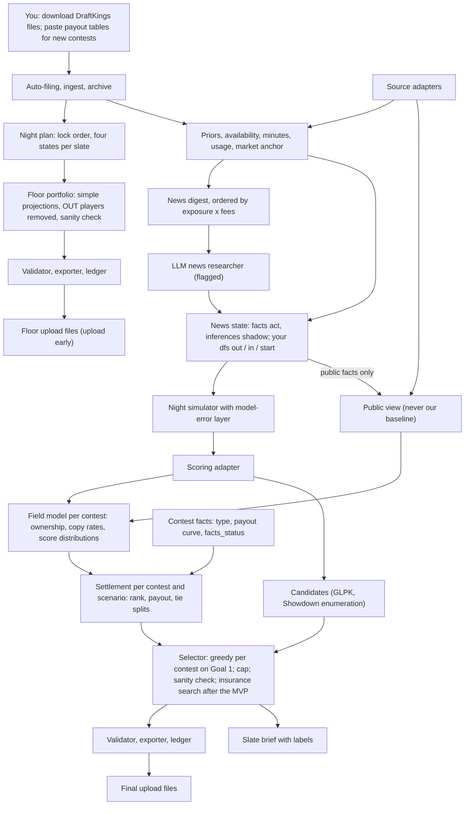
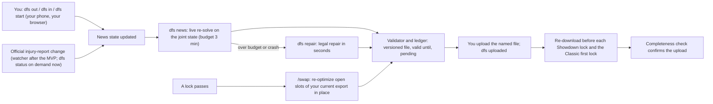
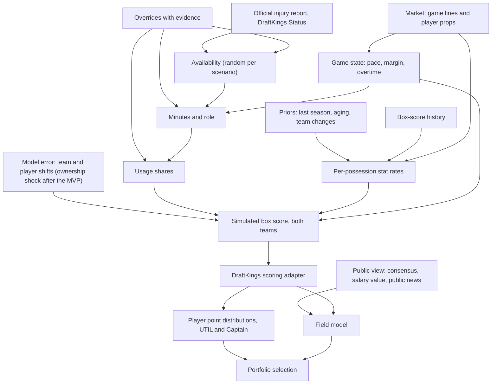

# NBA DFS Engine: Architecture

**Status:** version 4, revised after the adjudication of two independent critiques (`docs/review/ADJUDICATION.md`). Design only; no engine code exists yet. **Date:** 2026-10-14. **Go-live:** NBA opening night, Tuesday 2026-10-20 (first lock 2:00 pm CT, BOS at DET 3:00 pm ET, VERIFIED). **Requirements:** `docs/BRIEF.md` (living). **Build:** `docs/build/BUILD_PLAN.md`.

## Changelog

- **2026-10-14 (v4):** Both goals redefined by the owner's decision (Goal 1: top-1% prize equity in dollars; Goal 2: probability of a severe-drawdown night), sections 2, 6, 9 and 14 rewritten accordingly (ADJUDICATION entries 5, 9; ADR-024, ADR-025). Stored replacements and `dfs apply` removed in favor of a live re-solve on the joint news state, open-slot late swap, a legal repair fallback, `dfs start` and a re-download policy (entries 10, 11, 17, 19, 33; ADR-026). Three release states, feature flags, a sanity check for "sensible", early Floor upload (entries 3, 38; ADR-023). Insurance margin specified exactly and the control moved after the MVP (entry 8; ADR-025). Researcher output split into facts and inferences (entry 12). QA cut to one pass (entry 18; ADR-028). Spike demoted to a mechanics benchmark; simulator calibration targets stated (entry 16; ADR-027). Data posture answered (entry 14; ADR-005). Contest facts status and type classification (entry 1). Economic diagnostics beside the goals (entry 4). Field qualification and pre-registered tolerances (entry 6). Concentration cap made feasibility-tested; guarantees labeled (entry 7). Ramp gate redesigned; flashback; joint-failure diagnostics (entries 13, 24, 27). Verified-source definition; public view never falls back to our baseline (entry 14). Advisor rule (entry 15). Section 13 replaced by a pointer to the build plan. Every change carries its ADJUDICATION entry ID. (The v3 rule "rewritten whole, never extended with change logs" is retired by the owner's instruction.)
- **2026-10-13 (v3):** revised after red-team rounds 1 and 2 and the laptop benchmark (R9).

**How to read this:** every section stands alone. Evidence labels: **VERIFIED** means we ran it or read it in a primary source and the evidence is cited; **SUPPORTED** means a credible source says so but we did not observe it ourselves; **BET** means our judgment, to be tested. Numbers from the R9 spike are labeled "spike measurement" and describe that code, not the engine (ADR-027). Research memos are in `docs/research/` (R1 to R9, RR1 to RR4, S1 to S3, RT1, RT2, the advisor log), decision records in `docs/adr/` (ADR-001 to ADR-028; superseded records are kept), the adjudication in `docs/review/`, the reference files in `docs/reference/`.

---

## 1. Summary in plain English

### What the engine does

Each night it builds lineups for every DraftKings NBA entry you hold, Classic and Showdown Captain Mode, so that each contest's entries win as much top-1% prize money as the night allows and the night as a whole rarely ends having recovered less than a quarter of its entry fees. It simulates the whole night tens of thousands of times (every game, every player, blowouts, overtime, late scratches, and the chance that our own projections are wrong), simulates the opponents in each contest from public information, settles every contest in every simulated night (who finishes where, what that pays, how ties split), and picks the set of lineups that wins the most money across the most different versions of the night. It hands you one validated upload file per slate and a two-minute brief; when news breaks, one command re-solves the affected slates on the complete current news state in about a minute, and a seconds-long legal repair stands behind it.

### How a night runs (typical main slate, first tip 6:00 pm CT)

1. **Afternoon, about 15 minutes of your time.** Enter contests as usual. Download each slate's entries file (the salary export is optional; the entries file already carries the player pool); the engine picks them up from your Downloads folder by itself. For any contest it has not seen before, paste its payout table (about 45 seconds; both goals now run on money, so this is the one new habit worth forming in week 1). Type `/night` in Claude Code, or run `dfs night` from the desktop launcher if Claude is unavailable.
2. **Within about 10 minutes** a valid Floor file exists for every slate, with players already ruled out removed. **Upload it now** and confirm the read-back; a confirmed baseline removes the deadline gamble, and every later file replaces it only after passing the same checks.
3. **About 45 to 60 minutes after you start**, the full build is done: the simulation, the opponent model, the settlement, lineup selection, and the brief, plus any facts the news researcher filed if that capability is on. You upload one file per slate (about a minute each) and type `dfs uploaded <file>` after each read-back. You re-download the entries file before each Showdown's lock, before the main Classic's first lock, and before any late swap, so the engine can confirm what DraftKings actually holds.
4. **When news breaks:** type `dfs out "Player Name"`, `dfs in "Player Name"`, or `dfs start "Team: A, B, C, D, E"` for a confirmed lineup you read in your own browser. The engine re-solves every affected slate on the complete current news state (budget 3 minutes; measured in rehearsal), writes a versioned file stamped "valid until", and names it. If the re-solve cannot finish in time, `dfs repair` writes a legal repair in seconds (the ruled-out player replaced by the cheapest legal substitute by projection). An official injury-report change is picked up the same way; the news watcher that polls for it arrives after opening night.
5. **After a lock**, if games remain, `/swap` re-optimizes the open slots of your current DraftKings export in place, touching only entries whose news changed or whose improvement clears a threshold, and shows you the diff.
6. **Next morning, about 5 minutes.** Download one flagship standings file per slate and type `/results`. The engine settles every layer of its own work against the real field, which is how it learns (after the MVP).

Measured honestly, a typical 4-slate night needs about **30 to 45 minutes of your time, plus staying reachable for news from about 4:30 pm until the last lock** (more in week 1, when payout tables for new contests are pasted). The rehearsals time each action and project a full night from them (section 8).

### What it is built from

- **Deterministic Python on your laptop** does all arithmetic: parsing DraftKings files, projections, simulation, opponent fields, settlement, lineup selection, validation, export, and learning. It runs with or without Claude, from the desktop launcher.
- **Claude Code** is the judgment layer and runs only when you type a command. A news researcher turns injury and role news into checked fact records (what was announced, by whom, when) and separate inference records (its own minutes estimates, scored in shadow until calibrated). From week 2, a one-pass QA audit files cited challenges that code judges. Claude never writes lineups or upload files. The researcher is a flagged capability that may ship off for opening night; the manual commands are the rehearsed path.
- **Free data only, under the posture you chose on 2026-10-14 (Decision D1):** sources whose terms allow this use, plus `nba_api` for box scores and game logs only, plus the DraftKings files you download by hand (DraftKings' terms bar automated access, VERIFIED, terms dated 06/30/2026). ESPN's JSON stays off.
- **Three release states (ADR-023):** the **Floor** (valid, injury-scrubbed, projection-ranked lineups, no simulation), the **Baseline** (the simulation, field, settlement, selection, live re-solve, late swap, brief), and the **Optimizer** (the insurance control, QA, learning, the watcher). Every capability has a flag with the date it was rehearsed; an unrehearsed one stays off and the brief says so.

### Where this departs from your vision, and why

| Your step | What changed | Why, in terms of the two goals |
|---|---|---|
| 1. Upload the salary file and the entries file | One entries file per slate (each already contains its slate's full player list with IDs); the salary export is optional (rehearsal 1 records whether the 2026-27 NBA export carries `Status` or `Starting`; a real April 2026 NBA file did not, VERIFIED RR4). A payout-table paste for each new contest is recommended in week 1. The engine files everything from your Downloads folder. | A night has 3 to 5 slates, each with its own player IDs; reading IDs only from that slate's file removes the most common cause of invalid uploads. Both goals are settled in dollars, so the payout curve is an input, not a nicety. |
| 2. Project median, top-1% outcome, boom/bust, and ownership | Full distributions from a simulation of the whole night, including the chance our own projections are wrong. Ownership and copy rates are read off a simulated field built from public information only; the field never sees our private model. | Both goals depend on the joint settlement of every contest in the same simulated night; a simulation that treats our projections as truth, or a field that shares our edge, flatters us. |
| 3. The LLM removes players, overrides roles, and assigns players to lineups | The LLM files checked facts (who was announced, restricted, ruled out, by whom, when) that fixed code rules turn into distributions; its own numeric estimates are scored in shadow until they earn weight. Code assigns players to lineups. | Lineup choice is a settlement over thousands of scenarios and opponents; only code can compare candidates on it, and an LLM's stated confidence is not a statistical weight. |
| 4. Adversarial QA, up to three iterations | One pre-lock coherence pass from week 2: cited missed-news challenges and lineup-coherence flags, judged by code. Historical splits are computed by code; leverage swaps by the deterministic local-improvement step. | What an LLM can catch an hour before lock is a missed quote or an incoherent pairing, not a 20-game statistical split; three iterations cost more than they found in your prior engines. |
| 5. Present the upload file | A valid Floor file before any modeling step, uploaded early; every slate planned in lock order; only DraftKings validity can block a file; one live re-solve on the complete news state for late news, with a seconds-long legal repair behind it; a per-slate ledger with four separately tracked states; a completeness check from re-downloads timed before each Showdown lock and the Classic first lock. | Lock-time failures were the largest avoidable loss in your prior engines; a blank entry wins nothing in every scenario. |
| 6. Post-contest analysis | Every layer is settled against its own baseline and against real standings (a control portfolio, the insurance variants, and a contest flashback against the actual opponent lineups), and model changes need held-out wins plus your sign-off. | A few contests a night are noise; thousands of player and opponent observations a night, and the real opponent lineups in every standings file, are signal. |
| New | The settlement (ranks, payouts, tie splits) as the engine's unit of value; the insurance budget control; three release states with feature flags; `dfs start` for confirmed starters you read yourself; a volume ramp gated on calibration and flashback results, not on two weeks of finishes. | Direct levers on both goals as you now define them, on late news, and on not scaling losses. |

**Three things to know up front:**

- **Goal 2 now binds often.** Recovering under 25% of fees is a common ordinary night, unlike literal zero cashes, so the insurance control, once it runs after the MVP, is expected to act regularly. The Baseline reports Goal 2 as a labeled, uncalibrated estimate; the Floor prints "not estimated".
- **Both goals rest on payout facts and copy rates from night one.** Every number in the brief carries the status of the contest facts it uses (verified, template, default) and whether copy rates are still "unfitted". A number on defaults is never presented as measured (ADJUDICATION entries 1 and 5).
- **Opening night ships the release state that was rehearsed.** The Floor is rehearsed live on Oct 15 and at scale on Oct 16; the Baseline cannot exist until about Oct 17, so it is drilled on saved Oct 16 files over the weekend and runs live for the first time on Monday Oct 19 evening with the Floor already uploaded; anything that fails its drill stays off and the brief says so (ADR-023, BUILD_PLAN).

### What we learned from your prior engines

Two things, both VERIFIED in those repos' own records (RR1 to RR4):

1. **Lock-time failures were the largest avoidable loss.** Entries locked blank in slates nobody built, a stale lock list, a check that changed no number but blocked a file, a late file refused after first tip, entries locked blank after a file was built.
2. **The lineups themselves also lost.** MLB's bottom decile stayed weak even with blank entries removed; NFL finished at the 53.8th percentile with blanks removed (worse than the median); NHL Classic cashed 23 of 136 against 32.2 expected for random lineups; your own past NBA entries cashed 13.2% against 23.3% of fields paid (R8).

So this design puts delivery first, keeps the MVP thin (three release states, section 13), requires every piece of sophistication to beat a simpler version on real standings, writes limits on its own process into the design (section 13), and recommends ramping volume only as evidence arrives (Decision D9): moving from about 1 entry a night to 50 to 200 is a 50 to 100x increase in spend with no measured edge yet.

### Where the edge is supposed to come from (ADJUDICATION entry 20)

Three hypotheses, each with the result that would falsify it. Every feature after the MVP names which one it serves; replicating a commercial platform's feature is not a reason by itself.

1. **Execution reliability.** No blank, late or rejected entry. Falsified by any delivery failure.
2. **Late-news reaction.** Our entries reflect a scratch and its beneficiary before the field's stale share does. Falsified if our ownership error on news-driven players is no better than the field's.
3. **Minutes and role on rotation changes.** Our minutes error on news-affected players beats the 75% season plus 25% last-five baseline. Falsified if it does not after 30 such player-games.

Section 9 measures each: delivery failures per night, ownership error on news-driven chalk, and minutes error on news-affected players against the baseline.

---

## 2. Goals as math

### The short version

- **Goal 1** for each contest is **top-1% prize equity**: the expected dollars our entries win from top-1% finishing places, after splitting tied prizes with opponents who hold the same lineup or the same score, expressed as a share of that contest's top-1% prize pool (ADR-024, owner decision of 2026-10-14). Every entry's top-1% winnings count, not only the best entry's.
- **Goal 2** is the probability of a **severe-drawdown night**: total winnings across every contest, Classic and Showdown combined, below 25% of the night's entry fees (the share is the setting `goal2.alpha`; near zero it becomes the literal "zero cashes" definition) (ADR-025, owner decision of 2026-10-14).
- Both are computed from **one shared simulation of the whole night** and **one settlement per contest per scenario**: where each of our entries ranks, what that rank pays, and how ties split.
- **One setting, the insurance budget**, says how much of each contest's Goal 1 you will give up to lower Goal 2. It acts after the MVP; the Baseline reports it.
- **Every number carries two labels:** the status of the contest facts it rests on (verified, template, default) and whether the layer producing it is calibrated. A number on defaults is never presented as measured (ADJUDICATION entries 1 and 2).

### Notation

- A **slate** is a DraftKings draft group: the Classic main slate, an early or late Classic slate, or one Showdown game.
- For contest `c`: `N_c` is the field size, `n_c` our entries, `N'_c = N_c - n_c` the opponents, `f_c` the entry fee. `F = sum over c of n_c x f_c` is the night's total fees.
- **Top-1% places:** `k_c = max(1, floor(0.01 x N_c))`, so any field under 200 has one top-1% place, first place (Decision D10).
- **Paid places:** `m_c`. **Payout curve:** `W_c(r)`, the prize at rank `r`, from the exact table when known, otherwise a parametric curve for the contest's type and size (section 3, Component 4). **Top-1% pool:** `T_c = sum over r <= k_c of W_c(r)`.
- A **scenario** `s` is one simulated night: every player's box score and DraftKings points at UTIL and at Captain (1.5x the bonus-inclusive total, ADR-020).
- `X_L(s)` is lineup `L`'s score in scenario `s`. `F_{c,s}(x)` is the probability that one simulated opponent in contest `c` scores at most `x` in scenario `s`, estimated by scoring a large weighted sample of simulated opponent lineups. `q_{c,L}` is lineup `L`'s copy rate in the simulated field for `c`.

### Three kinds of uncertainty in every scenario

1. **Outcome noise:** how the games go (pace, margin, overtime, minutes, shooting).
2. **Symmetric model error:** each scenario draws a shift in each team's and each player's expected production, sized from our own past projection errors by salary tier and role, wider in October and for rookies. In the MVP this is the only model-error layer. After the MVP it adds **one ownership shock per slate** that every contest on that slate shares.
3. **Edge uncertainty (after the MVP):** in each scenario the true expectation for every player is the public view plus a weight times (our view minus the public view), drawn once per night and shared by every player and contest, allowed below zero so that on some nights every bet where we disagreed with the public fails together. Its distribution is fitted from how our projections score against consensus; until then it feeds reporting only.

**What the synthetic evidence does and does not show (R9, with the 2026-10-14 correction note).** On a synthetic 8-game night, outcome noise alone and symmetric error alone gave zero literal washouts in 30,000 scenarios at 118 entries and about 0.5% to 1.0% at 25 entries, and an engine that assumed its own view was right underestimated washout about 9x at 25 entries. Those runs establish speed and arithmetic. They do not bound real risk: the synthetic single entries cashed 31% to 44% of the time against 22% paid, where your real NBA entries cashed 13% (R8), and the field's most-owned player was 22% where real chalk often reaches 40% or more. Simulation count controls numerical noise, not truth. No number from a synthetic night is a lower bound on anything real, and the brief never presents one that way (ADJUDICATION entry 2).

### The settlement: from scores to dollars

For contest `c` and scenario `s`, our entries are settled jointly:

1. For each entry `L`, the number of opponents scoring above it is `A_L ~ Binomial(N'_c, 1 - F_{c,s}(X_L(s)))`, widened to a beta-binomial once standings show how much multi-entry users' lineups cluster (section 5).
2. Our own entries also occupy ranks: sort them by score; `L`'s rank is `r_L = 1 + A_L + (number of our entries scoring above L)`.
3. `L` has `D_L` opponent copies, drawn from its copy rate `q_{c,L}` (Poisson with mean `N'_c x q_{c,L}`, or binomial). A copied lineup ties exactly; different lineups can also tie on score, and the field sample measures how often.
4. DraftKings pools the prizes of tied places and splits them evenly (VERIFIED, ADJUDICATION V13). `L`'s prize is the average of `W_c(r_L + j)` for `j = 0 .. D_L`, divided by `1 + D_L`, when `r_L <= m_c`; otherwise zero.

Expectations over `A_L` sum the binomial's mass over the ranks near its mean (the binomial is tight). Fields under 10,000 entries use the exact joint settlement, because our 20 entries in a 1,200-entry field can occupy neighboring ranks; larger fields use the additive approximation during selection and the exact settlement in reporting (ADR-024).

### Goal 1: top-1% prize equity per contest

```
Prize1_c(L, s) = prize of L in the settlement, counted only when r_L <= k_c

G1_c = average over scenarios of  [ sum over L in E_c of Prize1_c(L, s) ]  /  T_c
```

- For a single-entry contest this is the expected share of the top-1% pool our one lineup wins; in a field under 200 it is first-place money only.
- For a multi-entry contest every entry's top-1% winnings add up, so a second entry that would win first place in the same scenario has real value, which the original "at least one entry" definition gave it none of (B-I-01).
- **Duplication and ties are inside the objective.** A tie for first in a top-heavy contest keeps a small share of a large prize; a tie deep in the top 1%, where neighboring prizes are nearly equal, keeps nearly all of a small one. This is money after rank-aware splits, never a flat per-copy penalty (ADJUDICATION V3 showed the R9 spike used the flat penalty, so its duplication results do not describe this method).
- **Reported beside Goal 1:** the raw probability of at least one top-1% finish; Goal 1 computed with copy rates set to zero (until the copy-rate tolerances below pass, both are shown and copy rates are labeled "unfitted"); the contest's facts status; P(first) and P(top 0.1%) from a fitted upper tail in large fields (a raw sample resolves the top 1% but not first place in a 35,000-entry field; your NFL engine overpriced first place 18x to 280x from a raw sample, RR2).
- **Small fields:** per-scenario values are stored, not just hit or miss, and first-place contests always use the binomial formula; the "did it clear the line" shortcut understated first-place odds by 7% to 38% relative on the synthetic night (R9).

### Goal 2: probability of a severe-drawdown night

```
Winnings(s) = sum over contests c and entries L in E_c of  prize of L in the settlement (every paid place)

P(SD) = average over scenarios of  1{ Winnings(s) < alpha x F }        alpha = goal2.alpha, default 0.25
```

- An unfilled entry wins nothing in every scenario, so delivery is part of Goal 2; the brief shows unfilled entries next to `P(SD)`.
- Contests are conditionally independent given the scenario; the scenario carries the shared errors (a misjudged game, after the MVP a misjudged slate's ownership). Because the same opponents enter several contests on a slate, the brief also shows a **shared-field sensitivity**: the same simulated users entering every contest on the slate (ADJUDICATION entry 6).
- **Reported beside Goal 2:** the literal washout probability (`alpha` near zero); Goal 2 with and without the edge-uncertainty layer once it exists; Goal 2 under three field-strength settings (no edge, stronger field, concentrated chalk) once the field model has them; per-game concentration (share of all entries, Classic and Showdown combined, depending on each game).
- **At your volume this goal binds often.** A 25% fee-recovery floor is missed on many ordinary nights, unlike literal washout, so the insurance control is expected to act regularly rather than rarely.
- **Until the model-error layers are calibrated on real nights,** the Baseline brief labels Goal 2 "model estimate, uncalibrated" and shows its assumptions beside it; the Floor prints "not estimated".

### Economic diagnostics beside the goals (ADJUDICATION entry 4)

Always shown with the two goals, never inside them: total fees `F`; expected net return `E_s[Winnings(s)] - F` under stated assumptions; probability of recovering the night's fees; probability of a meaningful prize (any entry winning at least 10x its fee); the distribution of the fraction of entries cashing. Changes in volume are reported separately from changes in skill. Better median rank alone never justifies scaling spend (section 9).

### The control: the insurance budget (ADR-025; after the MVP)

```
For each contest c, let G1*_c be the best Goal 1 the engine finds for c alone.
Choose the night's portfolio that minimizes P(SD)
subject to G1_c >= (1 - epsilon) x G1*_c for every contest c.
```

- In words: "I'll give up at most epsilon of my top-1% prize equity, in every contest, to lower the chance of a severe-drawdown night." At 0% the engine maximizes Goal 1 and uses Goal 2 only to break ties. Each contest keeps its own guarantee, so no contest is quietly sacrificed and the setting means the same thing on a 3-contest night and a 12-contest night.
- **How it is enforced.** Start from each contest's own best portfolio, then search single-lineup swaps in any contest. For a candidate portfolio `E_c` against the contest's best `E*_c`, let `Delta_c = G1_c(E_c) - G1_c(E*_c)` on the validation set and `SE_paired(Delta_c)` the standard error of the per-scenario differences between those two portfolios' values, cumulative from `E*_c` (never per incremental swap). A swap is accepted only if it lowers `P(SD)` on the validation set and every contest satisfies

  ```
  Delta_c - 2 x SE_paired(Delta_c) >= -epsilon x G1_c(E*_c)
  ```

  There is no pre-freeze rule. After the search, a contest in which no candidate swap satisfied the constraint is labeled "frozen" and the brief names it. A test feeds a known case and checks the implementation reproduces this formula; the R9 spike computed a different margin (the unpaired error of the level, ADJUDICATION V1), which is why its insurance numbers are indicative only.
- **Why the margin:** without it the search exploits noise in the validation set; on the synthetic night a contest held to a 5% budget without a margin kept only 0.919 of its odds on fresh scenarios (R9).
- **Roll-back is a label:** after the search each contest is checked on the reporting set; a contest more than two standard errors below its guarantee is flagged, and if a roll-back is applied the final numbers are recomputed on a fresh reporting draw, so no reported number comes from scenarios that chose the portfolio (ADJUDICATION entry 8).
- **What the setting is:** a model-based target under stated assumptions, not a real-world guarantee.
- **Default (Decision D3): 2%** as a starting value. The R9 figures (a 2% budget removing about two thirds of synthetic washout at 25 entries for 0.2% of average odds) were measured with the wrong margin and the old goals; the first real nights re-measure the price under the corrected rule and the new Goal 2.
- **When it runs:** after the MVP (chunk C12), whenever the validation set holds at least 50 severe-drawdown scenarios; otherwise the brief says Goal 2 is too rare to trade tonight. In the Baseline the brief reports Goal 2 and the control does not act.

### How the goals trade off, and the hunch test

Both goals depend on which ways the night can unfold that our entries cover. Goal 1 wants each contest's entries high in that contest's standings in as many scenarios as possible, with first place worth the most; Goal 2 wants, in every scenario, enough winnings somewhere to clear a quarter of the fees. Both reward covering different scenarios, which is your hunch. They disagree in three places: target height (a ceiling build gives up floor, directly in single-entry contests), cross-contest concentration (Goal 1 does not care whether every contest leans on the same game; Goal 2 does), and night composition (Showdowns depend on one game each).

**Evidence so far.** Between lineups, the literature agrees with the hunch: lowering the correlation among our entries raises the chance at least one is top 1% and lowers the chance all miss (Hunter, Vielma and Zaman; Haugh and Singal; R2, R5). Concentration is a measured cause of bad nights: in your NFL data, 85% or more of entries on one player raised the zero-paid rate 1.4x to 12x (RR2, VERIFIED). On the synthetic night, building every contest on one thesis cut average odds 6.5% to 11.7% and, at 25 entries, raised washout from 0.51% to 1.42% (R9, VERIFIED as a measurement of that spike).

**The test, on real fields (ADR-025).** Each night the engine computes three portfolios even when the control is off (about a second): insurance 0%, insurance 20%, and the lowest-drawdown portfolio it can find. Next morning each is settled against the real standings, contest by contest: prize equity won, winnings as a share of fees, and the fraction of entries cashing. After 20 nights the brief gives a verdict with an interval, and says "undecided" if the interval includes zero. A model cannot confirm itself; real fields decide.

### How each goal is estimated, and how precise it is

- **Four independent scenario sets** (R9; ADR-025): a **screening** set (5,000) shortlists candidates; a **selection** set (15,000) drives the greedy method; a **validation** set (15,000) drives the insurance search and its constraint; a **reporting** set (30,000) produces every number in the brief. These sizes and the margin rule are the single source of truth; ADR-025 repeats them, and a test checks the two agree. Picking the best of thousands of candidates on one set flatters them (greedy's in-sample odds ran 0.7 to 3 points high, R2), and a search checked on one set exploits that set's noise (R9), so each job gets fresh scenarios.
- **Precision:** with 30,000 scenarios, a 1% probability has a standard error of about 0.06 percentage points and a 5% probability about 0.13 points (VERIFIED arithmetic). Prize equity has the extra noise of the settlement draws, reported as its own standard error.
- **Common random numbers:** every comparison uses the same scenarios, which cut comparison noise 1.6x in a toy test (R3, VERIFIED) and more when lineups overlap.
- **Precision is not accuracy.** The learning loop checks the model against reality with dense signals: predicted cash probability and prize equity per entry against realized settlement (50 to 200 entries a night), predicted top-1% and min-cash lines against the actual lines in every standings file, predicted copy counts against observed, and how much our nightly winnings vary compared with what the model predicts (which is what sizes the model-error layers).
- **Pre-registered calibration tolerances (ADJUDICATION entry 6).** Copy rates stop being labeled "unfitted" when predicted copy counts for the field's 20 most common lineups fall within a factor of 2 of observed on at least 4 of the first 5 standings files per format, and our entries' predicted expected copies fall within 1.0 of observed on average. Thresholds are qualified separately: the realized top-1% and min-cash scores must fall within the predicted distribution with spread-out positions across contests. These are written before any standings file exists.

---

## 3. System overview

### The boundary in one sentence

Claude sets beliefs about the world (who plays, for how long, in what role, and whether that news is public) as validated records; deterministic code does everything after that, including every lineup and every file you upload.

### Components

Numbering changed from v3 (the replacement store, v3 Component 15, is removed; ADJUDICATION entry 10). Each row says whether it is in the Floor (F), Baseline (B) or Optimizer (O) release state.

| # | Component (deterministic unless marked LLM) | State | Job | What it means for you |
|---|---|---|---|---|
| 1 | **Inbox, auto-filing and ingest** | F | Pick up DraftKings files from your Downloads folder, opening only files whose names and headers match DraftKings formats; file them by content (draft group from the player IDs) and download time, never by name; detect encodings; identify each slate; fail closed with plain-language errors. Standings zips are moved out of Downloads to a private folder outside the project, and only hashed tables enter the project. Every raw download and pre-lock snapshot is archived from Oct 15. `/status` prints which file it used for each slate. | You download; the engine files. No wrong-folder or wrong-version mistakes. |
| 2 | **Night plan and slate state** | F | Order slates by lock time; track four states per slate separately: file validity (against the identified input snapshot and lock time), news state, model status (which capabilities ran), confirmed upload. | No slate is forgotten; `/status` prints the one next action per slate and never relabels missing evidence as verified. |
| 3 | **Clock, identity and team map** | F | One lock clock from each file's Game Info; one identity rule (person plus role, per slate, because DraftKings IDs change between slates); one team-code map; reviewed name matches persist and are versioned per run. | Removes the drifted-copy bugs that were your MLB engine's top root cause. |
| 4 | **Contest facts** | F | Per contest: type (classified from the name: GPP, double-up, satellite, "Top N", other), entry fee, entry limit, field size, paid places, payout curve, and a `facts_status` of verified (pasted table or entry-history export for a recurring contest), template (cached from a same-named contest) or default (type-specific curve and paid share). Optional: observed entries and capacity with a timestamp. The brief lists every contest's status. | Both goals are settled on these facts; the brief says which numbers rest on what. |
| 5 | **Source adapters** | F (injury report), B (the rest) | Schedule, injury report, lines, props, history (sportsdataverse files, `nba_api` for box scores and game logs), news, under the chosen posture; rate limited; every response snapshotted with a timestamp and hash; each adapter reports "verified" only when its local path returned current data that parsed and passed freshness. | Data failures degrade the build instead of stopping it, and a documentation-only source is never shown as working. |
| 6 | **Priors and rates** | B | Per-possession stat rates with shrinkage, recency decay, aging, early-season variance inflation; after the MVP, historical splits (back-to-backs, rest) computed here when the evidence bar is met. | Sensible projections from opening night with no current-season data. |
| 7 | **Availability, minutes and usage** | B | Probability of playing; minutes by role; redistribution when teammates sit; usage shares that sum to 100%; fixed rules that turn a fact record (named starter, restriction, out, in) into a distribution. | Captures a cheap player stepping into a starter's role, with honest uncertainty. |
| 8 | **Market anchor** | B | Game lines set team totals and pace; props pull stat means toward the market when available; after the MVP, market-implied minutes from prop ladders. | Rest, travel and matchup are priced once, by the most efficient source. |
| 9 | **News state and override store** (fed by you and by the LLM) | B | One file per night of confirmed facts: `dfs out`, `dfs in`, `dfs start`, official report changes, and researcher fact records (quote checked against the saved source page, publish time known). Inference records stored separately and scored in shadow. A later fact about a player supersedes an earlier one. | Every late-news file is built on the complete current state; you can veto or add a fact with one command. |
| 10 | **Night simulator** | B | Stat-level joint simulation, bottom-up (attempts from possessions and usage share, makes from shrunk percentages), with game, team and player factors and the symmetric model-error layer; blowouts, overtime and availability drawn per scenario; calibrated against last season before any slate. | Correlation, Captain math, double-doubles and shared failure come out of the same simulated nights. |
| 11 | **Scoring adapter** | F | Versioned DraftKings scoring with nightly self-checks against standings; Captain totals eighth-point exact. | A rule change is caught the morning after it happens. |
| 12 | **Field model and settlement** | B | Simulated opponents per contest family, built from a public view that never falls back to our private model; ownership, copy rates and per-scenario score distributions read off it; the settlement (each of our entries' rank, payout at that rank, tie splits) for every contest and scenario. | Thresholds and dollars reflect the field you face, without leaking our edge into it. |
| 13 | **Candidate generator** | F (one solve per entry on simple projections), B (the full pool) | Classic: thousands of lineups from GLPK on simulated outcomes and ownership-adjusted means. Showdown: every legal lineup, screened. The Floor uses the same solver once per entry on simple projections. | A wide pool, each lineup winning some plausible night. |
| 14 | **Portfolio selector** | F (cap, slot assignment, sanity check), B (greedy on Goal 1) | Greedy per contest on Goal 1 (prize equity); feasibility-tested concentration cap; slot assignment for late swap; the sanity check; scenario labels (after the MVP); the insurance search (after the MVP). | Your two goals, optimized directly, with every guarantee labeled. |
| 15 | **Validator, exporter, ledger and legal repair** | F | Every DraftKings rule checked against the downloaded files; the only writer of upload files, each hashed into the run manifest; a per-slate ledger of committed and pending lineups and the news state each file assumed; one engine run at a time; `dfs repair` (remove a ruled-out player, insert the cheapest legal substitute by projection) in seconds. | Every exported file passes the validator against its input snapshot and lock time; platform acceptance is confirmed separately. |
| 16 | **Late news re-solve and late swap** | B | `dfs news` (run by the news commands): re-simulate affected games, refresh fields, rebuild candidates, re-select before the first lock or re-optimize open slots after it, export a versioned file stamped "valid until". `/swap`: pin locked cells, re-optimize open slots, rewrite only entries whose news changed or whose improvement clears a threshold, re-check concentration, show the diff. | Late news reaches every affected entry on the complete current state; late scratches become pivots instead of zeros. |
| 17 | **News watcher** (plain Python, no Claude) | O | Polls the official injury report and Bluesky reporter posts; official changes run the re-solve through the run lock; reporter posts raise "possible" alerts you confirm with a command. Until it ships, your own alerts and `dfs status` (which diffs the injury report on demand) are the channel. | You hear about news fast; a misread post can never change your lineups without your confirmation. |
| 18 | **Brief** | F (lite), B (full) | Two-minute slate brief: the four states per slate, capabilities that are off, contest facts status, thesis, assumptions, exposures, risks, the news that would change the build, what was skipped, input freshness, Goal 1 and Goal 2 with their labels, and an "if the engine is down" card. | One page tells you what the engine believes, what it could not do, and what to do. |
| 19 | **Run store and replay** | F | Manifest per run: inputs, snapshots, configuration, identity-map version, versions, seeds, LLM decision records, release state and capability flags, outputs. Replay command after the MVP; everything it needs is recorded from day one. | Any night can be replayed exactly. |
| 20 | **Learning** | O | Standings and box-score ingest, per-layer scorecards, contest flashback against real opponent lineups, joint-failure diagnostics, shadow challengers, adoption workflow. | The engine improves only on evidence, with your sign-off. |
| 21 | **Desktop launcher** | F (`dfs night --floor`, `dfs status`, `dfs out`, `dfs in`, `dfs uploaded`, `dfs repair`), B (adds `dfs start`, `dfs news`, `dfs swap`) | The same commands from a desktop shortcut, with the same plain-language output, no Claude needed. Names are fuzzy-matched against tonight's slates with one confirmation. | The night survives a Claude outage or usage cap, and you can enter news yourself. |
| 22 | **LLM: news researcher** (flagged; may ship off) | B | Reads a deterministic news digest ordered by exposure times fees, searches sparingly, files fact records with evidence and separate inference records. | News read faster and more completely than any free feed, when the capability is rehearsed and on. |
| 23 | **LLM: QA audit** (one pass, from week 2) | O | Cited missed-news challenges and lineup-coherence flags; code judges them. | A second opinion that must cite its source. |
| 24 | **LLM: results analyst** (weekly, from week 3) | O | Reads the scorecards, writes the weekly review, drafts challenger proposals; the advisor may be consulted here. | You approve or reject model changes once a week. |

### Night data flow



### Late news and lock waves



### The deterministic and LLM boundary

| Decision | Who decides | How it is checked |
|---|---|---|
| Who is in the player pool | Code, from the downloaded file; the LLM may propose an exclusion with a reason | Validator; exclusion logged and scored |
| Probability a questionable player plays | Code maps official status; you (`dfs out`, `dfs in`) and the LLM may file a fact record with evidence | Schema check, quote check, publish-time check; Brier score afterward |
| Confirmed starters | You (`dfs start`, from a lineups page you read in your own browser); the LLM may file a fact with a reporter quote | Fact record with source and time; coverage tracked |
| Minutes, role and usage shifts | Code rules translate facts; the LLM's numeric inferences are shadow-scored until calibrated | Coverage of stated ranges tracked for two weeks before any blend |
| Whether a fact is public | The LLM tags it; code requires public evidence (official report, team statement, reporter post) for a "public" tag | Tagged facts reach the field model; private judgments do not |
| Distributions, correlation, Captain points, model error | Code only | Calibration tests against box scores and our own errors |
| Ownership, opponent lineups, copy rates, score distributions, settlement | Code only (public view) | Nightly comparison with standings, measure by measure |
| Which lineups to enter, in which slots | Code only | Validator; sanity check; real-field scorecards |
| Changes after review (week 2 on) | The LLM files cited challenges and coherence flags; code judges | Quote and time checks; materiality and regret |
| What goes in an upload file | Code only; hooks block Claude from writing there by any tool | Manifest hashes; validator re-reads every file |
| Whether a model change is adopted | You, after a held-out comparison | Weekly review |

## 4. Projections

### The short version

Every player gets a full distribution of DraftKings points from a simulation of the whole night. The simulation draws who plays, how many minutes each player gets (including blowouts and overtime), how the team's possessions are shared, each counting stat, and how wrong our own expectations might be, then scores the line with DraftKings' exact rules. Medians, top-1% outcomes, boom and bust rates, and Captain values are summaries of that simulation. What it means for results: the tails that decide tournaments come out of the same simulated games that set everyone else's scores.

### The projection graph, as implemented

The attached blueprint was a good start; this version fixes its gaps (R3 critique): minutes depend on game state, availability is a random draw, priors and news are explicit inputs, model error is part of every scenario, and the field has its own inputs.



### Minutes and role come first

- **Base distribution:** each player's minutes have a role-specific center and spread (a truncated normal core on 0 to 48), from season-long and recent minutes with recency decay. The benchmark to beat is a practitioner baseline: 75% season plus 25% last five games (R3).
- **Game state:** each scenario draws the final margin around the spread; above about 15 points, starters lose minutes and the bench gains them. Calibration targets: margin around the spread with a standard deviation of 13.2 points, 18.6% of games decided by 20 or more, overtime in 5.4% of games (RR4, VERIFIED arithmetic on a historical lines file of unknown provenance; RotoGrinders data gives 6.2% to 6.4% overtime, R5). Overtime adds 5 minutes for players on the floor.
- **Early exits:** a small probability of injury or foul trouble cuts a player's minutes in a scenario.
- **Reconciliation:** each team's minutes sum to 240 (plus 25 per overtime) in every scenario.
- **Restrictions:** a return-from-injury cap enters as an override with a hard cap.
- What it means for results: minutes are where every vendor says NBA slates are decided (R1, VERIFIED).

### Minutes and usage when a player sits

- **Share model:** each team's possessions used are a fixed pool; each active player's share is base usage x a per-scenario multiplier x minutes, renormalized to 100%. When a player sits, his share and minutes flow to teammates automatically (R3 section 2).
- **Where the freed share goes:** a position-similarity prior (a guard's absence lifts guards most), updated by with-or-without-you evidence in proportion to how much "without" data exists (shrinkage constant about 300 minutes, BET), plus any redistribution hint from an override. The number of games the absent player has already missed is an input (RR4, BET).
- **Efficiency cost:** about 1 point per 100 possessions of shooting efficiency per extra 1% of usage (R3, SUPPORTED).
- **Uncertainty:** redistribution weights are drawn per scenario, so the beneficiary's distribution is wide when evidence is thin.

### Where LLM facts and inferences meet the model (ADJUDICATION entry 12)

The news researcher files two kinds of record (schema in section 7), and so can you.

- **Fact records** say what happened: a player was announced as a starter, given a minutes restriction, ruled out, or cleared to play; each carries the source, the publish time and a quote that code checks against the saved page. In the MVP only fact records with a verified quote and a known publish time inside 24 hours change the simulation. Fixed code rules translate each fact type into a distribution: "named starter" uses the role's starter minutes prior for that team; "restriction of N minutes" sets a hard cap of N; "out" sets `p_active` to 0 and redistributes minutes and usage through the share model; "in" restores the model's prior for that player and removes lineups built for his absence. A record whose publish time cannot be read is stored but never changes availability or role. A later fact about the same player supersedes an earlier one, so Monday's day-before report cannot outlive Tuesday's game-day report.
- **Inference records** are the LLM's own numbers: minutes as 10th/50th/90th percentiles, usage and per-stat multipliers, redistribution hints. In the MVP they are stored and scored in shadow (section 9). The precision-weighted blend, after inflating the LLM's stated uncertainty by a coverage factor starting at 1.5, switches on only after two weeks show the stated ranges cover actuals at the stated rate. An LLM's stated confidence is not a statistical weight, and the LLM and the model share most of their evidence, so they are not independent witnesses.
- **Role changes are mixtures, not averages.** If a fact changes the probability of starting or carries a condition ("only if player Y is out"), each scenario first draws which world it is in; averaging a "named starter, 34 minutes" belief with a "bench, 15 minutes" prior would give 24 minutes, a number neither world produces.
- **Team totals still hold:** minutes and usage are renormalized after every change.
- **Limits:** one record can move a teammate's expected minutes by at most a set amount (default 8) unless the evidence is an official status change.
- **Precedence:** official OUT designations override everything; your commands beat the LLM's records.

### Rates and early-season priors

- **Rates per possession,** shrunk toward a role and position prior with empirical Bayes (weight on the player's own data grows with his possessions), with a separate recency decay per stat, following DARKO's published method (R3).
- **Opening night:** priors are last season's per-possession rates adjusted for age, team and role; team changes move through the usage share model; coaching changes shrink pace toward league average. The early-season variance multiplier widens every player's uncertainty and decays as minutes accumulate.
- **Players with no NBA history (rookies, two-way players):** in the MVP, salary-implied production plus the researcher's `no_history_prior` (a comparable role and a minutes range), because no permissive free source of draft slot and college statistics was verified (RT1 rank 12). A draft-slot prior is a backlog candidate if a permitted source is found.
- **The market carries the most current information:** team totals and spreads set efficiency and pace; player props pull stat means toward the market on nights the free quota allows.
- **Market-implied minutes (after the MVP, ADJUDICATION entry 31):** each player's prop ladder is turned into an implied DraftKings total and divided by his shrunk per-minute rate to give market-implied minutes, blended into the minutes prior with a stated weight; the news digest flags any player where the market and our depth chart disagree by 4 or more minutes.
- **Never used:** DraftKings' `AvgPointsPerGame` (0.0 for players with no history, RR4).

### Distributions and definitions

| Term | Definition | Why it matters |
|---|---|---|
| **Median** | 50th percentile of simulated DraftKings points | The typical night |
| **Mean** | Average simulated points | Salary value; optimizer input |
| **Top-1% outcome** | 99th percentile: the score he beats in only 1 of 100 simulated nights | What a top-1% lineup needs from him |
| **Ceiling** | 90th percentile | A steadier upside measure for the brief |
| **Boom rate** | Probability of at least 6 x salary/$1,000 points (Captain: the same multiple of Captain salary) | Chance he returns tournament value |
| **Bust rate** | Probability of fewer than 4 x salary/$1,000 points | Chance he sinks a lineup |
| **P(double-double), P(triple-double)** | Share of scenarios with the milestone | Bonuses come from each simulated line |
| **P(active)** | Share of scenarios in which he plays | Questionable players stay random until news |
| **Optimal rate** (after the MVP) | Share of scenarios in which he is in that scenario's best lineup | The simulation's own measure of slate-winning upside |

The boom and bust multiples are settings, revisited once real distributions exist (BET defaults).

### The simulator

Per scenario (R3 section 4; ADR-002):

1. **Model error:** draw the scenario's shifts in team and player expectations (section 2); after the MVP, also the slate's ownership shock.
2. **Game:** a pace factor shared by both teams; the final margin around the spread; overtime more likely when the margin is small.
3. **Team:** an offensive efficiency factor centered on the market's implied team total.
4. **Availability and minutes:** draw who plays; apply blowout trims and early exits; reconcile to 240.
5. **Player:** a shared "big night" multiplier across his stats, plus stat-specific overdispersion (negative binomial counts).
6. **Usage stats:** shot attempts, free throws and turnovers from team possessions x usage share; makes from shrunk percentages; points follow.
7. **Rebounds:** shared among active players from both teams' misses (negative correlation between same-team bigs).
8. **Assists:** a share of the team's made shots.
9. **Steals and blocks:** counts on opponent possessions and attempts.
10. **Scoring:** the versioned DraftKings adapter (triple-double +4.5; Captain 1.5x the bonus-inclusive total, ADR-020).

Not chosen: a possession-by-possession simulator (far more parameters to calibrate) and fantasy points from a multivariate normal (thins the upper tail tournaments are decided in, and cannot produce double-doubles; R3 spike). The R9 spike's simulator is a timing and mechanics benchmark only; it draws team points top-down and back-solves makes (ADJUDICATION V4), so the engine simulator is written to this section's bottom-up order and calibrated against last season's box scores (ADR-027).

**Determinism (ADR-021):** every random draw is keyed by (run seed, scenario index, game, person, stat) with a counter-based generator; no solver time limits; stable sort orders. Your NHL and golf engines gave different lineups from the same inputs (RR3).

**Runtime (R9, VERIFIED on a synthetic 8-game night of 208 players):** simulating the whole night takes 1.9 seconds for 10,000 scenarios and 6.7 seconds for 30,000, on one core. Simulation is never the bottleneck. The synthetic simulator's outputs were sane: game totals within 1.4 points of the betting totals, margins around the spread with a standard deviation of 12.7 to 12.9, teammate correlation about -0.02 and opponent correlation about +0.02 without model error. Its player spreads were a little wide (a star's standard deviation was 0.30 to 0.34 of his mean, against about 0.22 to 0.25 in real data); wider tails make top-1% odds look better than they are, so its Goal 1 numbers are optimistic. Calibration against last season (section 11) tightens them.

### Correlation, and what it means for Classic and Showdown

NBA correlation is small and comes mostly from the game (R3, R5): pace and overtime lift everyone in a game; team efficiency lifts teammates; fixed usage shares, shared rebounds, and minutes redistribution push teammates apart (a team's PG and SG totals correlated at -0.38 in one older FanDuel-scored study, R5); blowouts move minutes from starters to the bench. The model-error layer adds the correlation that matters most for washout: everyone on a team or slate we misjudged moves together. The simulator's output correlations are checked against last season's box scores by role pair before any slate is played.

- **Classic:** stacking teammates is a weak lever; shared game environment and shared downside matter. The selector discovers when a game stack pays.
- **Showdown:** the game script dominates. Close games and overtime reward stars at Captain; blowouts move fourth-quarter minutes to both benches, when cheap bench players and lopsided team splits win; the both-teams rule forces at least one player from the losing side.

### Captain handling

- Captain points are 1.5x the same scenario's bonus-inclusive total, and Captain salary is 1.5x UTIL salary (VERIFIED on 189 historical NBA pairs; always a whole $100, R6). Whether 1.5x applies to bonuses is SUPPORTED on a 2020 NBA export and becomes VERIFIED on the first 2026 Showdown standings file (ADR-020).
- Captain and UTIL are two roles of one person with different DraftKings IDs, paired by name and team, never by ID arithmetic; the slot label is read from the file header (UTIL in NBA files, FLEX in NFL and NHL).
- Every legal Showdown lineup is enumerated (about 440,000 for a 22-player pool in 0.015 seconds, R2, VERIFIED), so Captain tradeoffs are computed exactly.

---

## 5. Ownership and the field

### The short version

Ownership (how often each player is picked) is read off a simulated field of opponents who build lineups from a **public view** of the night: what any DraftKings player can see. Public news reaches them (with a share of opponents who never update); our private model and private judgments do not. Ownership, duplicate counts, and each contest's top-1% and min-cash lines all come from that field. What it means for results: the simulated field reacts to news like the real one, and our edge stays ours.

### Two views of the night

| View | Built from | Used for |
|---|---|---|
| **Engine view** | Everything: our model, the market, official news, your commands and all checked facts | Our lineups |
| **Public view** | Free consensus projections (Daily Fantasy Fuel's CSV when a file has numbers and parsed in a dry run), salary-implied value, betting lines, official statuses, DraftKings `Status` if present, and facts tagged **public**. When no consensus file exists, a **deterministic public formula** (salary-implied value blended with the market-implied team share and trailing DraftKings points per minute). **Never our own baseline model** (ADJUDICATION entry 14). | The simulated field |

- **Public versus private.** Every fact carries a `visibility` tag. "Public" requires public evidence: an official report, a team statement, or a reporter's post. Most news is public, and the real field reacts to it within minutes; leaving it out is how your NHL engine missed news-driven chalk by about 10x (50.7% actual against 4.7% predicted, RR3, VERIFIED). "Private" is our own inference; the field never sees it. "Private" is a hypothesis about informational advantage, not evidence that opponents lack it (A-I-06): the field also includes a stale share that never updates and a sharp share that infers the same rotation change we did.
- **Why the public view never falls back to our baseline:** any edge in our baseline would show up as simulated chalk, and the engine would fade its own edge. Daily Fantasy Fuel had no preseason projections, so the consensus path cannot be rehearsed before opening night; the opening-night public view is the deterministic formula unless a file parses in a dry run first.
- **Three tests (section 11):** a public scratch raises the beneficiary's simulated ownership; a private inference leaves it unchanged; a change to our baseline model alone leaves it unchanged always.

### Who the simulated opponents are

A mixture whose weights depend on the contest family (stake, field size, entry limit), following Haugh and Singal's opponent model and the open-source simulators (R2, R3):

1. **Optimizer-like entrants:** each solves the lineup problem on public-view projections plus personal noise, near the salary cap.
2. **Casual entrants:** pick players in proportion to public popularity (projection, value, name recognition), above a salary floor.
3. **Chalk duplicators:** copies of the handful of most obvious lineups; small in Classic, large in Showdown.
4. **Stale entrants:** lineups built before late news that never update.

Opponents are sampled **as users**, not as independent lineups: a multi-entry user's lineups share a core, with entry counts drawn from standings files once they exist. This widens the spread of the top-1% line the way real clustered fields do (RT1 rank 17). High-stakes fields are sharper but more alike; low-stakes fields softer and chalkier (R1, VERIFIED).

### Ownership

- Read off the field: the share of simulated lineups holding each player, by slot type.
- **One unit, checked nightly:** fractions summing to 8.0 in Classic and 1.0 Captain plus 5.0 UTIL in Showdown (RR4 lesson).
- **Captain and UTIL are separate.** Casual entrants concentrate their Captain picks on the obvious star (the field over-captains him on one documented slate, R5, SUPPORTED); optimizer entrants choose Captains by the numbers.
- **Uncertainty (after the MVP):** each scenario carries one ownership shock per slate, shared by every contest on that slate, so a wrong ownership read hurts all those contests together, as it does in reality.
- **Expected accuracy:** no vendor publishes ownership accuracy (R1, R3). BET: average misses of 3 to 6 percentage points among players above 5% ownership once calibrated, largest on late-news value plays. Measured from the first standings file.

### Cold start, qualification and calibration (ADJUDICATION entry 6)

- **No history needed to start.** The field's few settings (optimizer noise, casual share, salary floor, stale share, duplicator share) start from published rules of thumb (BET values in configuration), with a stated target that the most-owned Classic player lands at 40% to 60% on typical slates (the R9 spike's 22% was a strawman field).
- **The field is a family, not a point.** Three settings bundles exist from the start, used for Goal 2 sensitivity reporting: the default; a stronger field (less optimizer noise, lower stale share); concentrated chalk (higher casual and duplicator shares). The brief shows Goal 2 under all three once the layer that uses them ships.
- **Qualified by separate checks, never by ownership fit alone.** From the first standings file, the field scorecard measures, each against its own baseline: marginal ownership by salary tier; player-pair co-occurrence; salary left unspent; Captain combinations; exact-duplicate counts; entrant portfolio clustering (multi-entry users sharing cores); realized top-1% and min-cash cutoffs within the predicted distribution. Agreement among quantities drawn from one generator is internal consistency, not confirmation.
- **Pre-registered tolerances (written before any standings file exists).** Copy rates stop being labeled "unfitted" when predicted copy counts for the field's 20 most common lineups fall within a factor of 2 of observed on at least 4 of the first 5 standings files per format, and our entries' predicted expected copies fall within 1.0 of observed on average. Threshold calibration passes when realized cutoffs fall within the predicted distribution with spread-out positions across contests.
- **Fitted with heavy shrinkage across nights:** ownership by salary tier, salary left unspent, duplicate rates, Captain concentration, multi-entry clustering, and the stale share measured on late scratches. Your NFL engine's construction features flipped sign game to game (RR2), so nothing is fitted to a single night.
- **Cross-contest dependence** is carried two ways: the shared scenario (the same simulated games for every contest) and, after the MVP, one ownership shock per slate; the brief also shows the shared-field sensitivity (the same simulated users in every contest on a slate) beside the conditional-independence number.

### Duplicates and copy rates

- **Showdown:** a simulated field of a few hundred thousand lineups is cheap at 6 slots; each lineup's copy rate is its frequency in that sample, and the number of copies in the real field is drawn from it, so the settlement averages the prize over 0, 1, 2 ... copies at the ranks they occupy.
- **Classic:** exact-match frequency for chalky lineups; for rare ones, the product of ownerships times a correction fitted from standings.
- **Equal-score ties between different lineups** are measured in the field sample and enter the settlement the same way.
- Copy rates feed Goal 1 directly from night one (ADR-024); until the tolerances above pass they are labeled "unfitted" and Goal 1 is shown with and without them.

### Thresholds

- For each contest and scenario, the opponents' score distribution comes from scoring the field sample in that scenario, in chunks of scenarios so memory stays small.
- Top-1% and min-cash lines follow from the binomial formulas in section 2 (beta-binomial once clustering is fitted); fields under 200 size the field sample so first place is resolved; P(first) in large fields uses a fitted upper tail.
- Each morning, the realized top-1% and min-cash scores are placed within the predicted distribution; over many contests those positions should be spread evenly.

**Runtime and memory (R9, VERIFIED on a synthetic 8-game night, 8 worker processes, 14% to 19% background CPU):**

- Building fields: 2,000 optimizer-like Classic opponents (GLPK) in 3.8 seconds; 20,000 casual Classic opponents in 2.4 seconds; three Showdown fields (about 1.35 million legal lineups each, enumerated) in 3.3 seconds.
- Computing every contest's top-1% and cash lines in every scenario is the expensive step: **72% of the build** (152 of 211 seconds at 30,000 scenarios, spike measurement). The MVP keeps it chunked and limits it to slates that changed; a compiled sort or fewer field lineups are the first optimizations if needed.
- Peak memory for the whole build: **1.66 GB** including workers, under the 3 GB budget.
- Field realism to fix in calibration: the synthetic field's most-owned Classic player was only 22%, flatter than real NBA chalk (often 40% or more), which lowers field lines and makes duplicates rarer than real (BET).

---

## 6. Lineups and portfolio

### The short version

The engine builds a wide pool of legal lineups that each win some plausible version of the night, settles every candidate in every simulated contest (rank, payout, tie split), then picks entries one at a time, each time adding the lineup that adds the most expected top-1% prize money to the contest. After the MVP, a night-level search trades a little of each contest's prize equity for a lower chance of a severe-drawdown night, within the insurance budget, checked on scenarios the selection never saw. What it means for results: both goals, as you now define them, are optimized directly in dollars; diversity comes from covering different scenarios rather than from hand-set exposure rules; and every guarantee is labeled for what it actually covers.

### Candidate generation

**Classic** (8 slots, $50,000, at least 2 games):

- **Solver: GLPK** (through the free `swiglpk` package), with OR-Tools CBC as an automatic fallback (ADR-006). A solver finds the best combination of yes/no choices under rules such as the salary cap.
- **Measured (VERIFIED, indicative, other jobs running):** median 2.2 milliseconds per Classic lineup; 5,000 lineups in 21.8 seconds on one process and 7.6 seconds on four, with identical lineups on repeat runs (`spikes/solvers/out/20261013-1656_bench_summary.txt`). OR-Tools CBC took 37.7 seconds for the same 5,000 on four processes.
- **Inputs:** (a) individual simulated scenarios ("the best lineup if the night goes exactly like this"), (b) mean projections minus several weights on public-view ownership, (c) structural variants such as game stacks with players from both teams, (d) lightly perturbed means. Duplicates are removed after a canonical sort.
- **Formulation:** one yes/no variable per player plus position-feasibility rows, 5x to 25x faster than the "player in slot" model with identical lineups (R2, VERIFIED). Slot assignment is a separate later step.
- **No wall-clock limits, single-threaded solves, and a deterministic tie-break** (a tiny fixed perturbation keyed by each player's stable identifier), because every solver found the same optimal value but often returned different equally good lineups (R2, VERIFIED). The same inputs then give the same lineups (ADR-021).
- **R2 recommended OR-Tools CBC as primary** for maintenance reasons; this design keeps GLPK for its roughly 10x speed and makes OR-Tools CBC the automatic fallback (disagreement recorded in ADR-006).
- **Pool size:** about 4,000 to 20,000 per Classic slate. On the synthetic 208-player night, 4,500 candidate solves took 6.7 seconds on 8 workers (median 6.4 milliseconds each, 0 invalid lineups in 6,500) (R9, VERIFIED).

**Showdown** (Captain plus 5 UTIL, both teams): every legal lineup is listed (about 440,000 for a 22-player pool in 0.015 seconds, R2, VERIFIED), then screened before full scoring. No solver is needed.

### Selection against the goals

1. **Screen:** score every candidate on the screening scenario set (5,000); shortlist the strongest few thousand per contest by a cheap proxy (top-1% hit rate).
2. **Settle the shortlist** on the independent selection set (15,000): for each candidate and scenario, its opponent rank distribution and its expected top-1% prize given the contest's payout curve and its copy rate (section 2). Values are stored only for scenarios where the candidate is in the top 1% (sparse), which keeps memory near the bitset design's.
3. **Per contest, lazy greedy on Goal 1:** repeatedly add the candidate that adds the most expected top-1% prize equity to the contest given the entries already chosen, with the joint settlement for fields under 10,000 (our entries push each other down ranks) and the additive approximation above that. The objective keeps diminishing returns, so greedy applies (SUPPORTED, R2); the result is each contest's best Goal 1 found, `G1*_c`, reported as "best found" (the 63% bound covers this step on a count limit only, ADJUDICATION entry 7).
4. **Night insurance search (after the MVP, ADR-025):** single-lineup swaps in any contest that lower Goal 2 while every contest satisfies the exact paired constraint on the validation set; contests with no feasible swap are labeled frozen; the roll-back check on the reporting set is a label, and a fresh reporting draw follows any roll-back.
5. **Local improvement:** deterministic single-player swaps (for example a near-identical player with lower public ownership, or a swap that raises expected dollars at the same raw hit rate) kept only if they beat simulation noise without breaking any guarantee.
6. **Sanity check (ADR-023):** at least 95% of the cap used on average, no two identical lineups in one contest, the concentration cap honored or its relaxation reported, no lineup below the projection floor (default 85% of the slate's best single-lineup projection), and no player with `p_active` under 0.5 unless you asked for him. Labels only; never blocks.
7. **Report** every number from the reporting set, with the facts status and copy-rate label beside it, Goal 1 with and without duplication, and the raw top-1% probability. On synthetic data greedy selection's in-sample numbers ran 0.7 to 3 points high while on fresh scenarios it still beat taking the top projections (47% against 35% with 20 entries, R2), which is why selection and reporting never share scenarios.
8. **Memory:** candidate scoring uses matrix multiplication rather than index gathers (a naive version peaked at 3.5 GB; the rewrite at 645 MB, R2), and processes scenarios in chunks.

### Guardrails (in code)

- No lineup is entered twice in the same contest.
- **Concentration cap, feasibility-tested (ADJUDICATION entry 7):** no single player in more than 60% of a format's entries on the night (setting), applied per format. The selector first computes the minimum feasible cap for tonight's pools and entry counts (six Showdown slots over nine credible players need 66.7% on average, so a universal 60% is impossible there), applies the stricter of that and the setting, and reports when it relaxed. In your NFL data, 85% or more of entries on one player raised the zero-paid rate 1.4x to 12x, and that engine once shipped 94% on one player and cashed 0 of 18 (RR2, VERIFIED).
- **Per-game exposure across formats** is reported (share of all entries depending on each game, Classic and Showdown combined); on opening night all three games are shared by Classic and Showdown, so this is the number to watch.
- **Reuse across contests:** Decision D5.
- **Search quality is reported separately from model quality:** the greedy bound applies to step 3 on its candidate pool; the insurance search and local improvement are heuristic refinements reported with in-sample and out-of-sample numbers; "best found" never means optimal.
- Guardrails shape construction; they never block delivery.

### Single-entry, small multi-entry, and 150-max

The same objective covers all three; the differences come out of the settlement:

- **Single-entry:** the one lineup with the best expected top-1% prize; in fields under 200, the best expected first-place money after tie splits. Insurance costs are direct here, since one lineup cannot be both ceiling and floor.
- **3-max to 20-max:** a handful of lineups that win different scenario clusters (for example one for a close game with overtime, one for a blowout), settled jointly because they can occupy neighboring ranks in a 1,200-entry field.
- **150-max:** you fill only the entries you bought; greedy selection spreads them across scenarios, and a second lineup that would win first place in a scenario another entry already clears still earns its first-place money. DraftKings caps entries per user at about the smaller of 150 and 3% of the field (R6; from the one lobby request R6 made before reading DraftKings' terms, which will not be repeated).

### Late news and late swap: the joint re-solve (ADR-026)

- **Slot assignment on purpose:** after players are chosen, a separate step places later-game players in the flexible slots (UTIL, then G or F) where eligibility allows, which keeps more swap options open at no cost.
- **One path for late news (ADJUDICATION entries 10 and 17).** Stored replacement sets (v3) are gone: two sets for the same entry could collide on salary or players, and two teammates out is not two one-out cases. Instead the night keeps one **news state** (every confirmed fact with its time and source), and `dfs out`, `dfs in`, `dfs start` and an official report change all run the same **re-solve** on it: re-simulate affected games (draws keyed by game keep common random numbers elsewhere); refresh the public view and fields for slates containing them; rebuild candidates (Showdown re-enumerated; Classic adds solves around the beneficiaries and drops lineups with the out player); before the first lock re-select the affected contests on Goal 1; after it re-optimize open slots; validate; export a versioned file stamped "valid until" (the earliest lock among changed cells); update the ledger. **Budget 3 minutes at 10,000 scenarios**, measured on the Oct 16 twelve-game slate; the R9 spike's 44 seconds is a spike measurement, not evidence for the rewritten engine.
- **The legal repair** (`dfs repair`, automatic when the re-solve misses its budget or crashes, and the path `dfs out`, `dfs in` and `dfs start` take whenever the re-solve capability is off): remove each ruled-out player from unlocked slots and insert the cheapest legal substitute by projection; export in seconds, labeled "repair". It never rebuilds the Floor over an uploaded portfolio. If the Oct 16 drill shows detection-to-confirmed-upload exceeding the window at 30, 10 or 2 minutes before tip, the repair is the opening-night late-news path and the re-solve ships flagged off.
- **Late swap (`/swap`, `dfs swap`):** pin every `(LOCKED)` cell and every player whose game has started exactly as downloaded; subtract their salaries; re-optimize the open slots with the same candidate solver on current projections (locked games at their pre-lock distributions in the MVP; conditioning on finished games and the locked-field view after). An entry is rewritten only when a news fact changed since that entry's last exported file, or when the open-slot improvement clears a threshold (setting, default 3 projected points); every other entry stays as uploaded; the concentration cap is re-checked on the post-swap portfolio; the brief shows the diff before you upload. Never regenerate from the blank template; never move a locked player. This replaces v3's "swap only ruled-out players" rule, which forbade moving into a scratch's beneficiary from entries that never held the scratched player (B-I-08).
- **Showdown has no late swap:** every slot locks at the single tip, so Showdown files must be final before that game's lock, and a re-download before each Showdown lock is required (below).
- **Flexibility is valued through the simulation,** not a fixed "keep three late spots" rule.
- **If a 12-game slate exceeds the re-solve budget,** the first optimization is cached opponent field scores with sparse per-game deltas (B-D-06), which the R9 spike suggests removes most of the field-line recomputation.

### The ledger and the four states

The ledger is one JSON per slate. For every entry it records the committed lineup, any **pending** lineup (exported and named to you but not yet confirmed), which file each came from, and the news state that file assumed. Every new file is built on top of pending changes unless you say that upload did not happen; the engine refuses, in plain language, to write a row that would revert a newer change. Only one engine run happens at a time, using a lock file with a heartbeat that clears itself after about 2 minutes if a run crashes or the laptop sleeps, with a plain-language line in `/status`. News arriving during a run is merged into the next re-solve.

An upload becomes **committed** when you confirm the read-back with `dfs uploaded <file>` (or the one-line prompt in `/status`). A re-download of the entries file is **required before each Showdown's lock, before the main Classic slate's first lock, and before any `/swap`** (the engine needs the `(LOCKED)` markers anyway), and optional after intermediate uploads: a wrong-file upload reads back as "N of N", and a Showdown has no second lock to catch it (ADJUDICATION entry 19).

`/status` shows four states per slate, separately and never merged: **file validity** (the validator's result against the identified input snapshot and lock time), **news state** (which facts are applied), **model status** (which capabilities ran, and which are off), and **confirmed upload**. A test applies two outs in different games on one Classic slate in both orders and requires that no change is reverted and no ruled-out player remains.

### Scenario labels

Each lineup is tagged with the game script in which it wins most often (for example "BOS blowout, bench minutes" or "close game, overtime"), computed from the scenarios it covers. The brief lists the night's coverage by label, so you can see which ways the night are covered and which are not. You asked for named game theses per Showdown lineup in your NFL engine (RR2).

### What the portfolio looked like on the synthetic night (R9, spike measurements)

- Two lineups in the 150-max shared on average 1.3 of 8 players; lineups in different Classic contests shared 1.8.
- A Showdown single-entry lineup and that game's 20-max lineups shared 3.5 of 6 players.
- Share of entries touching each game ranged from 39% to 68%; the concentration cap never bound.
- **Duplication changed Showdown picks a lot in the spike**, but the spike used a flat per-copy penalty that the design rejects (ADJUDICATION V3), so its "kept 4, 1 and 0 of the 10 raw picks" result describes that penalty, not the rank-aware dollar settlement; expected copies per entry of 0.5 to 2.2 in Showdown 20-max contests and about 1 on a 2-game Classic slate are the useful numbers, because they show where copy rates matter most.

**Runtime (R9, spike measurements on a synthetic 8-game night, 118 entries, 11 contests):** candidates in 6.7 seconds; per-scenario results for the shortlist in about 30 seconds; greedy selection for every contest in 0.3 seconds; the insurance search in about 1 second. The whole first build, including fields and lines, took 211 seconds at 30,000 scenarios and 86 seconds at 10,000. The settlement adds work over the spike's bitsets; the Baseline chunk re-measures on a real slate and the budget in section 8 is the test.

## 7. The LLM layer

### The short version

Claude Code plays three roles, each a separate subagent with its own instructions and tools: a **news researcher** (a flagged capability; it may ship off for opening night, with your `dfs out`, `dfs in` and `dfs start` as the rehearsed path) that turns injury and role news into checked fact records and separate inference records, a one-pass **QA audit** (from week 2) that files cited challenges for code to judge, and a weekly **results analyst** (from week 3). The session you type into is the orchestrator: it runs the engine's commands, starts subagents, and reports in plain language. Claude runs only when you type a command, never writes lineups or upload files, and every night step also runs from the desktop launcher without Claude. The Fable advisor is for build sessions and the weekly review, never for a nightly run (ADJUDICATION entry 15).

### Agents, inputs and outputs

| Agent | Model | Tools | Reads | Writes |
|---|---|---|---|---|
| Orchestrator (your session) | Sonnet recommended for nightly runs | `uv run dfs ...`, Read | Command summaries (JSON) | Nothing directly |
| `news-researcher` (flagged) | Sonnet | WebSearch; `uv run dfs research fetch <url>` (saves the page and returns its text); Read | `runs/<id>/llm/news_digest.json` | `runs/<id>/llm/facts_<n>.json`, `runs/<id>/llm/inferences_<n>.json` |
| `qa-audit` (week 2, one pass) | Sonnet | Read; no web | `runs/<id>/llm/qa_packet.json` | `runs/<id>/llm/qa_proposals.json` |
| `results-analyst` (week 3) | Sonnet | Read; `uv run dfs learn query ...` | Scorecards (usernames already hashed) | `runs/weekly/<date>/review.md`, challenger proposals |

**The news digest (built by code):** official status changes since the last run; questionable, doubtful and game-time-decision players; DraftKings `Status` values if present; players the model flags as uncertain (new team, rookie, no history, minutes volatility, returning from injury); teams with several absences; the model's own redistribution guesses; names that appear in news or the salary file but not in the engine's ratings; and minutes until each lock. Items are **ordered by exposure times fees at risk** so the researcher spends its search budget from the top, and unrostered players whose status moves our beneficiaries are included (ADJUDICATION entry 21). The researcher reads a diff, not the whole slate. After the MVP the digest also flags any player whose market-implied minutes (from prop ladders) disagree with our depth chart by 4 or more minutes (chunk C21).

**The researcher's sources:** WebSearch results, plus pages fetched through `dfs research fetch` from an allowlist set by the data posture (Decision D1, answered): official.nba.com (injury report and league notices; report time in the file name), nba.com team and league news pages (the article's dateline), and Bluesky posts through the public API (the post's `createdAt`). It never fetches ESPN, RotoWire, paywalled news sites, sportsbooks, or DraftKings; news found only there can inform the researcher through WebSearch result snippets, but cannot be quoted as evidence.

**The fact record** (the researcher's primary output, and the format your commands write):

```json
{
  "fact_id": "2026-10-20-LAL-0001",
  "created_at": "2026-10-20T17:42:00-04:00",
  "kind": "starter_announced",
  "visibility": "public",
  "player": {"person_key": "<engine person key>", "name": "Player X"},
  "team": "LAL",
  "game_id": "<engine game id>",
  "detail": {"restriction_minutes": null, "in_place_of": "<person key or null>"},
  "source": {"kind": "llm", "model": "<model id>",
             "evidence": [{"url": "<link>", "snapshot_id": "<saved page id>",
                           "quote": "<under 15 words>", "published_at": "<time or null>"}]},
  "supersedes": "<earlier fact_id or null>"
}
```

`kind` is one of `out`, `in`, `questionable`, `starter_announced`, `bench_announced`, `restriction`, `pool_exclusion`, `data_flag`. Fixed code rules translate each kind into a distribution change (section 4). `published_at: null` means "time unknown": the record is stored and shown but never changes availability or role.

**The inference record** (optional; shadow-scored in the MVP): the same header plus `minutes: {q10, q50, q90, hard_cap}`, `usage_multiplier: {q10, q50, q90}`, `stat_multipliers`, `redistribution_hint`, `no_history_prior`, `condition`, and a `rationale`. It carries no weight in the simulation until section 9's coverage test passes.

**Checks before any record is used:** known player and game; game not locked; percentiles in order; minutes 0 to 48; multipliers 0.5 to 2.0; not expired; for facts, **the quoted words appear in the saved page's text and the publish time is known and within 24 hours**. A record whose quote is missing is dropped and listed in the brief. A `SubagentStop` hook runs these checks and sends the subagent back to fix an invalid file.

**Your veto:** every applied fact is one line in the brief; `dfs fact veto <id>` removes it and triggers the re-solve.

### The QA audit (one pass, from week 2; ADR-028)

**Why not opening week:** QA needs a measured LLM budget and a rehearsed build to audit. Opening week runs without it, and the brief says so.

**Independence:** a separate subagent that never sees the orchestrator's or researcher's reasoning, only a packet of facts: the top 15 players by portfolio exposure, the top 5 Showdown Captains, the raw news digest with its fetched sources, contest facts status, and the list of effects the model already includes. Its instructions are adversarial.

**Two proposal types only (at most 8):**

| Type | Example | How code judges it |
|---|---|---|
| Missed-news challenge | "The 0.9 for Y ignores this report" with the quote and page | The same quote and publish-time checks as a researcher fact, then materiality and regret (no contest may lose more than 2% of its Goal 1 under the old beliefs) |
| Lineup-coherence flag | "Lineups 4, 9 and 12 pair a point guard with his direct backup in a close-game script" | Re-selection with the pair excluded; accepted only if Goal 1 and Goal 2 do not worsen by more than noise |

**What QA does not do:** propose statistical splits (back-to-backs, rest days; code computes them in the priors module when at least 20 games or 300 minutes exist, the effect survives shrinkage, and it holds in a held-out half of seasons) or pairwise leverage swaps (the deterministic local-improvement step tests them in under a second). Your original "up to three iterations" was in the vision section the brief calls a starting hypothesis; the register asks you to say if it was a requirement (Decision D12).

**One pass:** build the packet, run QA once, validate, judge, apply accepted changes, rebuild, validate. At most 3 minutes; never within 45 minutes of the slate's lock. The pre-QA portfolio is always kept for the morning scorecard.

### Where the advisor fits (ADJUDICATION entry 15)

The Fable advisor receives the full conversation on every call, is inherited by subagents, costs extra usage, and cannot be capped by a setting (VERIFIED, `code.claude.com/docs/en/advisor`). So it is used where judgment pays and the clock does not run: in build sessions (when a chunk is stuck, and once before a chunk is declared done), in design and adjudication work, and in the weekly results review alongside the results analyst. It is never called inside `/night`, `/news`, `/swap` or `/results`. Each consultation names one decision and makes one call; the log is `docs/research/advisor-log.md`; if the advisor is unavailable the deterministic path continues. The advisor is not independent empirical validation.

### How it maps onto Claude Code

| Piece | Contents |
|---|---|
| `CLAUDE.md` (under 200 lines) | What the engine is; the boundary (facts and inferences, not lineups); the commands; safety rules (never write uploads, never touch DraftKings, only validity blocks delivery, never edit `src/` during a night run); how to report to you (plain language, lead with the answer, no em dashes); the budget rules; the advisor rule; the build-session protocol (read `docs/build/PROGRESS.md` and the chunk file, build only that chunk, consult the advisor when stuck and before declaring done, run the tests, update progress, commit, stop) |
| Skills (each a `/command`) | `/night`, `/news`, `/swap`, `/results`, `/weekly`, `/status`, `/replay`, and `/run-chunk <id>` for the build. Each starts with an Owns / Invokes / Does not own block (your skill library's convention) and calls `uv run dfs` commands rather than restating rules that live in code |
| Subagents (`.claude/agents/*.md`) | `news-researcher`, `qa-audit`, `results-analyst`, each with `model: sonnet` and a narrow tool list |
| Hooks | `SessionStart`: preflight (account check; warns if an `ANTHROPIC_API_KEY` would silently replace your login; inbox summary; next lock; usage). `PreToolUse` on `Edit,Write,NotebookEdit`: blocks `out/uploads/`, `data/snapshots/`, `config/models/`, and `src/` during a night run (liftable with `dfs unlock`, which is recorded). `PreToolUse` on `Bash` and `PowerShell`: blocks any command that mentions `out/uploads`, `draftkings.com`, the private standings folder, or `contest-standings`, unless it is a `uv run dfs` command. `SubagentStop`: validates the subagent's output |
| Permissions | Allow `uv run dfs *` and WebSearch; deny WebFetch entirely (fetching goes through `dfs research fetch`, which enforces the allowlist and saves the page); deny Read on the private standings folder |
| Usage reading | A status-line script writes the five-hour (and, when available, weekly) usage fields to a small file that preflight reads; where the fields do not exist (Team seats, the weekly window, R7), preflight asks you once a day to read `/usage` and type the number |
| Upload integrity | The exporter writes each file's hash into the run manifest; `/status` and the completeness check flag any upload file whose hash is not in a manifest, which catches a file made any other way |
| Capability flags | `config/capabilities.toml`: `enabled` and `rehearsed_on` per capability; a game-night run refuses to enable an unrehearsed capability without `dfs unlock` (ADR-023) |

### Guardrails

- Claude starts only when you type a command. The news watcher is plain Python. Pro is governed by the Consumer Terms, which bar automated use outside an API key (R7).
- LLM outputs are files validated by code before anything reads them.
- Other users' DraftKings names are replaced by hashes when standings are parsed. The raw zips are moved out of Downloads into a private folder outside the project, and Claude's Read, Bash and PowerShell access to that folder is blocked, so no other user's name reaches Anthropic (RT1 rank 28, RT2 finding 16).
- If Claude is unavailable or over its limit, every night step runs from the desktop launcher, and the brief says which LLM steps were skipped.

### Logging

Every LLM step leaves a decision record in the run folder: input packet, output file, checks, what was accepted or rejected and why, the saved source pages, and the token usage the subagent reported. Claude Code keeps transcripts for 30 days (R7); the run folder is the permanent record, and replays reuse these records instead of calling the model.

### The LLM budget

- **Your plans:** a Team standard seat (1.25x Pro per five-hour window, also shared with your daytime chat use and governed by your employer's policies) and a Pro plan (1x); both may run the engine (D4). Both have a five-hour and a weekly window; no absolute numbers are published (R7, VERIFIED in Anthropic's help center).
- **Planned nightly use (BET until measured):** one researcher run on the main build if the capability is on (at most 12 searches and 8 fetches), small researcher runs on late news only when the news needs interpretation (at most 4 searches, with a late-news reserve kept), QA from week 2 (one pass). The re-solve, repair, late swap and results use no LLM. No advisor calls in a nightly run.
- **Target:** a full night uses at most about 50% of one Pro five-hour window. The Monday Oct 19 build measures the real share.
- **The weekly window:** preflight and the brief show whichever usage numbers are available; on game days, no build or design work in Claude after noon once weekly usage passes 70%; the build itself records usage per chunk in `docs/build/PROGRESS.md` and follows the rule in section 13.
- **Fresh sessions** for `/news` and `/swap`, because a long session re-reads the whole conversation on every command (R7).

## 8. Slate-night runbook

### The short version

You download files, type one command, upload the Floor file early, upload one improved file per slate when the build finishes, and confirm each with `dfs uploaded`. When news breaks, one command re-solves every affected slate on the complete current news state in about a minute (a legal repair in seconds stands behind it), and you upload the named file. A valid file always exists, every slate is built in lock order, only DraftKings validity can stop a file, four states per slate are always visible, and every step also runs from the desktop launcher without Claude. Times are Central (your laptop's zone); DraftKings lists Eastern, and the engine converts.

### A typical night (main slate first tip 6:00 pm CT)

| When | What you do | What the engine does | Compute budget | If it fails |
|---|---|---|---|---|
| Morning (about 5 min) | Download one flagship standings file per slate from last night (and, weekly, the entry-history export); type `/results` | Files them (standings go to the private folder), checks scoring, writes the scorecard, the flashback and the real-field settlement of last night's insurance variants (after the MVP) | Under 5 min | Learning waits a day; tonight does not depend on it |
| Any time after DraftKings posts slates | Enter contests as usual | Nothing | None | None |
| 1:00 to 4:00 pm (about 15 to 20 min) | Download each slate's entries file (salary export optional); paste payout tables for contests the engine has not seen; type `/night` (or `dfs night` from the launcher) | **Ingest and night plan:** files the downloads, detects slates, classifies contests and their facts status, lists anything missing and the single next action per slate | Under 1 min | Plain-language error naming the file and the fix; never an upload from a bad file |
| | | **Floor:** a valid portfolio for every slate from laptop data, with players DraftKings marks OUT (if the export has `Status`) or the latest official report lists as Out removed; if neither is present, the brief marks it "not checked for injuries" | **Budget 5 min.** Measured in the Oct 15 rehearsal | The salary-implied version needs only the entries file |
| | **Upload the Floor file now;** `dfs uploaded <file>` after the read-back | Ledger marks the slate committed to the Floor | | |
| | | **Data and projections:** schedule, injuries, lines, props, history; the news digest ordered by exposure times fees | Target under 3 min | Missing sources are labeled real, cached, fallback or missing; the build continues |
| | | **Research (LLM, if the capability is on):** the researcher files fact and inference records | Target under 10 min | Skipped with a label if Claude is unavailable, over budget, or the capability is off; your commands stand in |
| | | **Build:** simulate, field, settlement, candidates, selection, sanity check, reporting, validate, export | **Budget 15 min to the main files.** Spike measurement: 3.5 min for the core build at 30,000 scenarios plus about 2.9 min for reporting (R9); re-measured on Oct 16 with the settlement in place | The Floor file already uploaded stands for any slate that fails |
| | | **QA (from week 2):** one pass, at most 3 minutes | Under 3 min | Stops at the time box or 45 minutes before lock; pre-QA portfolio ships |
| | | **Brief** | Under 1 min | Marks skipped steps and capabilities that are off |
| About 45 to 60 min after starting | Upload one file per slate; read back DraftKings' "uploaded N of N"; `dfs uploaded <file>` | Ledger marks the slate committed | Under 1 min | Any blank or mismatched entry is listed with its contest and the file to upload |
| From about 4:30 pm until last lock | Stay reachable; watch your own news alerts; read a lineups page in your browser for games with uncertain starters | `dfs status` diffs the official injury report on demand (the watcher that polls it arrives after the MVP) | Seconds | You can always type `dfs out`, `dfs in`, `dfs start` |
| On news | `dfs out "Name"`, `dfs in "Name"`, or `dfs start "Team: A, B, C, D, E"`; upload the named file; `dfs uploaded <file>` | **Re-solve** on the complete news state; versioned file stamped "valid until" | **Budget 3 min** (measured Oct 16) | `dfs repair` writes a legal repair in seconds, labeled |
| Before each Showdown lock, and before the main Classic's first lock | Re-download the entries file; `/status` | **Completeness check** against the ledger: every entry filled, matching what was exported | Under 1 min | A mismatch names the entry and the file to upload |
| After each lock, if later games remain | Re-download the entries file; `/swap` | Pins locked players exactly as downloaded; re-optimizes open slots; rewrites only entries whose news changed or whose improvement clears the threshold; shows the diff | Target under 3 min | The repair rule (remove ruled-out players from open slots) is the floor |
| Before last lock | Final `/status` | Completeness check | Under 1 min | Listed |

### The late-news path, end to end

The path is one command, one re-solve, one upload. Free news reaches you anywhere from about 1 minute (a reporter post) to 15 or more minutes (the next official report) after it breaks, so the response must take minutes, not a rebuild (R4). Your own phone and browser are the primary channel in the MVP.

| Minutes before tip | Step | Who |
|---|---|---|
| T-30 | A questionable star is ruled out; a reporter posts it | |
| T-29 | You see it on your phone | You |
| T-28 to T-26 | `dfs out "Player X"` (one confirmation); the re-solve runs on the complete news state and writes `classic_main_1800_v5.csv` and `sd_BOS-DET_1800_v5.csv`, valid until 6:00 pm, marked pending | You (seconds) and the engine (budget 3 min) |
| T-26 to T-22 | Upload the named files (about 1 to 2 minutes each); read back "uploaded N of N"; `dfs uploaded` | You |
| T-22 to T-20 | For the Showdown, re-download its entries file; `/status` confirms the upload and commits it | You and the engine |
| T-20 to T-0 | Buffer. If the official report later confirms the same news, nothing more is needed; the engine warns when any changed cell's game locks within 8 minutes (setting) and says "insufficient time to act" rather than writing a player from a game about to start | Engine |

**If the re-solve cannot finish** (over budget, crash, or under 8 minutes to lock): `dfs repair` writes the legal repair in seconds and names it.

**Two events close together** (for example two players ruled out in different games of the same Classic slate, or two teammates) are handled by the same step: the re-solve always runs on the complete news state, so the second file includes the first change and the joint case is modeled jointly (ADJUDICATION entry 10).

**Measured in rehearsal:** detection-to-confirmed-upload time at 30, 10 and 2 minutes before tip on Oct 16, including your work. If the window is missed at any of the three, the repair is the opening-night path and the re-solve ships flagged off.

### Questionable players before their status is known

They stay random in the simulation (each scenario draws whether they play), with the probability from their official status and any checked fact, so lineups are judged across both outcomes; the share model moves minutes and usage to teammates in the scenarios where they sit. When the status resolves, the re-solve handles "sits" and "plays" the same way: `dfs in` restores the model's prior and removes lineups built for his absence. Showdown has no late swap, so Showdown files must be final before that game's lock, and the news digest ranks questionable players by exposure times fees so the ones that matter are resolved first.

### Staggered tips

The night plan orders slates by lock. Showdowns lock entirely at their single tip, so their final file is uploaded before that tip. Classic entries keep later players swappable until each game's own start; lock times come from each file's Game Info on every run, never from a typed list (your MLB engine had 7 of 16 late-swap rows rejected from a stale list, RR1). Every file the engine writes carries a "valid until" stamp, and an expired file is never named.

### Opening night, Tuesday Oct 20

Three games, confirmed in two independent sources on 2026-10-14 (ADJUDICATION V9): BOS at DET 3:00 pm ET (a league-published time, not a placeholder), PHI at NYK 7:00 pm ET, OKC at SAS 9:30 pm ET. DraftKings' lobby listed a 3-game main Classic slate and the BOS at DET Showdown at 3:00 pm ET, a 2-game night Classic slate at 7:00 pm ET, and Showdowns at 7:00 and 9:30 pm ET (R6; read from the single lobby request R6 made before reading DraftKings' terms, which will not be repeated).

**First lock is 2:00 pm CT on a workday, and you are at the laptop from 12:30 to 2:00 pm CT (answered 2026-10-14):**

| When | What |
|---|---|
| Monday Oct 19, evening | Enter the Oct 20 contests; paste payout tables. After the day-before injury reports (due 5 pm local), download the entries files and run `/night`: the Floor, then the full build with research if the researcher capability is rehearsed and on. This is the first look at the 2026-27 injury report's file format; parser fixes are allowed Monday evening (no games that night). **Upload the Floor file and the improved file; `dfs uploaded` each; re-download; `/status`.** |
| Tuesday Oct 20, 7 to 9 am CT | Game-day reports for BOS and DET are due 8 to 10 am local, because that game tips before 5 pm (league rule, VERIFIED V14). Nothing for you to do. |
| Tuesday, 12:30 pm CT | Download the entries files again (including any contests entered after Monday). |
| Tuesday, 12:45 pm CT | Run `/night --game-day`: a capped researcher pass (at most 6 searches, 3 minutes) if the capability is on, or your own `dfs out`, `dfs in` and `dfs start` from what you read; then a deterministic rebuild for all three games that reuses every fact still current (a later fact about a player supersedes Monday's) and fills new entries. Its time is measured in the Oct 16 rehearsal (BET: under 10 minutes for a 3-game night). |
| Tuesday, by 1:30 pm CT | Upload; `dfs uploaded`; re-download the 3:00 pm Showdown and the main Classic entries files; `/status`. |
| Tuesday 2:00 pm CT | First lock (BOS at DET Showdown and the main Classic slate's BOS and DET players). |
| Tuesday evening | The usual late-news routine for PHI at NYK (6:00 pm CT) and OKC at SAS (8:30 pm CT); re-download before each Showdown lock; `/swap` on the main Classic slate after 2:00 pm. |

Opening night is the riskiest night of the season: new rosters, no current-season data, and Classic and Showdown sharing the same three games, so cross-format concentration is the number to watch in the brief.

### Fallback ladder

Each level ships if the one above cannot finish in time. Only DraftKings validity blocks a file; every other check labels it. The level reached, and the release state, are recorded in the run manifest and shown in the brief.

1. Optimizer build (after the MVP: with the insurance control and QA).
2. Baseline build (simulation, field, settlement, selection; researcher if on).
3. Baseline build with no LLM steps (`dfs night` from the launcher; your commands stand in for the researcher).
4. The Floor portfolio (already uploaded early).
5. The last validated file for that slate, re-validated against the newest download.
6. The legal repair of the last validated file (ruled-out players replaced by the cheapest legal substitute), in seconds.

The correct fallback depends on what failed (ADJUDICATION entry 11): an optional modeling failure preserves the last usable portfolio; identity or lock uncertainty stops an edit rather than shipping it; a known-OUT unlocked player is removed whenever a legal repair exists; a slate whose status cannot be established shows the emergency choice and its concrete known weakness, never a normal recommendation.

### The "if the engine is down" card

A one-page mock of the whole brief, in opening night's shape, is in `docs/SLATE-BRIEF-MOCK.md` (numbers invented to show the layout). The top of every brief carries: the latest validated upload file for each slate (with path and "valid until"), the Floor file for each slate, and the five fallback lines verbatim: `uv run dfs out "Name" --no-run`; `uv run dfs repair --slate <slate>`; upload in the browser; `uv run dfs uploaded <file>`; `uv run dfs status`. If a new export will not parse at 5:40 pm, the last validated files still work for every entry they cover, and `dfs repair` works from the last good download (RT1 walkthrough 6.3).

### Your time, honestly

| Stage | Minutes on a typical 4-slate night |
|---|---|
| Afternoon: 4 entries downloads, `/night`, Floor upload with read-back, read the brief, 4 improved uploads with read-back | 15 to 20 (plus payout pastes for new contests in week 1, about 45 seconds each) |
| News (about 2 events): the command, wait about a minute, upload the named files, `dfs uploaded` | 6 to 10 |
| Re-downloads timed to matter: before each Showdown lock (2) and before the main Classic's first lock (1) | 3 to 4 |
| One post-lock swap: re-download, `/swap`, read the diff, upload | 4 to 5 |
| Next morning: 3 to 4 flagship standings downloads and `/results` | 4 to 5 |
| **Total** | **About 32 to 44, plus staying reachable for news from about 4:30 pm to the last lock** |

The rehearsals time each action, and the acceptance criterion is a projection of a 4-slate, 10-contest night from those per-action times, because a rehearsal with two $0.25 contests cannot measure a full night directly.

### Process limits during a night

- Engine code is frozen from 60 minutes before the first lock to the last lock (a hook blocks edits to `src/`). You can lift it with `dfs unlock`; the run records it.
- No environment repair inside the entry window: a 60-second preflight runs first, and a failing preflight sends the night to the launcher's no-LLM path rather than to debugging (your golf engine lost 7 entries to environment repair inside a 90-minute window, RR3).
- A crashed run never blocks the next one: the run lock clears itself after about 2 minutes without a heartbeat.

---

## 9. Learning loop

### The short version

A few contests a night are mostly noise, so the engine does not learn from its own wins and losses directly. It learns from the thousands of player, ownership and opponent observations in every standings file, scores each layer of its work against that layer's own baseline and against real fields, runs proposed improvements in shadow, and adopts a change only when it wins on held-out nights and you sign off.

### Inputs

| Input | What it gives | Your effort |
|---|---|---|
| One flagship standings file per slate (next morning; other contests' files optional, ADJUDICATION entry 19) | Every opponent lineup in that contest, actual ownership by slot (Captain and UTIL separately), actual DraftKings points for every player on the slate | About 20 seconds per file, 3 to 4 files a morning; files are auto-filed; the engine checks that the contest is finished (`TimeRemaining` 0), rejects zero-byte or truncated files, and replaces other users' names with hashes on parse |
| DraftKings entry-history export (weekly) | Exact field size, places paid, prize pool, our place and points for every contest | About 30 seconds a week (parser ported from your NHL engine, ADR-018) |
| Box scores | Stat lines for scoring checks and projection errors | None; if the free box-score files lag, the scoring check uses the standings file's points that morning |
| The run store | Every prediction, with its baselines | None |

### What gets measured

**Fast (dense signal, useful within days):**

| Layer | Measures | Baseline it must beat |
|---|---|---|
| Availability | Brier score of P(active) by official status | Status mapped to fixed rates |
| Minutes | Average error; coverage of the 80% range; where actual values fall within predicted distributions; separately for news-affected players | 75% season plus 25% last five games |
| DraftKings points | Average error and bias by salary tier; CRPS (a score for a whole predicted distribution); coverage | Last-season per-minute rate x projected minutes |
| LLM facts | Were they right (the announced starter started; the restriction held); quote-check and publish-time failure rate | The official report alone |
| LLM inferences (shadow) | Coverage of stated minutes and usage ranges; error against actuals | The model without them; the blend switches on only after two weeks of adequate coverage |
| Your commands | The same, as their own layer | The model without them |
| Ownership | Average error by ownership bucket, and separately for news-driven chalk | The previous field version |
| Field model | Each of: marginal ownership, player-pair co-occurrence, salary left unspent, Captain combinations, exact-duplicate counts, entrant clustering, realized top-1% and min-cash cutoffs against prediction | A pure ownership sampler |
| Copy rates | Predicted against observed copy counts for our entries and the field's most common lineups (the section 5 tolerances) | Must pass before the "unfitted" label is removed |
| Settlement | Predicted prize equity and winnings per entry against realized; spread of nightly winnings against the model's prediction | Must be calibrated |
| Scoring | Recomputed points against standings; Captain = 1.5x UTIL | Must match exactly |

**Against real fields (moderate signal; ADJUDICATION entry 27).** Every morning the engine runs a **contest flashback** on each flagship standings file: it settles our final portfolio, the pre-QA portfolio, a portfolio from pre-fact projections, a **simple control portfolio** (maximum projection with exposure caps, which is what your NFL engine actually ran), a random-entry benchmark, and the **three insurance variants** (0%, 20%, lowest drawdown) against the **actual opponent lineups**, twice: under our pre-lock projections as they stood at lock, and under hindsight-known availability and minutes with simulated per-minute conversion. Our historical entries are replaced, never added. This separates construction from projection and from one night's luck, and it is the input to the volume ramp (Decision D9).

**Joint-failure diagnostics (ADJUDICATION entry 24):** errors grouped by game and by news event; the fraction of entries cashing; the best entry's distance from each cash line; winnings as a share of fees; each compared with its pre-lock prediction and bootstrapped by night. A bad night is attributed to a common assumption where one exists. These can reject a model; they never certify a small Goal 2.

**Slow (mostly noise for months):** cash rate against paid share, top-1% rate, severe-drawdown nights, return by contest type and size, realized against predicted Goal 2. Reported with intervals and never used alone to change the model. Detecting a top-1% rate moving from 1.0% to 1.5% needs about 7,700 independent entries per version (R3, VERIFIED arithmetic); your NFL engine's data put detection of a 5-point percentile shift at about 88 slates (RR2).

**Readouts for you:**

- **Two-week readout (Nov 3):** the ramp gate in Decision D9: delivery failures (must be zero), minutes and ownership accuracy against baselines with intervals, flashback prize equity against the control and the random benchmark, and the fee-recovery and expected-return diagnostics. Realized finishing percentile is shown but is not the gate.
- **Hunch verdict (after 20 nights):** the three insurance variants on real fields, with an interval, or "undecided".
- **Weekly scorecard:** one page, each layer improving or not.
- **Advisory contest-mix report** (later): which contest families give the best predicted prize equity and fee recovery per dollar, compared at equal spend. The engine never enters contests.

### Guardrails against chasing variance (ADJUDICATION entry 13)

- **The night is the unit of evidence,** not the player-game: several contests on one Showdown game reveal one basketball outcome.
- **Paired comparisons:** challenger and current model predict the same nights; the test is the average nightly difference with a block bootstrap by night.
- **Every promotion claim states** its independent nights, its news regimes, its interval, and its repeated-testing policy. Calendar time and file count never certify a model.
- **Challengers are frozen before their evaluation window;** held-out nights are used once per challenger family, so sequential challengers do not turn held-out nights into training data.
- **Predictions are stored as they stood at decision time;** a late-swap replay reproduces when news became available and whether you could act.
- **Adoption rule:** the 95% interval of the nightly difference excludes zero, and the effect holds in at least two of three subgroups (starters, bench, news-affected) (BET thresholds).
- **Nothing is fitted to one night;** field shapes are fitted with heavy shrinkage across nights.
- **Pre-registration:** each challenger states what it should improve before it runs; the copy-rate and threshold tolerances are already written (section 5).
- **At most 5 open decisions** queued for you at any time (your NHL engine reached 106, RR3).

### How a model change gets adopted

1. A challenger (a new model version or setting) is proposed as a versioned configuration change with its hypothesis, by the weekly analyst or by us.
2. It runs in **shadow** for at least two weeks: it predicts every night but does not touch your lineups.
3. The weekly review compares it with the current model on held-out nights and explains the result in plain language.
4. You approve or reject with `/weekly adopt <id>` or `/weekly reject <id>`.
5. Adoption bumps the version; every run records the versions it used; any change can be rolled back with one command.

### Fast and slow, side by side

| Fast (days to 2 weeks) | Slow (months) |
|---|---|
| Minutes and points calibration; early-season variance decay | Whether the insurance default is right |
| Ownership by salary tier; Captain concentration | Contest-type and contest-size performance |
| Field salary-left, duplicate and clustering rates; stale share | Realized severe-drawdown rate against prediction |
| Size of the model-error layer | Any claim that the engine beats the field |
| Override value (direction); quote-check failures | Strategy-level patterns such as stacking value |
| Scoring and file-format drift (the next morning) | |

---

## 10. Data

### The short version

The engine runs on free data under the posture you chose on 2026-10-14 (Decision D1): sources whose terms do not prohibit this use, plus `nba_api` for box scores and game logs only, plus the DraftKings files you download by hand. **"Verified source" means the chosen local path returned the required current data, parsed, and passed freshness checks** from this laptop; documentation-only and historical probes carry separate labels; every required input names its fallback (ADJUDICATION entry 14). Several inputs are not yet verified for the 2026-27 season and are labeled so below. Every response is saved with a timestamp so any night can be replayed, and every raw download and pre-lock snapshot is archived from Oct 15.

### What the engine needs, and the source for each

| Need | Source under the chosen posture | Fallback | Status on 2026-10-14 | What it means |
|---|---|---|---|---|
| DraftKings player pool, IDs, eligibility, salaries | Your entries file per slate (manual) | Your salary export (manual, optional) | Verified on 2026 files of other sports; the first NBA 2026-27 export is a rehearsal-1 task | No account risk |
| Contest facts | Pasted payout tables (recommended for each new contest in week 1); your entry-history export (field size, places paid, prize pool, after the fact); prize pool in the contest name | Type-specific template and default curves, labeled | Verified parser on your 432-row history; curves are BET defaults | Both goals are settled on these; the brief shows the status per contest |
| Status | Official NBA injury report; DraftKings `Status` if the NBA export has it | Your `dfs out` and `dfs in`; the researcher's web search | Archived reports parsed (March 2026); the 2026-27 file naming is unknown until Oct 19; `Status` column is a BET | Ground truth for Out, Doubtful, Questionable |
| Confirmed starters | **You,** via `dfs start` from a lineups page you read in your own browser; reporter posts found by the researcher | Starters stay uncertain in the simulation | No permitted automated source gives them in any posture (VERIFIED, R4 section 4.9; ADJUDICATION V7); confirmed starters arrived 0 to 75 minutes before tip | About 30 seconds per game you choose to confirm |
| Box-score history and priors | sportsdataverse ESPN box scores and play-by-play (CC BY 4.0 files) for last season; **`nba_api` box scores and game logs for the current season** (about five requests a night) | The standings files' points for scoring checks | sportsdataverse verified (last season complete; last updated Sept 9, so `nba_api` is the de facto current-season source); `nba_api` verified on 14 of 15 endpoints | A full season loads in seconds; current-season minutes are available for calibration from week 1 |
| Game lines (spread, total) | The Odds API free key (you create it before chunk C06), about 3 credits per pull | Your manual entry of totals in a pinch | Documentation only until the key exists | Team totals twice a day, well inside 500 credits a month |
| Player props | The Odds API per event (VERIFIED on the free tier, ADJUDICATION V12), budgeted to the largest slates; after the MVP, market-implied minutes from the ladders | Model without props | Documentation only until the key exists | Market-anchored medians on the biggest nights |
| Public projections (the field's view) | Daily Fantasy Fuel's free CSV when a file has numbers and parsed in a dry run | The deterministic public formula (salary-implied value, market-implied team share, trailing points per minute); **never our baseline** | Page fetched with an update stamp; projections empty in preseason, so the consensus path is unrehearsed before Oct 20 | A field that sees what casual players see |
| Late news | Your phone and browser, entered with the commands; the official report (`dfs status` diffs it; the watcher polls it after the MVP); the researcher's web search | Bluesky reporter mirror posts as "possible" alerts, after the MVP | Bluesky mirror verified reachable; unofficial and could stop | Free news reaches you about 1 to 20 minutes after it breaks, which is why the re-solve must take minutes |

### The posture as decided, and its terms bets

You chose permissive plus `nba_api` for box scores and game logs (Decision D1, 2026-10-14). Three terms judgments sit inside it, stated plainly; none is legal advice.

1. **The official injury report:** NBA.com's terms have no bot clause, but Section 9 says "the NBA Statistics may not be used in connection with any fantasy game" (VERIFIED quote). Whether injury statuses count as "NBA Statistics" is a BET.
2. **sportsdataverse files:** the files carry a CC BY 4.0 license, but the underlying box scores are ESPN's, and ESPN's terms ban automated access. Whether ESPN's terms reach data republished under that license is a BET.
3. **`nba_api` (stats.nba.com):** the terms restrict fantasy use (VERIFIED quote). You accepted this for box scores and game logs only, at about five requests a night, never faster than one per second, never for live data, and never as a source the field model reads.

ESPN's JSON, RotoWire, sportsbooks and DraftKings endpoints are off in this posture. Nothing in any posture defeats a technical block (bot protection, CAPTCHA, app keys).

### Sources table

"Verified" means data came back from this laptop on 2026-10-13; the command and an excerpt are shown. Full evidence is in `docs/research/R4-data-sources.md` and `spikes/data/out/`.

| Source | Provides | Cost | Access | Freshness | Terms for this use | Verified, with evidence |
|---|---|---|---|---|---|---|
| Your DraftKings files | Player pool, IDs, eligibility, salaries, entries, standings, entry history; `Status` and `Starting` in 2026 salary exports of other sports | Free | Manual download | At download | Your own account; manual | Yes for structure: `python -I inspect_salary_csvs.py out/downloads/github "*.csv"` returned `('rtelmore_DKSalaries-251018.csv', ['CPT','UTIL'], 66 rows, 33 pairs, 0 pairs with same ID, {'exact': 33})`; your 2026 entries file matched its salary file on 158 of 158 IDs (R6). **BET for NBA `Status` and `Starting`** (seen only in MLB, NFL, soccer and golf exports) until your first NBA export |
| Your DraftKings entry-history export | Field size, places paid, prize pool, place, points for every past contest | Free | Manual, weekly | After contests | Your own account | Yes: `nba_entry_history.py` read 432 NBA rows; median share of field paid 23.3% Classic, 22.5% Showdown; median rake 15.8% (R8, `spikes/history/out/20261013-1710_nba_entry_history.txt`) |
| Official NBA injury report | Out, Doubtful, Questionable, Probable, Available, with reasons | Free | PDF at `ak-static.cms.nba.com/referee/injury/Injury-Report_<date>_<time>.pdf` | One file per 15-minute slot from January 2026 (live about 4 seconds after its slot); one hourly file, overwritten within the hour, from October to at least December 2025, so the watcher also re-checks an hourly file by its last-modified time (R4) | No bot clause; fantasy clause is a BET (above) | Yes, archived reports (none exist in preseason; naming for 2026-27 unknown until Oct 19, so the parser tries both known patterns): `{'slot_ET': '2026-03-15_05_15PM', 'status': 200, 'bytes': '87881', 'last_modified': 'Sun, 15 Mar 2026 21:15:04 GMT'}`; parser read 151 rows with 0 unrecognized statuses |
| sportsdataverse (GitHub) | ESPN box scores 1994 to 2026, play-by-play from 2002 | Free | Release files (parquet) | Daily in season (SUPPORTED); last updated Sep 9, 2026 | CC BY 4.0; underlying data is ESPN's (BET, above) | Yes: `player_box_2026.parquet`, 0.61 MB, 34,883 rows, Oct 21 2025 to Jun 13 2026 |
| The Odds API | Game lines and player props | Free tier, 500 credits a month | REST with a key you create | Near real time | "Do not resell, repackage, or redistribute" raw data; use in your own app allowed (VERIFIED quote) | No: docs only, because creating the key is your step |
| Daily Fantasy Fuel | DraftKings salaries and free projections, CSV button | Free | Page CSV | Update stamp on page | Terms silent on scraping; robots.txt blocks only `/lineup/*` | Partly: page fetched with "Updated At: Tue, Oct 13, 2026, 5:57 PM ET"; projections empty in preseason |
| Bluesky public API | Reporter mirror posts | Free, no login | `public.api.bsky.app/xrpc/...` | Seconds | Developer guidelines target spam, not reading public posts (VERIFIED) | Yes: a Shams Charania mirror account posting at 19:50 and 19:53 UTC; unofficial and could stop |
| stats.nba.com via `nba_api` | **Approved on 2026-10-14 (D1) for box scores and game logs only**, about five requests a night; it also offers schedule, play-by-play, rosters, lineups, on/off, which stay unused | Free | `nba_api` 1.11.4 | Last night's games by afternoon; not live during games | Restricts fantasy use (VERIFIED quote) | Yes, 14 of 15 endpoints: `PlayerGameLogs 2025-26 Regular Season: ok=True latency=0.44s [26651]`; GameRotation HTTP 500 |
| ESPN public JSON | DraftKings game lines, prop ladders, injuries (RotoWire's text), depth charts, news | Free | `site.api.espn.com` and core API | Injuries within minutes | Prohibits access "using a robot, spider, script, or other automated means" (VERIFIED quote) | Yes: 5 games with DraftKings odds ("CLE -1.5", total 228.5); 135 injury entries; 123 prop items for one game |
| RotoWire lineups and news | Expected and confirmed starters; news | Free pages | HTML, RSS | Minutes | Forbids crawling or scraping (VERIFIED); has sued a company for scraping injury data | Yes, reachable; not recommended |
| Sportsbooks and pick'em apps | Lines and props | Free | Various JSON | Live | All restrict or prohibit automated access (VERIFIED quotes in R4) | Mostly blocked (403, CAPTCHA, or an app key); never to be worked around |
| cdn.nba.com | Live scoreboard and box scores | Free | JSON | Live | NBA.com terms | No: bot protection returns 403 to scripts; not to be worked around |
| DraftKings JSON endpoints | Lobby, contest details, draftables | Free | JSON | Live | Terms bar automated access "to obtain, collect or access any information on the Website" (VERIFIED quote) | Not used (ADR-004). R6 made one lobby request before reading the terms; facts from it are labeled as such and it will not be repeated |

### Storage, versioning and snapshots

| Store | Holds | Format | In git? |
|---|---|---|---|
| `inbox/` | Files auto-filed from Downloads | As downloaded | No |
| `data/archive/<date>/` | Every raw download and pre-lock snapshot from Oct 15 onward (DraftKings files, injury reports, lines, props, projection pages), byte for byte, with time and hash | Raw files plus a manifest | No |
| `data/snapshots/<date>/` | Every source response and every page the researcher fetched | Raw files plus a manifest | No |
| `data/history/` | Box scores, play-by-play, lines, projections history | Parquet | No |
| `data/engine.duckdb` (after the MVP) | Players, identity map, contest facts, predictions, results, scorecards | DuckDB (a single-file analytics database), arriving with the learning chunk; MVP tables are Parquet and JSON | No |
| `runs/<run_id>/` | Manifest, inputs, configuration and identity-map snapshot, news state, LLM decision records, baseline and final projections and portfolios, settlement outputs, upload-file hashes, brief, logs | JSON, Parquet, Markdown | No |
| `out/uploads/` | Upload files, versioned by slate, lock time and version; `stale/` for superseded files | CSV mirroring DraftKings' encoding | No |
| `config/` | Settings, data posture, capability flags, model versions | TOML | Yes |
| `src/`, `tests/`, `docs/` | Code, tests, documents | | Yes (private repo) |

- **Versioning:** code and configuration in git; each model and setting carries a version; every run manifest records the git commit, configuration hash, capability flags and release state, model versions, seeds, input hashes, identity-map version, contest-facts version and status, decision-record IDs, the fallback level reached, and output hashes.
- **Snapshots and archive:** kept for the season; replays read them instead of the network.
- **Backups:** `data/` and `runs/` are copied weekly to a local folder or drive you choose, never to the internet (they hold your entries and hashed standings).
- **Request budget:** about 50 to 150 requests a night across a few hosts, never faster than one per second per host; `nba_api` about five.

## 11. Testing

### The short version

Every DraftKings rule has a passing and a failing test; every parser is tested on real files; scoring is tested against real DraftKings results; the simulator is tested against last season's box scores before it touches a slate; and the whole night is rehearsed on live preseason slates before opening night. The smoke test runs in under 60 seconds and the full suite in under 5 minutes.

### Scoring tests (ADR-020)

- Five real triple-doubles (all match +4.5, none +3) and double-double and no-bonus controls from R6.
- Synthetic lines at every 9 and 10 threshold; a quadruple-double (+4.5 total); lines where threes or turnovers would wrongly trigger a bonus; overtime included; inactive players score 0.
- Captain: 1.5x the bonus-inclusive total, exact to the eighth point (85.875 stored, 85.88 displayed; VERIFIED 1.5 x 57.25 = 85.875).
- Every morning: recomputed points match the standings file for every player, and Captain points equal 1.5x UTIL points for every player rostered at both, which makes the Captain rule VERIFIED on 2026 NBA data on the first morning.

### Lineup validation and file tests (ADR-010, ADR-026)

- One passing and one failing fixture per validator rule: cap, slots, eligibility from `Roster Position`, repeats, two-game rule, Captain row in the Captain slot, same person at Captain and UTIL, both-teams rule, locked cells unchanged, no player from a started game, WNBA contest names, wrong-slate files, stale files.
- Parser tests on real files: your 2026 DraftKings files from other sports (structure), public NBA salary files 2018 to 2026, the April 2026 NBA salary file from dfs-architect, and your NBA preseason and opening-night exports (from the Oct 15 and Oct 16 test entries). Encodings: UTF-8 with byte-order mark, UTF-8, cp1252 with accented names.
- Round trip: export, re-read, re-validate; unchanged cells byte-identical to the download.
- Late swap: real mid-slate entries files with `(LOCKED)` cells (your 2026 MLB file has 87 locked and 63 open cells, R6); regenerating from the blank template is impossible by construction; the scope rule rewrites only entries whose news changed or whose improvement clears the threshold.
- **Ledger, re-solve and repair:** a file that would revert a newer change is refused; two outs in different games on one Classic slate, applied in either order, never revert a change and never leave a ruled-out player in a lineup; two same-team absences are modeled jointly; conflicting pivots resolve to one legal lineup; a status reversal (`dfs in` after `dfs out`) removes lineups built for his absence and never brings back a player ruled out by another fact; an unrostered scratch changes our beneficiaries; a failed upload crossing a lock leaves the ledger pending and `/status` names it; an official change during a running build is queued, not applied in parallel; a file past its "valid until" time is never named; a crashed run's lock clears itself; the legal repair produces a valid file in under 10 seconds on a 12-game slate; "insufficient time to act" fires when a changed cell's game locks within the set minutes.
- **News input:** `dfs out`, `dfs in` and `dfs start` match names with accents and suffixes (Doncic, Jokic, Jr.); a later fact supersedes an earlier one for the same player; a test set of reporter posts with negations ("upgraded from out to questionable", "will start with X out") never produces an official-class change.
- **Four states:** a slate with a valid file but an unconfirmed upload shows exactly that; a slate whose model status is "Floor" never shows Goal 2 as a number.
- **Document consistency:** the scenario-set sizes and the insurance constraint read the same in this document and ADR-025.
- **Upload guard:** a file written into `out/uploads/` by anything other than the exporter is flagged by `/status`; Claude's Bash, PowerShell, Edit and Write calls that touch `out/uploads/` are blocked.
- Property tests: thousands of random lineups per pool; every invalid one rejected, every valid one accepted.

### Model tests

- **Simulator calibration against last season** (before opening night, then weekly; ADR-027 targets): final margin around the spread (standard deviation about 13), game total around the betting total (about 18), overtime rate (5% to 6%), share of 20-plus point games (about 19%), starter standard deviation 0.22 to 0.25 of the mean, double-double and triple-double rates by role, where actual points fall within predicted distributions, and teammate and opponent correlations by role pair.
- **Settlement tests:** tiny contests whose outcomes can be counted by hand: a 10-entry field with a 3-place payout and known scores; ties at a payout boundary with more tied entries than paid places; two of our entries adjacent in rank; a copied lineup at first place; Goal 1 and Goal 2 computed both ways (exact joint and additive) agree on large fields and differ as expected on small ones.
- **Insurance constraint test:** a known case where the paired formula and the unpaired-level formula disagree; the implementation must match the paired one (ADJUDICATION V1).
- **Adversarial examples (ADR-027):** exchangeable entrants (our edge must be zero); a stronger field plus a shared error against our preferred players; the same lineup and opponents repeated across contests (the conditional-independence product must be wrong and the shared-field sensitivity right); two same-team scratches and a failed upload across a lock; a concentrated Showdown pool where the cap is infeasible.
- **Model-error layer:** predicted spread of nightly winnings against realized, once nights accumulate.
- **Public and private views, three directions:** a public scratch raises the beneficiary's simulated ownership; a private inference leaves it unchanged; a change to our baseline model alone leaves it unchanged always.
- **Fact checks:** a fabricated quote, a stale page, an unknown publish time (stored, never applied), and an out-of-range minutes value are each handled as specified.
- **Determinism:** the same inputs give byte-identical upload files, including under artificial CPU load; replays reproduce the original run.
- **Backtests:** projections on last season in time order (train earlier, test later) against named baselines (section 9). The field model can only be backtested once standings exist (from Oct 16's test contests).
- **Showdown coverage audit (after the MVP):** on saved slates, how often a candidate that scores well on fresh scenarios was discarded by the screen, without promoting hindsight winners.

### Calibration metrics (tracked nightly)

Brier score and log loss for availability and cash probabilities; average error and CRPS for minutes and points; coverage of stated ranges; where actuals fall within predicted distributions; ownership error by bucket; field-score distribution distance; threshold calibration.

### Performance tests

The runtime budgets in section 8 are tests: the build (15 minutes to the main files), the re-solve (3 minutes at 10,000 scenarios), the legal repair (under 10 seconds) and the swap (3 minutes) must finish inside budget on a recorded 12-game slate.

### Acceptance criteria

Each build chunk's "definition of done" and "what I check" live in `docs/build/chunks/`; the milestone criteria are in `docs/build/BUILD_PLAN.md`. The ones that decide opening night: a real file uploaded and confirmed from real NBA files on Oct 15 (Floor); the full build inside the section 8 budget, a news drill timed at 30, 10 and 2 minutes before tip, and a late swap DraftKings accepts on Oct 16 (Baseline); the desktop launcher producing valid files with Claude closed; the same night twice giving identical files.

## 12. Risks, ranked by impact on the two goals

| Rank | Risk | Why it ranks here | Mitigations |
|---|---|---|---|
| 1 | **Entries lock blank, late, or rejected** | A blank entry wins nothing in every scenario; the largest avoidable loss in your MLB, NFL, NHL and golf engines (RR1 to RR3) | Floor before any modeling step, uploaded early; lock-order plan; only validity blocks; completeness check from re-downloads timed before each Showdown lock and the Classic first lock; ledger and run lock; versioned names; the legal repair in seconds; desktop launcher; code freeze; preflight; two live rehearsals and replay drills |
| 2 | **The build does not reach the Baseline by Oct 19** | Five build days, two live rehearsal nights, a shared usage window | Three release states; the Floor rehearsed Oct 15; feature flags with rehearsed-on dates; the usage rule in section 13; the plan's "Floor only" branch |
| 3 | **Payout facts or copy rates are wrong, and both goals now run on them** | A wrong curve or an unfitted copy rate steers the selector toward the wrong lineups | Facts status on every number; pasted tables for new contests; type-specific defaults; Goal 1 shown with and without duplication; pre-registered tolerances; the sanity check's projection floor |
| 4 | **Opening night is compressed and unusual** | 2:00 pm CT first lock on a workday; three games shared by Classic and Showdown; no current-season data | Monday-evening build; 12:45 pm CT game-day pass with you at the laptop; widened early-season uncertainty; the Oct 15 2-game rehearsal in opening night's shape |
| 5 | **The simulation is too confident** | Understates Goal 2 and misstates Goal 1; the synthetic field was a strawman | Calibration against last season with stated targets; model-error layer; sensitivity reporting under three field settings; no synthetic number ever presented as a bound |
| 6 | **Minutes and role errors early in the season** | Minutes decide NBA slates; October is hardest; confirmed starters come from you | Role-aware priors; widened uncertainty; fact records with fixed translation rules; `dfs start`; mixtures for role changes |
| 7 | **Field and ownership miscalibrated, especially news-driven chalk** | Moves every threshold, copy rate and settlement; your NHL engine missed late chalk by about 10x | Public view with public facts and a stale share; the deterministic public formula, never our baseline; separate qualification checks; heavy shrinkage from the first standings file |
| 8 | **Late news arrives too late, or the re-solve misses its budget** | Free channels lag 1 to 20 minutes; the re-solve budget is unmeasured for the rewritten engine | One command, one path; the legal repair in seconds; "insufficient time to act"; the Oct 16 drill decides whether the re-solve ships on |
| 9 | **Late-swap files rejected** | Late swap is where late news pays | Edit DraftKings' current export in place; never move a locked player; rewrite only entries that need it; Oct 15 and 16 $0.25 tests |
| 10 | **Claude unavailable or over budget** (including the build week) | Loses research and QA, and the build draws on the same weekly window as opening night | Every night step runs from the launcher; usage shown in preflight; usage recorded per build chunk; the researcher may ship off |
| 11 | **A data source disappears or enforces its terms** | Lost inputs degrade projections; `nba_api` is now a de facto in-season source | Permissive posture with narrow `nba_api` use; history in local files; a named fallback for every input; labeled gaps |
| 12 | **Scaling spend 50 to 100x before any measured edge** | Your prior engines and past NBA entries finished at or below the field (RR1 to RR3, R8) | Volume ramp gated on delivery, calibration and flashback (Decision D9); the control portfolio and random benchmark settled nightly |
| 13 | **Process bloat repeats** | Your prior engines grew machinery faster than results | Process limits (section 13); every component must beat a simpler version on real standings; research stopping rule |
| 14 | **Chasing variance** | Changing the model on noise makes it worse | Night-level paired tests; frozen challengers; held-out nights used once; your sign-off |
| 15 | **Laptop problems** (sleep, updates, battery, memory) | A dead laptop at lock is a blank night | Preflight checks power and memory; keep-awake during night runs; peak memory under 3 GB; pause Windows updates on game nights |
| 16 | **Identity or eligibility errors** | A player matched to the wrong person, or a two-way or inactive player | One identity rule; reviewed matches persist and are versioned; the official report; the sanity check's `p_active` rule |
| 17 | **DraftKings account risk** | Disqualification or forfeited prizes | All DraftKings access manual; hooks block `draftkings.com` |
| 18 | **Privacy** | Standings carry other users' names; entries are your edge | Names hashed on parse; Claude cannot read raw standings; runtime data never committed; private repository |

---

## 13. Build plan

### The short version

The build plan lives in `docs/build/BUILD_PLAN.md`, with one file per chunk in `docs/build/chunks/` and a tracker in `docs/build/PROGRESS.md`. Each chunk is one fresh Claude Code session started with `/run-chunk <id>`. The plan is sized to the calendar as it stands on 2026-10-14: the only live preseason nights left are Thursday Oct 15 (2 games, Floor rehearsal) and Friday Oct 16 (12 games, Floor at scale plus the news and swap drills); Oct 17 to 19 are the Baseline chunks and replay drills on saved files, with the Baseline's first live run on Monday Oct 19 evening; opening night is Tuesday Oct 20 with a 2:00 pm CT first lock (ADJUDICATION entries 3 and 32). The v3 schedule in this section, which assumed building on Oct 14, is retired.

### Release states (ADR-023)

- **Floor:** parsers, validator, exporter, contest facts, injury-scrubbed lineups ranked on simple projections under the concentration cap, no simulation; brief-lite. Milestone M1, rehearsed with a real upload on Oct 15.
- **Baseline:** adds the night simulation, a first field model, per-contest selection on Goal 1, the live late-news re-solve, the open-slot late swap, the manual news commands and the one-page brief. Milestones M2 (sensible portfolio) and M3 (opening-night ready), drilled on saved Oct 16 files over Oct 17 to 19 and run live for the first time on Monday Oct 19 evening with the Floor already uploaded.
- **Optimizer:** the insurance control, results ingest and scorecards, contest flashback, the news watcher, the duplication calibration, the edge-uncertainty layer, QA, the weekly analyst, replay; after opening night, one chunk at a time, each required to beat the simpler version on real standings.

Every capability has a flag with a `rehearsed_on` date; a capability without one cannot be enabled on a game night without `dfs unlock`. The brief lists what is off.

### Process limits (part of the design)

- Smoke test under 60 seconds; full test suite under 5 minutes.
- At most 5 open decisions queued for you.
- No engine edits from 60 minutes before first lock to last lock on game nights (hook-enforced; `dfs unlock` lifts it and is recorded).
- QA is one pass of at most 3 minutes (ADR-028).
- A new component ships only with a real-standings comparison against what it replaces, or, before opening night, a rehearsal that exercises it.
- Research ends when it resolves a named decision or hits its time budget; no new research memos before Oct 20 except a spike a chunk needs (ADJUDICATION entry 26).
- **Build usage budget (ADJUDICATION entry 36):** every build session records its Claude usage in `docs/build/PROGRESS.md`. If the first four MVP chunks use more than about 40% of a weekly window, the Floor is the opening-night release: C05 to C09 move after Oct 20 and C10 and C11 are built in Floor mode only. Nightly runs target at most about 50% of one Pro five-hour window.
- This document carries a changelog at the top (the v3 rule "rewritten whole, never extended with change logs" is retired by the owner's instruction of 2026-10-14).

### Spike code (ADR-027)

`spikes/night/night_spike.py` is a timing and mechanics benchmark only: the engine's field scoring, threshold and settlement arithmetic and greedy selection are regression-checked against it on its synthetic night. It is never an oracle for the simulator's statistics, insurance behavior or duplication. The engine's simulator is calibrated against last season's box scores before any slate (section 11).

---

## 14. Decisions for you

Decisions answered on 2026-10-14 are recorded with their answers. Open decisions have a recommendation and a default, so the build is not blocked.

| # | Decision | Status and answer |
|---|---|---|
| D1 | **Data posture** | **Answered 2026-10-14:** permissive, plus `nba_api` for box scores and game logs only (about five requests a night). Because the sportsdataverse file was last updated Sept 9, `nba_api` is the de facto current-season box-score source unless that job resumes. ESPN JSON off. Create a free The Odds API key before chunk C06 |
| D2 | **Duplication in Goal 1** | **Retired 2026-10-14:** duplication and ties are inside Goal 1 by definition (ADR-024). Copy rates are labeled "unfitted" until the section 2 tolerances pass, and Goal 1 is shown with and without them |
| D3 | **Insurance budget default** | **2%** as a starting value, enforced with the exact paired margin (ADR-025); re-measured on the first real nights because the R9 figures used the wrong margin and the old goals. The control runs after the MVP |
| D4 | **Team seat for personal DFS** | **Answered 2026-10-13:** both the Team seat and the Pro plan may run the engine; size nightly work to Pro-level limits; the second account is overflow |
| D5 | **Lineup reuse across contests** | **No hard rule** (default): the optimizer may reuse a lineup when it helps each contest; the Goal 2 settlement discourages reuse; the brief lists every reuse |
| D6 | **Flat-prize contests** (double-ups, "Top N win $X", satellites) | **Maximize the chance to cash there** and flag them in the brief; under Goal 1 as prize equity a flat-prize contest's top-1% places pay the same as min-cash, so the settlement already does this |
| D7 | **Opening-night timing** | **Answered 2026-10-14:** you are at the laptop from 12:30 to 2:00 pm CT on Tuesday Oct 20. Plan: Monday-evening build after the day-before reports; Tuesday 12:45 pm CT capped researcher pass (or manual facts), rebuild, upload by 1:30 pm; Floor file uploaded early (section 8) |
| D8 | **Test entries** | **Answered 2026-10-14:** yes; one $0.25 Classic and one $0.25 Showdown entry on Oct 15 and on Oct 16 (about $1 total), which also produce the real files the build needs |
| D9 | **Volume ramp** | **Start at about 25 to 50 entries a night.** Scale up after the Nov 3 readout only if: zero delivery failures over the window; minutes and ownership accuracy beat the named baselines with intervals excluding zero; contest-flashback prize equity beats the control portfolio and a random-entry benchmark on real fields; and the fee-recovery and expected-return diagnostics are shown beside the verdict. Realized finishing percentile is reported but is not the gate (ADJUDICATION entry 13) |
| D10 | **Top 1% in fields of 100 to 199 entries** | **Keep the rule:** first place only for any field under 200 |
| D11 | **Goal 2 threshold `goal2.alpha`** | **25%** by your decision of 2026-10-14; a setting. Literal washout (alpha near zero) is always reported beside it |
| D12 | **QA iterations** | Your vision said "at most three iterations"; the design now runs one pass (ADR-028) on the reading that the vision section was a starting hypothesis. **Say so if three was a requirement** |

**Actions for you (not decisions):**

- Before chunk C02: enter one $0.25 Classic and one $0.25 Showdown contest on Thursday Oct 15 and export their entries files and salary files (the build's first real fixtures). Export the Oct 20 salary files now (DraftKings already lists the slates).
- Before chunk C06: create the free The Odds API key (about 2 minutes).
- Rotate the Anthropic API key stored in plain text at `Documents\dfs-os\.env.txt`, and make sure no `ANTHROPIC_API_KEY` is set in your shell, which would silently replace your Claude login (RR4, R7). nba-betting-system's `config\settings.yaml` and `alembic.ini` also hold database passwords in plain text.
- Approve this design and the build plan, so chunk C01 can start.
