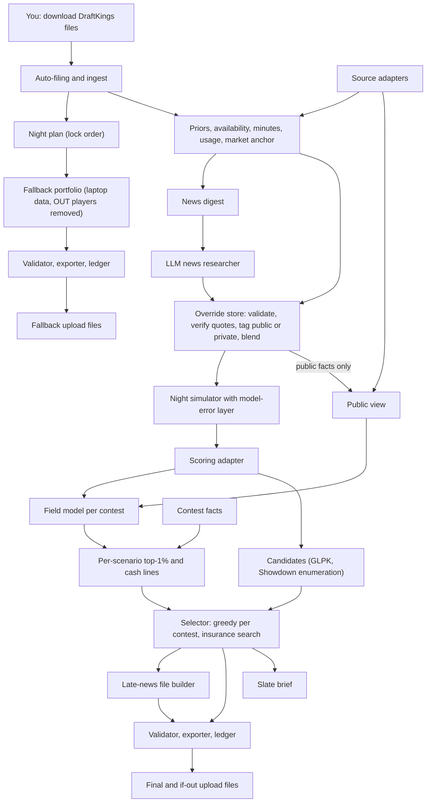
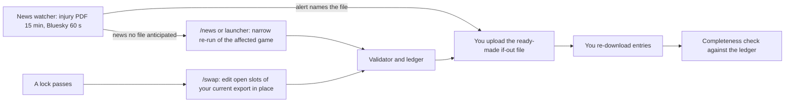
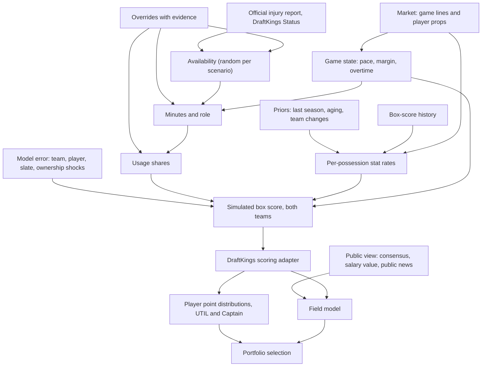

# NBA DFS Engine: Architecture

**Status:** version 2, revised after red-team round 1 (`docs/research/RT1-red-team-round1.md`). Design only; no engine code exists yet. **Date:** 2026-10-13. **Go-live:** NBA opening night, Tuesday 2026-10-20 (first lock 2:00 pm CT).

**How to read this:** every section stands alone. Evidence labels: **VERIFIED** means we ran it or read it in a primary source and the evidence is cited; **SUPPORTED** means a credible source says so but we did not observe it ourselves; **BET** means our judgment, to be tested. Research memos are in `docs/research/` (R1 to R9, RR1 to RR4, S1, S2, RT1, RT2), decision records in `docs/adr/` (ADR-001 to ADR-022), your brief in `docs/brief/`.

---

## 1. Summary in plain English

### What the engine does

Each night it builds lineups for every DraftKings NBA entry you hold, Classic and Showdown Captain Mode, so that each contest has the best chance of a top-1% finish and the night as a whole rarely ends with zero cashes. It simulates the whole night tens of thousands of times (every game, every player, blowouts, overtime, late scratches, and the chance that our own projections are wrong), simulates the opponents in each contest from public information, and picks the set of lineups that wins in the most different versions of the night. It hands you one validated upload file per slate, ready-made backup files for each late-news possibility, and a two-minute brief.

### How a night runs (typical main slate, first tip 6:00 pm CT)

1. **Afternoon, about 15 minutes of your time.** Enter contests as usual. Download each slate's entries file and salary export; the engine picks them up from your Downloads folder by itself. Type `/night` in Claude Code, or run `dfs night` from the desktop launcher if Claude is unavailable.
2. **Within about 10 minutes** a valid fallback file exists for every slate, with players already ruled out removed. You can upload it as insurance.
3. **About 30 to 45 minutes after you start**, the full build is done: injury and role research, the simulation, the opponent model, lineup selection, and the brief. Alongside the main files it writes a ready-made "if this player is out" file for each questionable player. You upload one file per slate (about a minute each) and re-download once so the engine can confirm every entry is filled. The independent QA review joins the build in week 2, after one measured live night.
4. **When news breaks** (a desktop alert from the news watcher, or you see it first), you upload the matching ready-made file: one upload, no engine run. If the news is something no file anticipated, `/news` re-runs the affected game in a few minutes.
5. **After a lock**, if games remain, `/swap` edits the open slots of your current DraftKings export in place.
6. **Next morning, about 5 minutes.** Download the standings files and type `/results`. The engine scores every layer of its own work against real fields, which is how it learns.

Measured honestly, a typical 4-slate night needs about 25 to 35 minutes of your time (more in week 1, when payout tables for new contests are pasted). Rehearsal 3 measures it (section 13).

### What it is built from

- **Deterministic Python on your laptop** does all arithmetic: parsing DraftKings files, projections, simulation, opponent fields, lineup selection, validation, export, and learning. It runs with or without Claude, from the desktop launcher.
- **Claude Code** is the judgment layer and runs only when you type a command. A news researcher turns injury and role news into structured records whose quotes code checks against the saved source page. From week 2, an independent QA agent proposes changes that code scores. Claude never writes lineups or upload files.
- **Free data only.** All DraftKings data comes from files you download, because DraftKings' terms bar automated access to its site (VERIFIED, terms dated 06/30/2026). Third-party data follows the posture you choose (Decision D1).

### Where this departs from your vision, and why

| Your step | What changed | Why, in terms of the two goals |
|---|---|---|
| 1. Upload the salary file and the entries file | One entries file per slate (each already contains its slate's full player list with IDs) plus the salary export (which adds DraftKings' `Status` column). The engine files them from your Downloads folder. | A night has 3 to 5 slates, each with its own player IDs; reading IDs only from that slate's file removes the most common cause of invalid uploads, and auto-filing removes the most common manual mistake. |
| 2. Project median, top-1% outcome, boom/bust, and ownership | Full distributions from a simulation of the whole night, including the chance our own projections are wrong. Ownership is read off a simulated field built from public information. | Both goals depend on the joint outcome of every contest in the same simulated night; a simulation that treats our projections as truth says washouts almost never happen, which is false. |
| 3. The LLM removes players, overrides roles, and assigns players to lineups | The LLM files structured, evidence-checked beliefs (probability of playing, minutes range, usage shift, whether the news is public). Code assigns players to lineups. | Lineup choice is a probability over thousands of scenarios and opponents; only code can compare candidates on it, and structured beliefs can be scored. |
| 4. Adversarial QA, up to three iterations | QA proposals are typed and judged by code: belief changes against an evidence bar computed from our own past errors, construction changes by simulation with beliefs fixed. QA starts in week 2. | QA changes that cannot show evidence or improvement are noise; opening week has no budget or measurement for them yet. |
| 5. Present the upload file | A valid fallback before any LLM step, every slate planned in lock order, only DraftKings validity can block a file, ready-made late-news files, a per-entry ledger so two news events cannot undo each other, and a completeness check after every upload. | Lock-time failures were the largest avoidable loss in your prior engines; a blank entry has zero chance at either goal. |
| 6. Post-contest analysis | Every layer is scored against its own baseline and against real standings (including a simple control portfolio and the insurance variants), and model changes need held-out wins plus your sign-off. | A few contests a night are noise; thousands of player and opponent observations a night are signal. |
| New | The insurance budget control, the model-error layer, the desktop launcher, a volume ramp tied to evidence (Decision D9). | Direct levers on Goal 2, on late news, and on not scaling losses. |

### What we learned from your prior engines

Two things, both VERIFIED in those repos' own records (RR1 to RR4):

1. **Lock-time failures were the largest avoidable loss.** Entries locked blank in slates nobody built, a stale lock list, a check that changed no number but blocked a file, a late file refused after first tip, entries locked blank after a file was built.
2. **The lineups themselves also lost.** MLB's bottom decile stayed weak even with blank entries removed; NFL finished at the 53.8th percentile with blanks removed (worse than the median); NHL Classic cashed 23 of 136 against 32.2 expected for random lineups; your own past NBA entries cashed 13.2% against 23.3% of fields paid (R8).

So this design puts delivery first, keeps Phase 1 thin, requires every piece of sophistication to beat a simpler version on real standings, writes limits on its own process into the design (section 13), and recommends ramping volume only as evidence arrives (Decision D9): moving from about 1 entry a night to 50 to 200 is a 50 to 100x increase in spend with no measured edge yet.

---

## 2. Goals as math

### The short version

- **Goal 1** for each contest is the probability that at least one of our entries finishes in the top 1%. Once the field model has been checked against real standings, a finish is counted at the share of prize money it keeps after ties with opponents holding the same lineup.
- **Goal 2** is the probability that, across every contest tonight, no entry cashes.
- Both are computed on **one shared simulation of the whole night** that includes two kinds of uncertainty: how the games go, and how wrong our own projections and ownership estimates are.
- **One setting, the insurance budget**, says how much of each contest's top-1% odds you will give up to lower washout risk. When washout is negligible on a given night, the brief says so and the setting does nothing.

### Notation

- A **slate** is a DraftKings draft group: the Classic main slate, an early or late Classic slate, or one Showdown game.
- For contest `c`: `N_c` is the field size, `n_c` our entries, `N'_c = N_c - n_c` the opponents.
- **Top-1% places:** `k_c = max(1, floor(0.01 x N_c))`. A rank counts when it is within the first 1% of the field, so any field under 200 has one top-1% place, first place. This covers your rule for fields under 100 and makes 100 to 199 explicit. (Research memo R2 used a ceiling; this document governs.)
- **Paid places:** `m_c`, from the contest's payout table: exact from your entry-history export or a pasted table when available, otherwise the contest family's default (about 23% of the field for NBA tournaments, VERIFIED on your 394 past NBA Classic entries, R8).
- A **scenario** `s` is one simulated night: every player's box score and DraftKings points at UTIL and at Captain (1.5x the bonus-inclusive total, ADR-020).
- `X_L(s)` is lineup `L`'s score in scenario `s`; `B_c(s)` is our best entry's score in contest `c`.
- `F_{c,s}(x)` is the probability that one simulated opponent in contest `c` scores at most `x` in scenario `s`, estimated by scoring a large weighted sample of simulated opponent lineups.

### Two kinds of uncertainty in every scenario

1. **Outcome noise:** how the games go (pace, margin, overtime, minutes, shooting).
2. **Model error:** how wrong our beliefs are. Each scenario also draws a shift in each team's and each player's expected production (sized from our own past projection errors by salary tier and role, wider in October and for rookies), a slate-wide scoring-environment shift, and **one ownership shock per slate that every contest on that slate shares**.

Why: without model error, the simulation treats our projections as the truth, and on a night of about 100 entries across 10 contests it says a washout essentially never happens. An earlier benchmark run without this layer showed exactly that (P(washout) of 0.0 on an 11-contest, 118-entry synthetic night, RT1 reading the benchmark's debug output). Real washouts come from shared errors: a game we misjudged, ownership we misjudged on every contest of a slate. Effect with the layer: TODO-R9. The layer's size is a setting fitted from the scorecards, starting from BET values.

### Goal 1: top-1% probability per contest

Given the scenario, the number of opponents who beat score `x` is binomial (each opponent independently beats `x` with probability `1 - F_{c,s}(x)`), widened to a beta-binomial once standings show how much multi-entry users' lineups cluster:

```
P(top 1% in c | s, L) = BinomCDF( k_c - 1 ;  N'_c ,  1 - F_{c,s}( X_L(s) ) )

G1_c (raw) = average over scenarios of  max over L in E_c of  P(top 1% in c | s, L)
```

- For a single-entry contest this is the probability our lineup finishes top 1%; for multi-entry contests it is the probability at least one entry does, because the best-scoring entry decides that event.
- **Duplication:** the duplication-adjusted version replaces each term with `P(top 1% in c | s, L) x share_c(L, s)`, where `share_c` is the expected fraction of the prize kept, averaged over the distribution of the number of opponent copies (not computed at the average number of copies). DraftKings pools tied places' prizes and splits them evenly (terms, VERIFIED). A five-way tie for first in a top-heavy contest keeps about a fifth of first-place money; a tie deep in the top 1%, where neighboring prizes are nearly equal, keeps nearly all of it. Taking the maximum over our entries of probability x share keeps the "adding a lineup never hurts" property that the selection method's quality guarantee relies on (RT1 rank 8).
- **When it switches on (Decision D2):** opening week selects on the raw probability and shows the duplication-adjusted number beside it, because duplicate rates in the simulated field are unfitted guesses until real NBA standings exist. Selection switches to the adjusted version after at least five NBA Showdown standings files have fitted the duplicate rate.
- **Big-field first place:** a sampled field resolves the top 1% (thousands of samples above the line) but not first place in a 35,000-entry contest. P(first) and P(top 0.1%) are reported beside Goal 1 from a fitted upper tail; your NFL engine overpriced first place 18x to 280x from a raw sample (RR2, VERIFIED).
- **Small fields:** for fields under about 1,000, per-scenario probabilities are stored (8-bit), not just hit or miss, because a single sampled line is too noisy when one place counts.

### Goal 2: probability of a total washout

```
P(no cash in c | s) = 1 - BinomCDF( m_c - 1 ;  N'_c ,  1 - F_{c,s}( B_c(s) ) )

P(W) = average over scenarios of  product over contests c of  P(no cash in c | s)
```

- Contests are treated as independent only after conditioning on the scenario, and the scenario now carries the shared errors (a misjudged game, a misjudged slate's ownership) that make contests fail together.
- **Delivery is part of Goal 2.** A blank entry cannot cash. The brief reports unfilled entries next to `P(W)`.
- **Reported two ways:** with and without the model-error layer, so you can see how much of the risk is "the games" and how much is "us being wrong".

### The control: the insurance budget

```
For each contest c, let G1*_c be the best Goal 1 the engine finds for c alone.
Choose the night's portfolio that minimizes P(W)
subject to G1_c >= (1 - epsilon) x G1*_c for every contest c.
```

- In words: "I'll give up at most epsilon of my top-1% odds, in every contest, to lower the chance of a night with zero cashes." At 0% the engine maximizes top-1% odds and uses washout only to break ties.
- Each contest keeps its own guarantee, so no contest is quietly sacrificed and no weighting between contests is needed. The setting means the same thing on a 3-contest night and a 12-contest night (ADR-001).
- **How it is enforced (RT1 rank 7):** start from each contest's own best portfolio, then search single-lineup swaps in any contest, accepting a swap only if it lowers `P(W)` and every contest still meets its guarantee, both measured on a **validation scenario set** that selection never saw. Every later step (local improvement, QA, late swap) re-checks the guarantee.
- **Noise floor:** a budget smaller than two standard errors of a contest's Goal 1 estimate is reported as "within noise" for that contest, because it cannot be enforced honestly.
- **When washout is not a live tradeoff:** if `P(W)` at 0% is under 1% (with the model-error layer), the brief says "washout risk is negligible tonight" and skips the search.
- **Default (Decision D3):** TODO-R9. You prefer large prizes (your NFL instruction was to "err on side of trying to win large prizes", RR2), so the recommendation leans low.

### How the goals trade off, and the hunch test

Both goals depend on the same thing: which ways the night can unfold that our entries cover. Goal 1 wants each contest's best entry above that contest's top-1% line in as many scenarios as possible; Goal 2 wants, in every scenario, at least one contest above its much lower cash line. Both reward covering different scenarios, which is your hunch. They disagree in three places: target height (a ceiling build gives up some floor, directly so in single-entry contests), cross-contest concentration (Goal 1 does not care whether every contest leans on the same game; Goal 2 does), and night composition (Showdowns depend on one game each).

**Evidence so far.** Between lineups, the literature agrees with the hunch: lowering the correlation among our entries raises the chance at least one is top 1% and lowers the washout chance (Hunter, Vielma and Zaman; Haugh and Singal; R2, R5). Concentration is a measured washout cause: in your NFL data, 85% or more of entries on one player raised the zero-paid rate 1.4x to 12x (RR2, VERIFIED). On a synthetic night shaped like your volume: TODO-R9. Status: BET until measured on real fields.

**The test, on real fields (RT1 rank 3).** Each night the engine stores three portfolios: insurance 0%, insurance 20%, and the lowest-washout portfolio the search can find. Next morning each is scored against the real standings: top-1% finishes and whether it would have washed out. After 20 nights the brief gives a verdict with an interval. The model's own frontier is shown nightly too, but a model cannot confirm itself; real fields decide.

### How each goal is estimated, and how precise it is

- **Three scenario sets** (RT1 rank 18): a **screening** set (10,000) shortlists candidates; an independent **selection** set (10,000) drives the greedy method and the insurance search; an independent **reporting and validation** set (30,000) produces every number in the brief and checks the insurance guarantees. Picking the best of thousands of candidates on one set flatters them; checking on a fresh set removes the flattery.
- **Precision:** with 30,000 scenarios, a 1% probability has a standard error of about 0.06 percentage points (about 6% relative) and a 5% probability about 0.13 points (VERIFIED arithmetic).
- **Common random numbers:** every comparison uses the same scenarios, which cut comparison noise 1.6x in a toy test (R3, VERIFIED) and more when lineups overlap.
- **Precision is not accuracy.** The learning loop checks the model against reality with dense signals: predicted cash probability per entry against realized cashes (50 to 200 entries a night), predicted top-1% and min-cash lines against the actual lines in every standings file, and how much our nightly cash rate varies compared with what the model predicts (which is what sizes the model-error layer).

---

## 3. System overview

### The boundary in one sentence

Claude sets beliefs about the world (who plays, for how long, in what role, and whether that news is public) as validated records; deterministic code does everything after that, including every lineup and every file you upload.

### Components

| # | Component (deterministic unless marked LLM) | Job | What it means for you |
|---|---|---|---|
| 1 | **Inbox, auto-filing and ingest** | Pick up DraftKings files from your Downloads folder and file them by content (entries, salary exports, standings, entry history); detect encodings; identify each slate from its player list; fail closed with plain-language errors. | You download; the engine files. No wrong-folder mistakes. |
| 2 | **Night plan** | Order slates by lock time; track every entry's state (empty, fallback, full build, uploaded, confirmed). | No slate is forgotten; `/status` prints the one next action per slate. |
| 3 | **Clock, identity and team map** | One lock clock from each file's Game Info; one identity rule (person plus role, per slate, because DraftKings IDs change between slates); one team-code map; reviewed name matches persist and are versioned per run. | Removes the drifted-copy bugs that were your MLB engine's top root cause. |
| 4 | **Contest facts** | Field size, paid places and payout curve per contest: from your entry-history export (ported parser, ADR-018), a pasted table, the prize pool in the contest name, or the family default, in that order; the brief lists which contests are on defaults. | Better thresholds from week 1 with near-zero effort. |
| 5 | **Source adapters** | Schedule, injury report, lines, props, history, news, under your data posture; rate limited; every response snapshotted with a timestamp and hash. | Data failures degrade the build instead of stopping it. |
| 6 | **Priors and rates** | Per-possession stat rates with shrinkage, recency decay, aging, early-season variance inflation. | Sensible projections from opening night with no current-season data. |
| 7 | **Availability, minutes and usage** | Probability of playing; minutes by role; redistribution when teammates sit; usage shares that sum to 100%. | Captures a cheap player stepping into a starter's role, with honest uncertainty. |
| 8 | **Market anchor** | Game lines set team totals and pace; props pull stat means toward the market when available. | Rest, travel and matchup are priced once, by the most efficient source. |
| 9 | **Override store** (fed by the LLM and by you) | Validate overrides (including that quoted words appear in the saved source page), blend them, tag them public or private, keep the before and after. | You can veto or add an override with one command; every one is scored. |
| 10 | **Night simulator** | Stat-level joint simulation with game, team and player factors plus the model-error layer; blowouts, overtime and availability drawn per scenario. | Correlation, Captain math, double-doubles and shared failure come out of the same simulated nights. |
| 11 | **Scoring adapter** | Versioned DraftKings scoring with nightly self-checks against standings. | A rule change is caught the morning after it happens. |
| 12 | **Field model** | Simulated opponents per contest family, built from a public view of the night; ownership and duplicate counts are read off it. | Thresholds reflect the field you face, without leaking our private research into it. |
| 13 | **Candidate generator** | Classic: thousands of lineups from GLPK on simulated outcomes and ownership-adjusted means. Showdown: every legal lineup, screened. | A wide pool, each lineup winning some plausible night. |
| 14 | **Portfolio selector** | Greedy coverage per contest; insurance search across the night; concentration cap; slot assignment for late swap; scenario labels. | Your two goals, optimized directly. |
| 15 | **Late-news file builder** | At build time, a complete, validated "if this player is out" file for each questionable player and slate (a full alternate portfolio for Showdown; a 2- to 3-slot re-optimization for Classic). | Acting on news becomes one upload. |
| 16 | **Validator, exporter and ledger** | Every DraftKings rule checked against the downloaded files; the only writer of upload files, each hashed into the run manifest; a per-entry ledger of the last exported lineup; one engine run at a time. | You never receive an invalid file, and two news events cannot undo each other. |
| 17 | **Late swap** | Pin locked players, treat started and finished games as known, edit open slots of your current export in place. | Late scratches become pivots instead of zeros. |
| 18 | **News watcher** (plain Python, no Claude) | Polls the official injury report every 15 minutes and Bluesky reporter mirrors every 60 seconds for players in our pool; raises a desktop alert naming the ready-made file to upload. | You hear about news fast, and know exactly what to do. |
| 19 | **Brief** | Two-minute slate brief: thesis, assumptions, exposures, risks, the news that would change the build and the file for each, what was skipped, input freshness, and an "if the engine is down" card. | One page tells you what the engine believes and what to do. |
| 20 | **Run store and replay** | Manifest per run: inputs, snapshots, configuration, identity-map version, versions, seeds, LLM decision records, fallback level reached, outputs. | Any night can be replayed exactly. |
| 21 | **Learning** | Standings and box-score ingest, per-layer scorecards, counterfactual ranks, shadow challengers, adoption workflow. | The engine improves only on evidence, with your sign-off. |
| 22 | **Desktop launcher** | `dfs night`, `dfs news`, `dfs swap`, `dfs status` from a desktop shortcut, with the same plain-language output, no Claude needed. | The night survives a Claude outage or usage cap. |
| 23 | **LLM: news researcher** | Reads a deterministic news digest, searches sparingly, files override records with evidence. | News read faster and more completely than any free feed. |
| 24 | **LLM: QA adversary** (from week 2) | Independent review; typed proposals; code judges them. | A second opinion that must earn its changes. |
| 25 | **LLM: results analyst** (weekly, from week 3) | Reads the scorecards, writes the weekly review, drafts challenger proposals. | You approve or reject model changes once a week. |

### Night data flow



### Late news and lock waves



### The deterministic and LLM boundary

| Decision | Who decides | How it is checked |
|---|---|---|
| Who is in the player pool | Code, from the downloaded file; the LLM may propose an exclusion with a reason | Validator; exclusion logged and scored |
| Probability a questionable player plays | Code maps official status; the LLM may file an availability record with evidence | Schema check, quote check; Brier score afterward |
| Minutes, role and usage shifts | Code model; the LLM files ranges with evidence | Blend rules (section 4); coverage of stated ranges tracked |
| Whether a fact is public | The LLM tags it; code requires public evidence (official report, team statement, reporter post) for a "public" tag | Tagged facts reach the field model; private judgments do not |
| Distributions, correlation, Captain points, model error | Code only | Calibration tests against box scores and our own errors |
| Ownership, opponent lineups, thresholds | Code only (public view) | Nightly comparison with standings |
| Which lineups to enter, in which slots | Code only | Validator; frontier; real-field scorecards |
| Changes after review (week 2 on) | The LLM proposes typed changes; code judges | Evidence bar or simulation test |
| What goes in an upload file | Code only; hooks block Claude from writing there by any tool | Manifest hashes; validator re-reads every file |
| Whether a model change is adopted | You, after a held-out comparison | Weekly review |

---

## 4. Projections

### The short version

Every player gets a full distribution of DraftKings points from a simulation of the whole night. The simulation draws who plays, how many minutes each player gets (including blowouts and overtime), how the team's possessions are shared, each counting stat, and how wrong our own expectations might be, then scores the line with DraftKings' exact rules. Medians, top-1% outcomes, boom and bust rates, and Captain values are summaries of that simulation. What it means for results: the tails that decide tournaments come out of the same simulated games that set everyone else's scores.

### The projection graph, as implemented

The attached blueprint was a good start; this version fixes its gaps (R3 critique): minutes depend on game state, availability is a random draw, priors and news are explicit inputs, model error is part of every scenario, and the field has its own inputs.



### Minutes and role come first

- **Base distribution:** each player's minutes have a role-specific center and spread (a truncated normal core on 0 to 48), from season-long and recent minutes with recency decay. The benchmark to beat is a practitioner baseline: 75% season plus 25% last five games (R3).
- **Game state:** each scenario draws the final margin around the spread; above about 15 points, starters lose minutes and the bench gains them. Calibration targets: margin around the spread with a standard deviation of 13.2 points, 18.6% of games decided by 20 or more, overtime in 5.4% of games (RR4, VERIFIED arithmetic on a historical lines file of unknown provenance; RotoGrinders data gives 6.2% to 6.4% overtime, R5). Overtime adds 5 minutes for players on the floor.
- **Early exits:** a small probability of injury or foul trouble cuts a player's minutes in a scenario.
- **Reconciliation:** each team's minutes sum to 240 (plus 25 per overtime) in every scenario.
- **Restrictions:** a return-from-injury cap enters as an override with a hard cap.
- What it means for results: minutes are where every vendor says NBA slates are decided (R1, VERIFIED).

### Minutes and usage when a player sits

- **Share model:** each team's possessions used are a fixed pool; each active player's share is base usage x a per-scenario multiplier x minutes, renormalized to 100%. When a player sits, his share and minutes flow to teammates automatically (R3 section 2).
- **Where the freed share goes:** a position-similarity prior (a guard's absence lifts guards most), updated by with-or-without-you evidence in proportion to how much "without" data exists (shrinkage constant about 300 minutes, BET), plus any redistribution hint from an override. The number of games the absent player has already missed is an input (RR4, BET).
- **Efficiency cost:** about 1 point per 100 possessions of shooting efficiency per extra 1% of usage (R3, SUPPORTED).
- **Uncertainty:** redistribution weights are drawn per scenario, so the beneficiary's distribution is wide when evidence is thin.

### Where LLM overrides meet the model

The news researcher files override records (schema in section 7): probability of playing and starting, minutes as 10th/50th/90th percentiles with an optional hard cap, usage and per-stat multipliers as percentiles, redistribution hints, an optional condition ("only if player Y is out"), and a public or private tag.

- **Role changes are mixtures, not averages (RT1 rank 16).** If an override changes the probability of starting or carries a condition, each scenario first draws which world it is in: with the override's probability the player gets the override's minutes, otherwise the model's. Averaging a "named starter, 34 minutes" belief with a "bench, 15 minutes" prior would give 24 minutes, a number neither world produces.
- **Within the same role,** the override and the model are blended by precision weighting, after inflating the LLM's stated uncertainty by a coverage factor fitted from its track record (starting at 1.5).
- **Team totals still hold:** minutes and usage are renormalized after every override.
- **Limits:** one override can move a teammate's expected minutes by at most a set amount (default 8) unless the evidence is an official status change.
- **Precedence:** official OUT designations override everything; your overrides beat the LLM's.

### Rates and early-season priors

- **Rates per possession,** shrunk toward a role and position prior with empirical Bayes (weight on the player's own data grows with his possessions), with a separate recency decay per stat, following DARKO's published method (R3).
- **Opening night:** priors are last season's per-possession rates adjusted for age, team and role; team changes move through the usage share model; coaching changes shrink pace toward league average. The early-season variance multiplier widens every player's uncertainty and decays as minutes accumulate.
- **Players with no NBA history (rookies, two-way players):** in Phase 1, salary-implied production plus the researcher's `no_history_prior` (a comparable role and a minutes range), because no permissive free source of draft slot and college statistics was verified (RT1 rank 12). A draft-slot prior is a Phase 3 candidate.
- **The market carries the most current information:** team totals and spreads set efficiency and pace; player props pull stat means toward the market on nights the free quota allows.
- **Never used:** DraftKings' `AvgPointsPerGame` (0.0 for players with no history, RR4).

### Distributions and definitions

| Term | Definition | Why it matters |
|---|---|---|
| **Median** | 50th percentile of simulated DraftKings points | The typical night |
| **Mean** | Average simulated points | Salary value; optimizer input |
| **Top-1% outcome** | 99th percentile: the score he beats in only 1 of 100 simulated nights | What a top-1% lineup needs from him |
| **Ceiling** | 90th percentile | A steadier upside measure for the brief |
| **Boom rate** | Probability of at least 6 x salary/$1,000 points (Captain: the same multiple of Captain salary) | Chance he returns tournament value |
| **Bust rate** | Probability of fewer than 4 x salary/$1,000 points | Chance he sinks a lineup |
| **P(double-double), P(triple-double)** | Share of scenarios with the milestone | Bonuses come from each simulated line |
| **P(active)** | Share of scenarios in which he plays | Questionable players stay random until news |
| **Optimal rate** (Phase 2) | Share of scenarios in which he is in that scenario's best lineup | The simulation's own measure of slate-winning upside |

The boom and bust multiples are settings, revisited once real distributions exist (BET defaults).

### The simulator

Per scenario (R3 section 4; ADR-002):

1. **Model error:** draw the scenario's shifts in team and player expectations, the slate scoring environment, and the slate's ownership shock (section 2).
2. **Game:** a pace factor shared by both teams; the final margin around the spread; overtime more likely when the margin is small.
3. **Team:** an offensive efficiency factor centered on the market's implied team total.
4. **Availability and minutes:** draw who plays; apply blowout trims and early exits; reconcile to 240.
5. **Player:** a shared "big night" multiplier across his stats, plus stat-specific overdispersion (negative binomial counts).
6. **Usage stats:** shot attempts, free throws and turnovers from team possessions x usage share; makes from shrunk percentages; points follow.
7. **Rebounds:** shared among active players from both teams' misses (negative correlation between same-team bigs).
8. **Assists:** a share of the team's made shots.
9. **Steals and blocks:** counts on opponent possessions and attempts.
10. **Scoring:** the versioned DraftKings adapter (triple-double +4.5; Captain 1.5x the bonus-inclusive total, ADR-020).

Not chosen: a possession-by-possession simulator (far more parameters to calibrate) and fantasy points from a multivariate normal (thins the upper tail tournaments are decided in, and cannot produce double-doubles; R3 spike). The R9 benchmark's simulator is the reference implementation that Phase 1 rewrites into the engine with tests (ADR-022).

**Determinism (ADR-021):** every random draw is keyed by (run seed, scenario index, game, person, stat) with a counter-based generator; no solver time limits; stable sort orders. Your NHL and golf engines gave different lineups from the same inputs (RR3).

**Runtime:** TODO-R9.

### Correlation, and what it means for Classic and Showdown

NBA correlation is small and comes mostly from the game (R3, R5): pace and overtime lift everyone in a game; team efficiency lifts teammates; fixed usage shares, shared rebounds, and minutes redistribution push teammates apart (a team's PG and SG totals correlated at -0.38 in one older FanDuel-scored study, R5); blowouts move minutes from starters to the bench. The model-error layer adds the correlation that matters most for washout: everyone on a team or slate we misjudged moves together. The simulator's output correlations are checked against last season's box scores by role pair before any slate is played.

- **Classic:** stacking teammates is a weak lever; shared game environment and shared downside matter. The selector discovers when a game stack pays.
- **Showdown:** the game script dominates. Close games and overtime reward stars at Captain; blowouts move fourth-quarter minutes to both benches, when cheap bench players and lopsided team splits win; the both-teams rule forces at least one player from the losing side.

### Captain handling

- Captain points are 1.5x the same scenario's bonus-inclusive total, and Captain salary is 1.5x UTIL salary (VERIFIED on 189 historical NBA pairs; always a whole $100, R6). Whether 1.5x applies to bonuses is SUPPORTED on a 2020 NBA export and becomes VERIFIED on the first 2026 Showdown standings file (ADR-020).
- Captain and UTIL are two roles of one person with different DraftKings IDs, paired by name and team, never by ID arithmetic; the slot label is read from the file header (UTIL in NBA files, FLEX in NFL and NHL).
- Every legal Showdown lineup is enumerated (about 440,000 for a 22-player pool in 0.015 seconds, R2, VERIFIED), so Captain tradeoffs are computed exactly.

---

## 5. Ownership and the field

### The short version

Ownership (how often each player is picked) is read off a simulated field of opponents who build lineups from a **public view** of the night: what any DraftKings player can see. Public news reaches them (with a share of opponents who never update); our private model and private judgments do not. Ownership, duplicate counts, and each contest's top-1% and min-cash lines all come from that field. What it means for results: the simulated field reacts to news like the real one, and our edge stays ours.

### Two views of the night

| View | Built from | Used for |
|---|---|---|
| **Engine view** | Everything: our model, the market, official news, and all overrides | Our lineups |
| **Public view** | Free consensus projections (Daily Fantasy Fuel's CSV when it has numbers), salary-implied value, betting lines, official statuses, DraftKings `Status`, and overrides tagged **public**. Our own baseline model is used only as a fallback when no consensus source has numbers. | The simulated field |

- **Public versus private (RT1 rank 4).** Every override carries a `visibility` tag. "Public" requires public evidence: an official report, a team statement, or a reporter's post. Most news is public, and the real field reacts to it within minutes; leaving it out is how your NHL engine missed news-driven chalk by about 10x (50.7% actual against 4.7% predicted, RR3, VERIFIED). "Private" is our own inference (for example our minutes estimate beyond what was reported); the field never sees it.
- **Why not build the field from our baseline model:** any edge in our baseline would show up as simulated chalk, and the engine would fade its own edge.
- **Three tests (section 11):** a public scratch raises the beneficiary's simulated ownership; a private override leaves it unchanged; a change to our baseline model alone leaves it unchanged whenever a consensus source exists.

### Who the simulated opponents are

A mixture whose weights depend on the contest family (stake, field size, entry limit), following Haugh and Singal's opponent model and the open-source simulators (R2, R3):

1. **Optimizer-like entrants:** each solves the lineup problem on public-view projections plus personal noise, near the salary cap.
2. **Casual entrants:** pick players in proportion to public popularity (projection, value, name recognition), above a salary floor.
3. **Chalk duplicators:** copies of the handful of most obvious lineups; small in Classic, large in Showdown.
4. **Stale entrants:** lineups built before late news that never update.

Opponents are sampled **as users**, not as independent lineups: a multi-entry user's lineups share a core, with entry counts drawn from standings files once they exist. This widens the spread of the top-1% line the way real clustered fields do (RT1 rank 17). High-stakes fields are sharper but more alike; low-stakes fields softer and chalkier (R1, VERIFIED).

### Ownership

- Read off the field: the share of simulated lineups holding each player, by slot type.
- **One unit, checked nightly:** fractions summing to 8.0 in Classic and 1.0 Captain plus 5.0 UTIL in Showdown (RR4 lesson).
- **Captain and UTIL are separate.** Casual entrants concentrate their Captain picks on the obvious star (the field over-captains him on one documented slate, R5, SUPPORTED); optimizer entrants choose Captains by the numbers.
- **Uncertainty:** each scenario carries one ownership shock per slate, shared by every contest on that slate, so a wrong ownership read hurts all those contests together, as it does in reality.
- **Expected accuracy:** no vendor publishes ownership accuracy (R1, R3). BET: average misses of 3 to 6 percentage points among players above 5% ownership once calibrated, largest on late-news value plays. Measured from the first standings file.

### Cold start and calibration

- **No history needed to start.** The field's few settings (optimizer noise, casual share, salary floor, stale share, duplicator share) start from published rules of thumb (BET values in configuration).
- **From the first standings file:** each file gives every opponent lineup and actual ownership by slot. The engine fits only stable shapes with heavy shrinkage across nights: ownership by salary tier, salary left unspent, duplicate rates, Captain concentration, multi-entry clustering, and the stale share measured on late scratches. Your NFL engine's construction features flipped sign game to game (RR2), so nothing is fitted to a single night.
- **Graded before it carries weight:** duplicate-adjusted selection switches on only after five NBA Showdown standings files (section 2); leverage effects are judged against real fields weekly (your MLB engine leaned contrarian while winners were chalkier, RR1).

### Duplicates

- **Showdown:** a simulated field of a few hundred thousand lineups is cheap at 6 slots; each lineup's copy rate is its frequency in that sample, and the number of copies in the real field is drawn from it (so the expected prize share averages over 0, 1, 2 ... copies).
- **Classic:** exact-match frequency for chalky lineups; for rare ones, the product of ownerships times a correction fitted from standings.

### Thresholds

- For each contest and scenario, the opponents' score distribution comes from scoring the field sample in that scenario, in chunks of scenarios so memory stays small.
- Top-1% and min-cash lines follow from the binomial formulas in section 2 (beta-binomial once clustering is fitted); fields under 200 size the field sample so first place is resolved; P(first) in large fields uses a fitted upper tail.
- Each morning, the realized top-1% and min-cash scores are placed within the predicted distribution; over many contests those positions should be spread evenly.

**Runtime and memory:** TODO-R9.

---

## 6. Lineups and portfolio

### The short version

The engine builds a wide pool of legal lineups that each win some plausible version of the night, then picks entries one at a time, each time adding the lineup that wins the most simulated nights the portfolio does not already win. A night-level search then trades a little of each contest's top-1% odds for washout protection, within the insurance budget, checked on scenarios the selection never saw. What it means for results: the two goals are optimized directly, and diversity comes from covering different scenarios rather than from hand-set exposure rules.

### Candidate generation

**Classic** (8 slots, $50,000, at least 2 games):

- **Solver: GLPK** (through the free `swiglpk` package), with OR-Tools CBC as an automatic fallback (ADR-006). A solver finds the best combination of yes/no choices under rules such as the salary cap.
- **Measured (VERIFIED, indicative, other jobs running):** median 2.2 milliseconds per Classic lineup; 5,000 lineups in 21.8 seconds on one process and 7.6 seconds on four, with identical lineups on repeat runs (`spikes/solvers/out/20261013-1656_bench_summary.txt`). OR-Tools CBC took 37.7 seconds for the same 5,000 on four processes.
- **Inputs:** (a) individual simulated scenarios ("the best lineup if the night goes exactly like this"), (b) mean projections minus several weights on public-view ownership, (c) structural variants such as game stacks with players from both teams, (d) lightly perturbed means. Duplicates are removed after a canonical sort.
- **Formulation:** one yes/no variable per player plus position-feasibility rows, 5x to 25x faster than the "player in slot" model with identical lineups (R2, VERIFIED). Slot assignment is a separate later step.
- **No wall-clock limits,** so the same inputs give the same lineups (ADR-021).
- **Pool size:** about 4,000 to 20,000 per Classic slate. Runtime: TODO-R9.

**Showdown** (Captain plus 5 UTIL, both teams): every legal lineup is listed (about 440,000 for a 22-player pool in 0.015 seconds, R2, VERIFIED), then screened before full scoring. No solver is needed.

### Selection against the goals

1. **Screen:** score every candidate on the screening scenario set; shortlist the strongest few thousand per contest.
2. **Re-score the shortlist** on the independent selection set, storing per-scenario top-1% and cash results (bits for big fields, 8-bit probabilities for fields under about 1,000).
3. **Per contest, lazy greedy coverage:** repeatedly add the candidate that adds the most top-1% probability given the entries already chosen (raw probability in opening week; duplicate-adjusted once calibrated). Because the objective takes the best of our entries in each scenario, adding a lineup never lowers it, so greedy selection is provably at least about 63% as good as the best set from the same pool, and usually much closer (R2, VERIFIED theorems). The result is each contest's best Goal 1, `G1*_c`.
4. **Night insurance search:** starting from step 3, single-lineup swaps in any contest that lower washout while every contest keeps at least `(1 - epsilon) x G1*_c`, checked on the reporting and validation set. Skipped, with a line in the brief, when washout at 0% is under 1%.
5. **Local improvement:** deterministic single-player swaps (for example a near-identical player with lower public ownership) kept only if they beat simulation noise without breaking any guarantee.
6. **Report** every number from the reporting set.

### Guardrails (in code)

- No lineup is entered twice in the same contest.
- **Concentration cap:** no single player in more than 60% of the night's entries (setting). In your NFL data, 85% or more of entries on one player raised the zero-paid rate 1.4x to 12x, and that engine once shipped 94% on one player and cashed 0 of 18 (RR2, VERIFIED).
- **Per-game exposure across formats** is reported (share of all entries depending on each game, Classic and Showdown combined).
- **Reuse across contests:** Decision D5.
- Guardrails shape construction; they never block delivery.

### Single-entry, small multi-entry, and 150-max

The same objective covers all three; the differences come out of the math:

- **Single-entry:** the one lineup with the best top-1% probability; in fields under 200, the best chance of finishing first. Insurance costs are direct here, since one lineup cannot be both ceiling and floor.
- **3-max to 20-max:** a handful of lineups that win different scenario clusters (for example one for a close game with overtime, one for a blowout).
- **150-max:** you fill only the entries you bought; greedy selection spreads them across scenarios. DraftKings caps entries per user at about the smaller of 150 and 3% of the field (R6; this pattern comes from the one lobby request R6 made before reading DraftKings' terms, which will not be repeated).

### Late-swap flexibility and late-news files

- **Slot assignment on purpose:** after players are chosen, a separate step places later-game players in the flexible slots (UTIL, then G or F) where eligibility allows, which keeps more swap options open at no cost.
- **Ready-made "if out" files (RT1 ranks 2 and 13):** for each questionable player with a probability of playing between 10% and 90%, and each slate he is on, the engine builds and validates a complete upload file for the "out" outcome:
  - **Showdown:** a full alternate portfolio selected from the enumerated lineups with him removed, because a star's absence changes the Captain choice, the chalk and the duplicate picture.
  - **Classic:** a re-optimization of 2 to 3 slots per affected entry, using only players in games that have not started, preferring later games.
  - Files are rebuilt whenever a newer upload file is exported, so they always start from the latest exported lineups (the ledger, below).
- **Showdown has no late swap:** every slot locks at the single tip, so Showdown files must be final before that game's lock.
- **Flexibility is valued through the simulation,** not a fixed "keep three late spots" rule.

### The per-entry ledger

The ledger records, for every entry, the last lineup exported, which file it was in, and whether you confirmed the upload. Every new file is built from whichever is newer, your latest download or the ledger, and the engine refuses (in plain language) to write a row that would revert a newer exported change unless you confirm the newer file was never uploaded. Only one engine run happens at a time; news arriving during a run is merged into the next file. This stops two news events in different games from undoing each other (RT1 rank 9).

### Scenario labels

Each lineup is tagged with the game script in which it wins most often (for example "BOS blowout, bench minutes" or "close game, overtime"), computed from the scenarios it covers. The brief lists the night's coverage by label, so you can see which ways the night are covered and which are not. You asked for named game theses per Showdown lineup in your NFL engine (RR2).

**Runtime:** TODO-R9.

---

## 7. The LLM layer

### The short version

Claude Code plays three roles, each a separate subagent with its own instructions and tools: a **news researcher** (from opening night) that turns injury and role news into checked belief records, an independent **QA adversary** (from week 2) that proposes typed changes for code to judge, and a weekly **results analyst** (from week 3). The session you type into is the orchestrator: it runs the engine's commands, starts subagents, and reports in plain language. Claude runs only when you type a command, never writes lineups or upload files, and every night step also runs from the desktop launcher without Claude.

### Agents, inputs and outputs

| Agent | Model | Tools | Reads | Writes |
|---|---|---|---|---|
| Orchestrator (your session) | Sonnet recommended for nightly runs | `uv run dfs ...`, Read | Command summaries (JSON) | Nothing directly |
| `news-researcher` | Sonnet | WebSearch; `uv run dfs research fetch <url>` (saves the page and returns its text); Read | `runs/<id>/llm/news_digest.json` | `runs/<id>/llm/overrides_<n>.json` |
| `qa-adversary` (week 2) | Sonnet | Read; `uv run dfs qa query ...` (read-only history queries, each logged); no web | `runs/<id>/llm/qa_packet_<n>.json` | `runs/<id>/llm/qa_proposals_<n>.json` |
| `results-analyst` (week 3) | Sonnet | Read; `uv run dfs learn query ...` | Scorecards (usernames already hashed) | `runs/weekly/<date>/review.md`, challenger proposals |

**The news digest (built by code):** official status changes since the last run; questionable, doubtful and game-time-decision players; DraftKings `Status` values; players the model flags as uncertain (new team, rookie, no history, minutes volatility, returning from injury); teams with several absences; the model's own redistribution guesses; names that appear in news or the salary file but not in the engine's ratings; and minutes until each lock. The researcher reads a diff, not the whole slate.

**The researcher's sources:** WebSearch results, plus pages fetched through `dfs research fetch` from an allowlist set by the data posture (Decision D1). Permissive posture allowlist: official.nba.com, nba.com team news pages, team and league press releases, `bsky.app` reporter posts, and major news outlets' articles. It does not fetch RotoWire, ESPN's data endpoints, sportsbooks, or DraftKings in any posture.

**The override record** (the researcher's output, and the format for your own overrides):

```json
{
  "override_id": "2026-10-20-LAL-0001",
  "created_at": "2026-10-20T17:42:00-04:00",
  "expires_at": "lock",
  "visibility": "public",
  "source": {"kind": "llm", "model": "<model id>", "confidence": "medium",
             "evidence": [{"url": "<link>", "snapshot_id": "<saved page id>",
                           "quote": "<under 15 words>", "published_at": "<time>"}]},
  "game_id": "<engine game id>",
  "player": {"person_key": "<engine person key>", "name": "Player X"},
  "condition": [{"person_key": "<key>", "status": "OUT"}],
  "availability": {"p_active": 0.97},
  "role": {"p_start": 0.90},
  "minutes": {"q10": 30.0, "q50": 34.0, "q90": 36.5, "hard_cap": null},
  "usage_multiplier": {"q10": 1.00, "q50": 1.10, "q90": 1.22},
  "stat_multipliers": {"ast": {"q10": 0.95, "q50": 1.05, "q90": 1.15}},
  "redistribution_hint": [{"person_key": "<key>", "minutes_weight": 0.6}],
  "no_history_prior": null,
  "rationale": "Coach said X starts in Y's place; X played 34 minutes in his last start."
}
```

- Omitted fields mean "no opinion". `condition` limits the override to scenarios where the condition holds. `no_history_prior` describes a player the engine has no data for (a comparable role and a minutes range). `visibility` is `public` only when the evidence is an official report, team statement or reporter post.
- Other record types: `data_flag` (stale or conflicting input) and `pool_exclusion` (remove a player, with a reason).
- **Checks before any override is used (RT1 rank 15):** known player and game; game not locked; percentiles in order; minutes 0 to 48; multipliers 0.5 to 2.0; not expired; **the quoted words appear in the saved page's text, and the page was published within the last 24 hours**. A failing record is dropped and listed in the brief. A `SubagentStop` hook runs these checks and sends the subagent back to fix an invalid file.
- **Your veto:** every override is one line in the brief; `dfs override veto <id>` removes it and triggers a narrow re-run.

### The QA loop (from week 2)

**Why not opening week:** QA needs a measured LLM budget and a week of standings to compute its evidence bar. Opening week runs without it, and the brief says so (RT1 rank 23).

**Independence:** a separate subagent that never sees the orchestrator's or researcher's reasoning, only a packet of facts: the portfolio and its frontier, exposures, baseline and final projections, overrides with evidence, public-view ownership, contest facts, the list of effects the model already includes, and earlier proposals with their rejection reasons. Its instructions are adversarial.

**Proposal types (at most 8 per iteration):**

| Type | Example | How code judges it |
|---|---|---|
| Belief: projection adjustment | "Player X loses minutes on the second night of back-to-backs" | Evidence bar, then materiality and regret |
| Belief: availability challenge | "The 0.9 for Y ignores this report" | A checked public source, then materiality and regret |
| Construction: swap pair | "Replace A with near-identical B in these 12 lineups; B is less owned" | Simulation with beliefs fixed |
| Construction: exposure cap or floor | "60% of entries depend on game 3" | Simulation with beliefs fixed |
| Data flag | "Game 4's total has not updated since noon" | Code re-checks the input and refreshes or labels it |

**The evidence bar for belief changes, computed by code.** QA cites a query; code reruns it and computes the numbers itself, so QA cannot invent statistics. A belief change passes only if:

1. **Sample size:** at least 20 games for a split or 300 minutes for a rate.
2. **Effect after shrinkage:** at least 1.5 minutes or 3% of DraftKings points.
3. **Not already priced in:** if the model already includes the effect (back-to-backs enter through the market and the minutes model), the evidence must come from the **model's own past errors** in that split, not the raw split.
4. **Not found by fishing (RT1 rank 26):** every query QA runs is logged; at most 10 per iteration; the effect must also hold in the held-out half of the seasons it did not search on.

**Why simulation cannot be the bar for beliefs:** re-simulating under a changed belief always makes the portfolio built for that belief look better. Simulation checks only **materiality** (does the change move the portfolio enough to matter) and **regret** (under the old beliefs, the new portfolio may lose no more than 2% of any contest's Goal 1).

**Construction changes** are accepted only if, with beliefs fixed, no contest's Goal 1 falls by more than noise, washout does not rise by more than noise, every insurance guarantee still holds, and at least one goal improves by more than two standard errors on common random numbers.

**One iteration:** build the packet, run QA once, validate, judge, apply accepted changes, rebuild, validate. **Stop rule** (first to happen): an iteration with nothing accepted; 3 iterations (2 on a Pro-only night); 10 minutes of wall time per iteration; 45 minutes before the slate's lock. The pre-QA portfolio is always kept for the morning scorecard.

### How it maps onto Claude Code

| Piece | Contents |
|---|---|
| `CLAUDE.md` (under 200 lines) | What the engine is; the boundary (beliefs, not lineups); the commands; safety rules (never write uploads, never touch DraftKings, only validity blocks delivery, never edit `src/` during a night run); how to report to you (plain language, lead with the answer, no em dashes); the budget rules |
| Skills (each a `/command`) | `/night`, `/news`, `/swap`, `/results`, `/weekly`, `/status`, `/replay`. Each starts with an Owns / Invokes / Does not own block (your skill library's convention) and calls `uv run dfs` commands rather than restating rules that live in code |
| Subagents (`.claude/agents/*.md`) | `news-researcher`, `qa-adversary`, `results-analyst`, each with `model: sonnet` and a narrow tool list |
| Hooks | `SessionStart`: preflight (account check; warns if an `ANTHROPIC_API_KEY` would silently replace your login; inbox summary; next lock; five-hour and weekly usage reminder). `PreToolUse` on `Edit,Write,NotebookEdit`: blocks `out/uploads/`, `data/snapshots/`, `config/models/`, and `src/` during a night run (liftable with `dfs unlock`, which is recorded). `PreToolUse` on `Bash` and `PowerShell`: blocks any command that mentions `out/uploads` or `draftkings.com` unless it is a `uv run dfs` command (RT1 rank 10). `SubagentStop`: validates the subagent's output |
| Permissions | Allow `uv run dfs *` and WebSearch; deny WebFetch entirely (fetching goes through `dfs research fetch`, which enforces the allowlist and saves the page); deny Read on `inbox/standings/` |
| Upload integrity | The exporter writes each file's hash into the run manifest; `/status` and the completeness check flag any upload file whose hash is not in a manifest, which catches a file made any other way |

### Guardrails

- Claude starts only when you type a command. The news watcher is plain Python. Pro is governed by the Consumer Terms, which bar automated use outside an API key (R7).
- LLM outputs are files validated by code before anything reads them.
- Other users' DraftKings names are replaced by hashes when standings are parsed, and Claude cannot read the raw standings files, so no other user's name reaches Anthropic (RT1 rank 28).
- If Claude is unavailable or over its limit, every night step runs from the desktop launcher, and the brief says which LLM steps were skipped.

### Logging

Every LLM step leaves a decision record in the run folder: input packet, output file, checks, what was accepted or rejected and why, the saved source pages, and the token usage the subagent reported. Claude Code keeps transcripts for 30 days (R7); the run folder is the permanent record, and replays reuse these records instead of calling the model.

### The LLM budget

- **Your plans:** a Team standard seat (1.25x Pro per five-hour window, also shared with your daytime chat use and governed by your employer's policies) and a Pro plan (1x). Both have a five-hour and a weekly window; no absolute numbers are published (R7, VERIFIED in Anthropic's help center).
- **Planned nightly use (BET until measured):** one researcher run on the main build (at most 12 searches and 8 fetches), small researcher runs on late news only when the news needs interpretation (at most 4 searches), QA from week 2 (2 iterations on Pro). Contingency files, late swap and results use no LLM.
- **Target:** a full night uses at most about 50% of one Pro five-hour window. Rehearsal 3 measures the real share.
- **The weekly window (RT1 rank 6):** preflight and the brief show five-hour and weekly usage; on game days, no build or design work in Claude after noon once weekly usage passes 70%; the build week itself is budgeted (section 13).
- **Fresh sessions** for `/news` and `/swap`, because a long session re-reads the whole conversation on every command (R7).

---

## 8. Slate-night runbook

### The short version

You download files, type one command, upload one file per slate, and confirm. When news breaks, the alert tells you which ready-made file to upload. A valid file always exists, every slate is built in lock order, only DraftKings validity can stop a file, and every step also runs from the desktop launcher without Claude. Times are Central (your laptop's zone); DraftKings lists Eastern, and the engine converts.

### A typical night (main slate first tip 6:00 pm CT)

| When | What you do | What the engine does | Compute budget | If it fails |
|---|---|---|---|---|
| Morning (about 5 min) | Download yesterday's standings files (and, weekly, the entry-history export); type `/results` | Files them, checks scoring, writes the scorecard and the real-field results of last night's insurance variants | Under 5 min | Learning waits a day; tonight does not depend on it |
| Any time after DraftKings posts slates | Enter contests as usual | Nothing | None | None |
| 1:00 to 4:00 pm (about 15 min) | Download each slate's entries file and salary export; type `/night` (or `dfs night` from the launcher) | **Ingest and night plan:** files the downloads, detects slates, lists anything missing and the single next action per slate | Under 1 min | Plain-language error naming the file and the fix; never an upload from a bad file |
| | | **Fallback:** a valid portfolio for every slate from laptop data, with players DraftKings marks OUT (salary export) or the latest official report lists as Out removed; if neither file is present, the brief marks it "not checked for injuries" (RT1 rank 22) | TODO-R9 (target under 5 min) | The salary-implied version needs only the entries file |
| | (Optional) upload the fallback files as insurance | | | |
| | | **Data and projections:** schedule, injuries, lines, props, news; the news digest | Target under 3 min | Missing sources are labeled real, cached, fallback or missing; the build continues |
| | | **Research (LLM):** the news researcher files checked override records | Target under 10 min | Skipped with a label if Claude is unavailable or over budget |
| | | **Build:** simulate, field, candidates, selection, insurance search, if-out files, validate, export | TODO-R9 (target under 15 min) | The fallback ships for any slate that fails |
| | | **QA (from week 2):** up to 2 or 3 time-boxed iterations | Target under 30 min | Stops at the time box or 45 minutes before lock; pre-QA portfolio ships |
| | | **Brief** | Under 1 min | Marks skipped steps |
| About 45 to 60 min after starting | Upload one file per slate; read back DraftKings' "uploaded N of N"; re-download the entries files; `/status` | **Completeness check** against the ledger: every entry filled, matching what was exported | Under 1 min | Any blank or mismatched entry is listed with its contest and the file to upload |
| From about 4:30 pm until last lock | Nothing unless alerted | **News watcher** (plain Python): official injury report every 15 minutes, Bluesky reporter mirrors every 60 seconds, for players in your pool; desktop alert names the ready-made file for that news | Seconds | Watcher health shows in `/status`; you can always run `/news` |
| On an alert | Upload the named if-out file; re-download; `/status` | Completeness check | Under 1 min | If no file matches the news, run `/news` (below) |
| After each lock, if later games remain | Re-download the entries file; `/swap` | Pins locked players exactly as downloaded; in Phase 1, swaps only players ruled out, in unlocked slots; from Phase 2, re-optimizes open slots conditioned on finished games | Target under 3 min | Swap-out-only is the floor |
| Before last lock | Final `/status` | Completeness check | Under 1 min | Listed |

### The late-news path, end to end

The fast path is a file that already exists. News that breaks 30 minutes before tip reaches you through free channels anywhere from about 1 minute (a Bluesky reporter mirror) to 15 or more minutes later (the next official report), so the response must take minutes, not a rebuild (R4; RT1 rank 2).

| Minutes before tip | Step | Who |
|---|---|---|
| T-30 | A questionable star is ruled out; a reporter posts it | |
| T-29 to T-28 | The watcher sees the reporter mirror (or you see the news) and alerts: "Player X OUT: upload `classic_main_1800_ifout_X_v3.csv` and `sd_BOS-DET_ifout_X_v3.csv`" | Watcher |
| T-28 to T-24 | Upload the named files (about 1 to 2 minutes each); read back "uploaded N of N" | You |
| T-24 to T-22 | Re-download the entries files; `/status` (or `dfs status`) runs the completeness check against the ledger | You and the engine |
| T-22 to T-0 | Buffer; the engine warns when any changed cell's game locks within 10 minutes and never writes a player from a game that has started | Engine |

**When no ready-made file fits** (news about a player who was not questionable, or two players out in one game), `/news` (or `dfs news`) runs the **narrow re-run**:

1. Ingest the fresh entries download and reconcile it with the ledger (a salary re-export is optional).
2. Update the affected players' availability (and roles, if the researcher has time and budget).
3. Re-simulate only the affected game; every other game's scenarios are reused unchanged, because draws are keyed by game.
4. Refresh the public view and the field for slates that contain that game.
5. Rebuild candidates for those slates (Showdown re-enumerated; Classic adds new solves around the beneficiaries and drops lineups with the out player).
6. Before the first lock, re-select the affected contests; after it, change only unlocked slots (Phase 1: swap out ruled-out players only).
7. Re-run the insurance search only if it was active tonight.
8. Validate, export with a new version number, update the ledger, and rebuild the remaining if-out files.

Budget: TODO-R9 (target under 3 minutes at 10,000 scenarios). Two events close together are merged into one file per slate; the run lock and ledger stop a stale file from reverting a newer one.

### Questionable players before their status is known

They stay random in the simulation (each scenario draws whether they play), with the probability from their official status and any checked override, so lineups are judged across both outcomes. Every one with a probability of playing between 10% and 90% gets a ready-made if-out file per slate.

### Staggered tips

The night plan orders slates by lock. Showdowns lock entirely at their single tip, so their final file is uploaded before that tip. Classic entries keep later players swappable until each game's own start; lock times come from each file's Game Info on every run, never from a typed list (your MLB engine had 7 of 16 late-swap rows rejected from a stale list, RR1).

### Opening night, Tuesday Oct 20

Three games, confirmed in two independent sources: the NBA schedule (R4, VERIFIED: BOS at DET 3:00 pm ET, PHI at NYK 7:00 pm ET, OKC at SAS 9:30 pm ET) and DraftKings' lobby (R6: a 3-game main Classic slate and the BOS @ DET Showdown at 3:00 pm ET, a 2-game night Classic slate at 7:00 pm ET, Showdowns at 7:00 and 9:30 pm ET; read from the single lobby request R6 made before reading DraftKings' terms, which will not be repeated).

**First lock is 2:00 pm CT on a workday, so the plan moves the heavy work to Monday evening (RT1 rank 24):**

| When | What |
|---|---|
| Monday Oct 19, evening | Enter the Oct 20 contests (DraftKings already lists them). After the day-before injury reports (due 5 pm local), download the entries and salary files and run `/night`: full build with research. Upload. Ready-made if-out files exist for every questionable player. |
| Tuesday Oct 20, morning | Game-day reports for BOS and DET are due 8 to 10 am local (7 to 9 am CT), because that game tips before 5 pm (league rule, R4, VERIFIED text). |
| Tuesday, 12:30 to 12:45 pm CT | Re-download the entries and salary files; run `dfs news` (no LLM needed), which finishes in under 15 minutes. |
| Tuesday, by 1:30 pm CT | Upload; re-download; `/status`. |
| Tuesday 2:00 pm CT | First lock (BOS @ DET Showdown and the main Classic slate's BOS and DET players). |
| Tuesday evening | The usual late-news routine for PHI at NYK (6:00 pm CT) and OKC at SAS (8:30 pm CT); `/swap` on the main Classic slate after 2:00 pm. |

Opening night is the riskiest night of the season: new rosters, no current-season data, and Classic and Showdown sharing the same three games, so cross-format washout risk peaks.

### Fallback ladder

Each level ships if the one above cannot finish in time. Only DraftKings validity blocks a file; every other check labels it. The level reached is recorded in the run manifest.

1. Full build (with QA from week 2).
2. Full build, no QA.
3. Build with no LLM steps (`dfs night` from the launcher).
4. The fallback portfolio.
5. The last validated file for that slate, re-validated against the newest download.

### The "if the engine is down" card

A one-page mock of the whole brief, in opening night's shape, is in `docs/SLATE-BRIEF-MOCK.md` (numbers invented to show the layout). The top of every brief carries four lines: the latest validated upload file for each slate (with path), the if-out file for each questionable player, the fallback file for each slate, and "run `dfs status` from the desktop launcher". If a new export will not parse at 5:40 pm, these files were validated at build time and still work for every entry they cover (RT1 walkthrough 6.3).

### Your time, honestly

| Stage | Minutes on a typical 4-slate night |
|---|---|
| Afternoon: 8 downloads, `/night`, read the brief, 4 uploads, 4 re-downloads, `/status` | 15 to 20 (plus payout pastes for new contests in week 1, about 45 seconds each) |
| News (about 2 alerts): upload the named files, re-download, `/status` | 4 to 8 |
| One post-lock swap | 4 to 5 |
| Next morning: standings downloads and `/results` | 4 to 5 |
| **Total** | **About 25 to 35** |

The red team counted 40 to 55 minutes for the previous version (RT1 section 6.2); auto-filing, ready-made if-out files, and alert-only re-exports cut it. Rehearsal 3 measures the real number, and it is an acceptance criterion.

### Process limits during a night

- Engine code is frozen from 60 minutes before the first lock to the last lock (a hook blocks edits to `src/`). You can lift it with `dfs unlock`; the run records it.
- No environment repair inside the entry window: a 60-second preflight runs first, and a failing preflight sends the night to the launcher's no-LLM path rather than to debugging (your golf engine lost 7 entries to environment repair inside a 90-minute window, RR3).

---

## 9. Learning loop

### The short version

A few contests a night are mostly noise, so the engine does not learn from its own wins and losses directly. It learns from the thousands of player, ownership and opponent observations in every standings file, scores each layer of its work against that layer's own baseline and against real fields, runs proposed improvements in shadow, and adopts a change only when it wins on held-out nights and you sign off.

### Inputs

| Input | What it gives | Your effort |
|---|---|---|
| Standings file per contest (next morning) | Every opponent lineup, actual ownership by slot (Captain and UTIL separately), actual DraftKings points | About 20 seconds per contest; files are auto-filed; the engine checks that the contest is finished (`TimeRemaining` 0), rejects zero-byte or truncated files, and replaces other users' names with hashes on parse |
| DraftKings entry-history export (weekly) | Exact field size, places paid, prize pool, our place and points for every contest | About 30 seconds a week (parser ported from your NHL engine, ADR-018) |
| Box scores | Stat lines for scoring checks and projection errors | None; if the free box-score files lag, the scoring check uses the standings file's points that morning |
| The run store | Every prediction, with its baselines | None |

### What gets measured

**Fast (dense signal, useful within days):**

| Layer | Measures | Baseline it must beat |
|---|---|---|
| Availability | Brier score of P(active) by official status | Status mapped to fixed rates |
| Minutes | Average error; coverage of the 80% range; where actual values fall within predicted distributions | 75% season plus 25% last five games |
| DraftKings points | Average error and bias by salary tier; CRPS (a score for a whole predicted distribution); coverage | Last-season per-minute rate x projected minutes |
| LLM overrides | The same measures with and without each override; Brier for availability; quote-check failure rate | The model without the override |
| Your overrides | The same, as their own layer | The model without them |
| Ownership | Average error by ownership bucket, and separately for news-driven chalk | The previous field version |
| Field model | Salary left unspent, duplicate rates, Captain concentration, multi-entry clustering, top-1% and min-cash lines against prediction | A pure ownership sampler |
| Model-error layer | Spread of our nightly cash rate against the model's prediction; calibration of per-entry cash probability | Must be calibrated |
| Scoring | Recomputed points against standings; Captain = 1.5x UTIL | Must match exactly |

**Against real fields (moderate signal):** every lineup we considered can be scored against the actual standings after the fact. Each night the engine records where these would have finished: the final portfolio, the pre-QA portfolio (week 2 on), a portfolio from pre-override projections, a **simple control portfolio** (maximum projection with exposure caps, which is what your NFL engine actually ran), and the **three insurance variants** (0%, 20%, lowest washout). This answers "does the machinery beat the simple version?" and tests your hunch against real opponents rather than simulated ones.

**Slow (mostly noise for months):** cash rate against paid share, top-1% rate, washout nights, return by contest type and size, realized against predicted washout. Reported with intervals and never used alone to change the model. Detecting a top-1% rate moving from 1.0% to 1.5% needs about 7,700 independent entries per version (R3, VERIFIED arithmetic); your NFL engine's data put detection of a 5-point percentile shift at about 88 slates (RR2).

**Readouts for you:**

- **Two-week readout (Nov 3):** average finishing percentile against 50 and against the control portfolio, with an interval; the input to the volume ramp (Decision D9).
- **Hunch verdict (after 20 nights):** the three insurance variants on real fields, with an interval.
- **Weekly scorecard:** one page, each layer improving or not.
- **Advisory contest-mix report** (Phase 3): which contest families give the best predicted top-1% odds and cash rates per dollar. The engine never enters contests.

### Guardrails against chasing variance

- **The night is the unit of evidence,** not the player-game.
- **Paired comparisons:** challenger and current model predict the same nights; the test is the average nightly difference with a block bootstrap by night.
- **Adoption rule:** the 95% interval of the nightly difference excludes zero, and the effect holds in at least two of three subgroups (starters, bench, news-affected) (BET thresholds).
- **Nothing is fitted to one night;** field shapes are fitted with heavy shrinkage across nights.
- **Pre-registration:** each challenger states what it should improve before it runs.
- **At most 5 open decisions** queued for you at any time (your NHL engine reached 106, RR3).

### How a model change gets adopted

1. A challenger (a new model version or setting) is proposed as a versioned configuration change with its hypothesis, by the weekly analyst or by us.
2. It runs in **shadow** for at least two weeks: it predicts every night but does not touch your lineups.
3. The weekly review compares it with the current model on held-out nights and explains the result in plain language.
4. You approve or reject with `/weekly adopt <id>` or `/weekly reject <id>`.
5. Adoption bumps the version; every run records the versions it used; any change can be rolled back with one command.

### Fast and slow, side by side

| Fast (days to 2 weeks) | Slow (months) |
|---|---|
| Minutes and points calibration; early-season variance decay | Whether the insurance default is right |
| Ownership by salary tier; Captain concentration | Contest-type and contest-size performance |
| Field salary-left, duplicate and clustering rates; stale share | Realized washout rate against prediction |
| Size of the model-error layer | Any claim that the engine beats the field |
| Override value (direction); quote-check failures | Strategy-level patterns such as stacking value |
| Scoring and file-format drift (the next morning) | |

---

## 10. Data

### The short version

A complete free stack works from your laptop today, but most free sources restrict automated or fantasy use in their terms. The design uses a **source layer with a posture switch**. The recommended default ("permissive") uses only sources whose terms do not prohibit this use, plus files you download by hand, and it rests on two stated bets about terms that you should accept or reject (Decision D1). Every response is saved with a timestamp so any night can be replayed.

### What the engine needs, and the recommended source for each

| Need | Recommended (permissive posture) | Fallback | What the wider posture would add | What it means |
|---|---|---|---|---|
| DraftKings player pool, IDs, eligibility, salaries | Your entries file per slate (manual) | Your salary export (manual) | Nothing; DraftKings is manual in every posture | No account risk |
| Contest facts | Your entry-history export (field size, places paid, prize pool), prize pool in the contest name, pasted payout tables | Contest-family defaults, listed in the brief | Nothing | Exact facts for every contest you have entered before |
| Status | Official NBA injury report every 15 minutes; DraftKings `Status` in your salary export | The researcher's web search | ESPN injuries JSON | Ground truth for Out, Doubtful, Questionable |
| Confirmed starters | DraftKings `Starting` column, if the 2026 NBA export has it (BET until your first NBA export, RT1 rank 21); reporter posts found by the researcher | Starters stay uncertain in the simulation | RotoWire lineups page | RotoWire marked teams "Confirmed" between 0 and 75 minutes before tip tonight, and one team's confirmed five differed from its expected five by 3 players (R4, VERIFIED), so starters often stay uncertain until late in any posture |
| Box-score history and priors | sportsdataverse ESPN box scores and play-by-play (CC BY 4.0 files on GitHub) | The standings files' points for scoring checks; your manual approval of `nba_api` as a backup (Decision D1) | stats.nba.com via `nba_api` | A full season loads in seconds with no load on NBA or ESPN servers; it depends on a volunteer daily job, so the brief shows its lag |
| Game lines (spread, total) | The Odds API free key (you create it on Oct 14), about 3 credits per pull | Your manual entry of totals in a pinch | ESPN scoreboard odds | Team totals twice a day, well inside 500 credits a month |
| Player props | The Odds API on about 12 nights a month (big slates first) | Model without props | ESPN prop ladders nightly | Market-anchored medians on the biggest nights |
| Public projections (the field's view) | Daily Fantasy Fuel's free DraftKings projections CSV (downloaded by you if the page's table only fills in a browser: about 30 seconds) | Salary-implied value, then our baseline | nothing extra | A field that sees what casual players see |
| Late news | Official injury report; Bluesky reporter mirrors every 60 seconds; the researcher's web search | Your own eyes and `/news` | ESPN injuries JSON, RotoWire RSS | Free news reaches you about 1 to 20 minutes after it breaks, which is why late news is handled with ready-made files |

### The two terms bets inside the permissive posture

1. **The official injury report:** NBA.com's terms have no bot clause, but Section 9 says "the NBA Statistics may not be used in connection with any fantasy game" (VERIFIED quote). Whether injury statuses count as "NBA Statistics" is a BET.
2. **sportsdataverse files:** the files carry a CC BY 4.0 license, but the underlying box scores are ESPN's, and ESPN's terms ban automated access. Whether ESPN's terms reach data republished under that license is a BET.

Neither is legal advice. If you reject either, the engine runs without it: statuses come from your salary export and the researcher, and priors come from your approval of another history source.

### Sources table

"Verified" means data came back from this laptop on 2026-10-13; the command and an excerpt are shown. Full evidence is in `docs/research/R4-data-sources.md` and `spikes/data/out/`.

| Source | Provides | Cost | Access | Freshness | Terms for this use | Verified, with evidence |
|---|---|---|---|---|---|---|
| Your DraftKings files | Player pool, IDs, eligibility, salaries, entries, standings, entry history; `Status` and `Starting` in 2026 salary exports of other sports | Free | Manual download | At download | Your own account; manual | Yes for structure: `python -I inspect_salary_csvs.py out/downloads/github "*.csv"` returned `('rtelmore_DKSalaries-251018.csv', ['CPT','UTIL'], 66 rows, 33 pairs, 0 pairs with same ID, {'exact': 33})`; your 2026 entries file matched its salary file on 158 of 158 IDs (R6). **BET for NBA `Status` and `Starting`** (seen only in MLB, NFL, soccer and golf exports) until your first NBA export |
| Your DraftKings entry-history export | Field size, places paid, prize pool, place, points for every past contest | Free | Manual, weekly | After contests | Your own account | Yes: `nba_entry_history.py` read 432 NBA rows; median share of field paid 23.3% Classic, 22.5% Showdown; median rake 15.8% (R8, `spikes/history/out/20261013-1710_nba_entry_history.txt`) |
| Official NBA injury report | Out, Doubtful, Questionable, Probable, Available, with reasons | Free | PDF at `ak-static.cms.nba.com/referee/injury/Injury-Report_<date>_<time>.pdf` | Every 15 minutes in the 2026 regular season; live about 4 seconds after its slot | No bot clause; fantasy clause is a BET (above) | Yes, archived reports (none exist in preseason; naming for 2026-27 unknown until Oct 19, so the parser tries both known patterns): `{'slot_ET': '2026-03-15_05_15PM', 'status': 200, 'bytes': '87881', 'last_modified': 'Sun, 15 Mar 2026 21:15:04 GMT'}`; parser read 151 rows with 0 unrecognized statuses |
| sportsdataverse (GitHub) | ESPN box scores 1994 to 2026, play-by-play from 2002 | Free | Release files (parquet) | Daily in season (SUPPORTED); last updated Sep 9, 2026 | CC BY 4.0; underlying data is ESPN's (BET, above) | Yes: `player_box_2026.parquet`, 0.61 MB, 34,883 rows, Oct 21 2025 to Jun 13 2026 |
| The Odds API | Game lines and player props | Free tier, 500 credits a month | REST with a key you create | Near real time | "Do not resell, repackage, or redistribute" raw data; use in your own app allowed (VERIFIED quote) | No: docs only, because creating the key is your step |
| Daily Fantasy Fuel | DraftKings salaries and free projections, CSV button | Free | Page CSV | Update stamp on page | Terms silent on scraping; robots.txt blocks only `/lineup/*` | Partly: page fetched with "Updated At: Tue, Oct 13, 2026, 5:57 PM ET"; projections empty in preseason |
| Bluesky public API | Reporter mirror posts | Free, no login | `public.api.bsky.app/xrpc/...` | Seconds | Developer guidelines target spam, not reading public posts (VERIFIED) | Yes: a Shams Charania mirror account posting at 19:50 and 19:53 UTC; unofficial and could stop |
| stats.nba.com via `nba_api` | Schedule, box scores, play-by-play, rosters, lineups, on/off | Free | `nba_api` 1.11.4 | Last night's games by afternoon; not live during games | Restricts fantasy use (VERIFIED quote) | Yes, 14 of 15 endpoints: `PlayerGameLogs 2025-26 Regular Season: ok=True latency=0.44s [26651]`; GameRotation HTTP 500 |
| ESPN public JSON | DraftKings game lines, prop ladders, injuries (RotoWire's text), depth charts, news | Free | `site.api.espn.com` and core API | Injuries within minutes | Prohibits access "using a robot, spider, script, or other automated means" (VERIFIED quote) | Yes: 5 games with DraftKings odds ("CLE -1.5", total 228.5); 135 injury entries; 123 prop items for one game |
| RotoWire lineups and news | Expected and confirmed starters; news | Free pages | HTML, RSS | Minutes | Forbids crawling or scraping (VERIFIED); has sued a company for scraping injury data | Yes, reachable; not recommended |
| Sportsbooks and pick'em apps | Lines and props | Free | Various JSON | Live | All restrict or prohibit automated access (VERIFIED quotes in R4) | Mostly blocked (403, CAPTCHA, or an app key); never to be worked around |
| cdn.nba.com | Live scoreboard and box scores | Free | JSON | Live | NBA.com terms | No: bot protection returns 403 to scripts; not to be worked around |
| DraftKings JSON endpoints | Lobby, contest details, draftables | Free | JSON | Live | Terms bar automated access "to obtain, collect or access any information on the Website" (VERIFIED quote) | Not used (ADR-004). R6 made one lobby request before reading the terms; facts from it are labeled as such and it will not be repeated |

### Storage, versioning and snapshots

| Store | Holds | Format | In git? |
|---|---|---|---|
| `inbox/` | Files auto-filed from Downloads | As downloaded | No |
| `data/snapshots/<date>/` | Every source response and every page the researcher fetched, byte for byte, with time and hash | Raw files plus a manifest | No |
| `data/history/` | Box scores, play-by-play, lines, projections history | Parquet | No |
| `data/engine.duckdb` | Players, identity map, contest facts, predictions, results, scorecards | DuckDB (a single-file analytics database) | No |
| `runs/<run_id>/` | Manifest, inputs, configuration and identity-map snapshot, LLM decision records, baseline and final projections and portfolios, upload-file hashes, brief, logs | JSON, Parquet, Markdown | No |
| `out/uploads/` | Upload files, versioned by slate, lock time and version | CSV mirroring DraftKings' encoding | No |
| `config/` | Settings, data posture, model versions | TOML | Yes |
| `src/`, `tests/`, `docs/` | Code, tests, documents | | Yes (private repo) |

- **Versioning:** code and configuration in git; each model and setting carries a version; every run manifest records the git commit, configuration hash, model versions, seeds, input hashes, identity-map version, contest-facts version, the override coverage factor, decision-record IDs, the fallback level reached, and output hashes.
- **Snapshots:** kept for the season; replays read them instead of the network.
- **Backups:** `data/` and `runs/` are copied weekly to a local folder or drive you choose, never to the internet (they hold your entries and hashed standings).
- **Request budget:** about 50 to 150 requests a night across a few hosts in the permissive posture, never faster than one per second per host.

---

## 11. Testing

### The short version

Every DraftKings rule has a passing and a failing test; every parser is tested on real files; scoring is tested against real DraftKings results; the simulator is tested against last season's box scores before it touches a slate; and the whole night is rehearsed on live preseason slates before opening night. The smoke test runs in under 60 seconds and the full suite in under 5 minutes.

### Scoring tests (ADR-020)

- Five real triple-doubles (all match +4.5, none +3) and double-double and no-bonus controls from R6.
- Synthetic lines at every 9 and 10 threshold; a quadruple-double (+4.5 total); lines where threes or turnovers would wrongly trigger a bonus; overtime included; inactive players score 0.
- Captain: 1.5x the bonus-inclusive total, exact to the quarter point (85.875 stored, 85.88 displayed).
- Every morning: recomputed points match the standings file for every player, and Captain points equal 1.5x UTIL points for every player rostered at both, which makes the Captain rule VERIFIED on 2026 NBA data on the first morning.

### Lineup validation and file tests (ADR-010)

- One passing and one failing fixture per validator rule: cap, slots, eligibility from `Roster Position`, repeats, two-game rule, Captain row in the Captain slot, same person at Captain and UTIL, both-teams rule, locked cells unchanged, no player from a started game, WNBA contest names, wrong-slate files, stale files.
- Parser tests on real files: your 2026 DraftKings files from other sports (structure), public NBA salary files 2018 to 2026, the April 2026 NBA salary file from dfs-architect, and your NBA preseason and opening-night exports. Encodings: UTF-8 with byte-order mark, UTF-8, cp1252 with accented names.
- Round trip: export, re-read, re-validate; unchanged cells byte-identical to the download.
- Late swap: real mid-slate entries files with `(LOCKED)` cells (your 2026 MLB file has 87 locked and 63 open cells, R6); regenerating from the blank template is impossible by construction.
- **Ledger:** a file that would revert a newer exported change is refused; two news events merge into one file per slate.
- **Upload guard:** a file written into `out/uploads/` by anything other than the exporter is flagged by `/status`; Claude's Bash, PowerShell, Edit and Write calls that touch `out/uploads/` are blocked.
- Property tests: thousands of random lineups per pool; every invalid one rejected, every valid one accepted.

### Model tests

- **Simulator calibration against last season** (before opening night, then weekly): final margin around the spread (standard deviation about 13), game total around the betting total (about 18), overtime rate (5% to 6%), share of 20-plus point games (about 19%), double-double and triple-double rates by role, where actual points fall within predicted distributions, and teammate and opponent correlations by role pair.
- **Model-error layer:** predicted spread of nightly cash rates against realized, once nights accumulate.
- **Public and private views, three directions:** a public scratch raises the beneficiary's simulated ownership; a private override leaves it unchanged; a change to our baseline model alone leaves it unchanged when consensus projections exist.
- **Override checks:** a fabricated quote, a stale page, and an out-of-range minutes value are each rejected.
- **Determinism:** the same inputs give byte-identical upload files, including under artificial CPU load; replays reproduce the original run.
- **Backtests:** projections on last season in time order (train earlier, test later) against named baselines (section 9). The field model can only be backtested once standings exist (from Oct 21).

### Calibration metrics (tracked nightly)

Brier score and log loss for availability and cash probabilities; average error and CRPS for minutes and points; coverage of stated ranges; where actuals fall within predicted distributions; ownership error by bucket; field-score distribution distance; threshold calibration.

### Performance tests

The runtime budgets in section 8 are tests: the build, the narrow re-run, if-out file generation and the swap must finish inside budget on a recorded slate.

### Acceptance criteria

Each phase in section 13 lists criteria you can check yourself, such as DraftKings reporting "uploaded N of N" for a real file, or the desktop launcher producing a valid file with Claude closed.

---

## 12. Risks, ranked by impact on the two goals

| Rank | Risk | Why it ranks here | Mitigations |
|---|---|---|---|
| 1 | **Entries lock blank, late, or rejected** | A blank entry has zero chance at both goals; the largest avoidable loss in your MLB, NFL, NHL and golf engines (RR1 to RR3) | Fallback before any LLM step; lock-order plan; only validity blocks; completeness check; ledger and run lock; versioned names; ready-made if-out files; desktop launcher; code freeze; preflight; three live rehearsals |
| 2 | **Opening night is compressed and unusual** | 2:00 pm CT first lock on a workday; three games shared by Classic and Showdown; no current-season data | Heavy build Monday evening; no-LLM refresh at 12:30 pm Tuesday (section 8); widened early-season uncertainty; the 2-game rehearsal on Oct 15 |
| 3 | **The simulation is too confident** | Understates washout and misstates top-1% odds; without model error the benchmark showed washout at zero (RT1) | Model-error layer; calibration against last season; per-entry cash calibration and nightly cash-rate spread; washout reported with and without the layer |
| 4 | **Minutes and role errors early in the season** | Minutes decide NBA slates; October is hardest | Role-aware priors; widened uncertainty; checked researcher overrides; mixtures for role changes |
| 5 | **Field and ownership miscalibrated, especially news-driven chalk** | Moves every threshold and duplicate estimate; your NHL engine missed late chalk by about 10x | Public view with public news and a stale share; three propagation tests; calibration from the first standings file with heavy shrinkage; duplicate-adjusted selection only after calibration |
| 6 | **Late news arrives too late to act on** | Free channels lag 1 to 20 minutes | Ready-made if-out files; Bluesky polling every 60 seconds; narrow re-run only when no file fits |
| 7 | **Late-swap files rejected** | Late swap is where late news pays | Edit DraftKings' current export in place; never move a locked player; $0.25 tests on Oct 14 and 15 (Decision D8); Phase 1 post-lock rule swaps only ruled-out players |
| 8 | **Claude unavailable or over budget** (including the build week) | Loses research and QA, and the build week draws on the same weekly window as opening night | Every night step runs from the desktop launcher; usage shown in preflight; build budget rule (section 13); second account if Decision D4 allows |
| 9 | **A data source disappears or enforces its terms** | Lost inputs degrade projections | Permissive default; history in local files; fallbacks for every source; labeled gaps |
| 10 | **Scaling spend 50 to 100x before any measured edge** | Your prior engines and past NBA entries finished at or below the field (RR1 to RR3, R8) | Volume ramp tied to the two-week readout (Decision D9); the control portfolio scored nightly |
| 11 | **Process bloat repeats** | Your prior engines grew machinery faster than results | Process limits (section 13); every component must beat a simpler version on real standings |
| 12 | **Chasing variance** | Changing the model on noise makes it worse | Night-level paired tests; shadow challengers; your sign-off |
| 13 | **Laptop problems** (sleep, updates, battery, memory) | A dead laptop at lock is a blank night | Preflight checks power and memory; keep-awake during night runs; peak memory under 3 GB; pause Windows updates on game nights |
| 14 | **Identity or eligibility errors** | A player matched to the wrong person, or a two-way or inactive player | One identity rule; reviewed matches persist and are versioned; DraftKings `Status` and the official report |
| 15 | **DraftKings account risk** | Disqualification or forfeited prizes | All DraftKings access manual; hooks block `draftkings.com` |
| 16 | **Privacy** | Standings carry other users' names; entries are your edge | Names hashed on parse; Claude cannot read raw standings; runtime data never committed; private repository |

---

## 13. Build plan

### The short version

Phase 1 is a thin, complete night, built and rehearsed on the only NBA game nights left before opening night: Wednesday Oct 14 (7 games), Thursday Oct 15 (2 games, the same shape as opening night) and Friday Oct 16 (12 games). There are no NBA games Oct 17 to 19 (VERIFIED, NBA schedule, R4). Everything else is added after opening night, one piece at a time, each required to beat the simpler version on real standings.

### Process limits (part of the design)

- Smoke test under 60 seconds; full test suite under 5 minutes.
- At most 5 open decisions queued for you.
- No engine edits from 60 minutes before first lock to last lock (hook-enforced; `dfs unlock` lifts it and is recorded).
- QA time-boxed at 10 minutes per iteration.
- A new component ships only with a real-standings comparison against what it replaces, or, in Phase 1, a rehearsal that exercises it.
- This document is rewritten whole when it changes, never extended with change logs.
- **Build-week Claude budget:** building the engine uses the same weekly window as opening night. The build runs on the Team seat if Decision D4 allows it and nights run on Pro; otherwise non-essential building stops at noon Monday Oct 19 if weekly usage passes 70%.

### Spike code (ADR-022)

The R9 night benchmark already simulates a night, builds fields and candidates, scores them in bit arrays and runs selection. It stays throwaway: Phase 1 rewrites its logic into the engine package with tests, and uses the spike as a test oracle (the same synthetic inputs must give the same numbers). This saves design time without importing untested code.

### Phase 1: the opening-week MVP (Oct 14 to Oct 19)

**Must ship by Monday Oct 19 (in build order):**

1. Auto-filing and ingest (entries, salary exports, standings, entry history), encodings, the night plan, one clock, one identity rule, one team map.
2. Validator, exporter, ledger, run lock, manifest hashes, completeness check, versioned names.
3. Contest facts from your entry-history export (ported parser, ADR-018) plus names and defaults.
4. Fallback portfolio (salary-implied points, last-season rates, ruled-out players removed).
5. Desktop launcher and `dfs status`.
6. History load; projections v0 (last-season rates x minutes, game-line anchor, questionable players random); simulator v0 with the model-error layer; scoring adapter and its tests.
7. Classic candidates (GLPK) and Showdown enumeration; field v0 (public view, casual plus a small optimizer share, no fitting); thresholds; per-contest greedy on raw probability; concentration cap; slot assignment; washout reported with and without model error.
8. Ready-made if-out files; the news watcher (injury report and Bluesky).
9. Brief v0 with the "if the engine is down" card and input freshness labels.
10. Claude layer: `CLAUDE.md`, `/night`, `/news`, `/swap`, `/status` as thin wrappers over the launcher commands; hooks (upload guard on all tools, DraftKings block, subagent output checks); preflight; the news researcher v0 (availability and minutes overrides with quote checks).

**Stretch (only if everything above is green by Sunday Oct 18):** the insurance search.

**Out (Phase 2 or later):** QA; results scorecards beyond the scoring check; full late-swap re-optimization; P(first) tail fitting; scenario labels; field calibration; duplicate-adjusted selection; learned ownership; the weekly analyst; the replay command (everything replay needs is recorded from day one).

**Schedule:**

| Day | Build | Rehearsal |
|---|---|---|
| Tue Oct 13 (tonight) | Design review | You: approve or send changes; create The Odds API key; export the Oct 20 salary files |
| Wed Oct 14 (7 games, first tip 6:30 pm CT) | Items 1 to 5 | **Rehearsal 1:** enter two or three $0.25 contests (Decision D8); export the NBA salary file (check whether `Status` and `Starting` exist and what `Starting` holds); fallback files; upload; "uploaded N of N"; re-download; completeness check. After the first lock: test both locked-cell formats and a post-lock fill of an empty later-game entry |
| Thu Oct 15 (2 games, 6:30 and 7:30 pm CT) | Item 6 | **Rehearsal 2:** full build without LLM on the 2-game slate (Classic plus both Showdowns), opening night's shape; repeat any late-swap test that failed |
| Fri Oct 16 (12 games) | Items 7 to 9 | **Rehearsal 3, dress rehearsal:** `dfs night` end to end; one alert drill (upload an if-out file); one `/swap` on a real post-lock file; time your minutes |
| Sat Oct 17 to Sun Oct 18 (no games) | Item 10; fixes from rehearsals; stretch if green | Replays of saved rehearsal data; the watcher and status mapping replayed against archived March 2026 injury reports |
| Mon Oct 19 | Fixes only until noon | Evening: opening-night build on the real Oct 20 slates (the researcher's first live run) |
| Tue Oct 20 | Go-live | 12:30 pm CT no-LLM refresh; upload by 1:30 pm |

**Acceptance criteria you can check yourself:**

1. Rehearsal 1: a valid file for every slate within 10 minutes of `dfs night`, DraftKings reports "uploaded N of N", and the completeness check passes. The locked-cell and post-lock-fill results are written into the late-swap rules.
2. Three deliberately wrong inputs (a Showdown entries file with a Classic salary file, yesterday's file, a WNBA contest) each produce a plain-language error and no upload.
3. Rehearsal 3: the full build finishes inside the section 8 budgets; the brief fits on one page with thesis, assumptions, exposures, risks, the news that would change the build (with its file), and what was skipped; if-out files exist for every questionable player.
4. The alert drill, from alert to completeness check, finishes in under 10 minutes.
5. `/swap` on a real post-lock file changes only open cells, and DraftKings accepts it.
6. With Claude closed, you run `dfs night` from the desktop launcher and get valid files for every slate.
7. Running the same night twice produces identical upload files.
8. Your measured time on the dress rehearsal is under 35 minutes.
9. The Monday evening build's LLM usage is recorded as a share of the five-hour and weekly windows, and is under the section 7 target or the caps are lowered.

### Phase 2: the first two weeks of the season (Oct 21 to Nov 3)

Results ingest and scorecards for availability, minutes, points, overrides, ownership, field and the model-error layer; counterfactual ranks (final, pre-override, control, insurance variants); the QA loop, after one measured live night; full late swap conditioned on finished games; P(first) and P(top 0.1%) with a fitted tail; scenario labels; the insurance search if not already in; the replay command; the two-week readout on Nov 3 (Decision D9).

**Acceptance:** `/results` finishes in under 5 minutes with a one-page scorecard; every QA proposal appears in the brief with evidence and its accept or reject reason; a replay of any Phase 2 night reproduces its files; the Nov 3 readout shows finishing percentile against 50 and the control, with intervals.

### Phase 3: November

Field calibration from standings with shrinkage; duplicate-adjusted selection after five Showdown standings files; a learned ownership model in shadow; the weekly analyst and the adoption workflow; the hunch verdict after 20 nights; a draft-slot rookie prior if a permissive source is found.

**Acceptance:** the weekly review shows each challenger's held-out comparison in plain language, and `/weekly adopt` and `/weekly reject` work and are recorded.

### Phase 4: December onward

Only upgrades the scorecards justify, for example a richer usage model, possession-level simulation of specific situations, or the advisory contest-mix report.

---

## 14. Decisions for you

Each has a recommendation and a default, so the build is not blocked while you decide.

| # | Decision | Recommendation (and the default) | Why |
|---|---|---|---|
| D1 | **Data posture.** Permissive (sources whose terms do not prohibit this use, plus your manual DraftKings files) or wider personal-use (adds stats.nba.com, ESPN and RotoWire pages, in literal breach of their terms) | **Permissive**, accepting its two stated bets (the injury report's status under NBA.com's fantasy clause; sportsdataverse's ESPN-derived files), and **create a free The Odds API key on Oct 14**. Optionally approve `nba_api` as a backup history source only if sportsdataverse stops updating | The permissive stack covers every need; the wider posture adds nightly props and richer box scores at a terms risk only you can accept. Results cost: props on about 12 nights a month instead of every night |
| D2 | **Duplication in Goal 1** | **Prize share, switched on after five NBA Showdown standings files** have fitted the duplicate rate; raw probability (with the prize-share number shown beside it) until then | Ties split prizes, but an unfitted duplicate estimate could push the engine toward odd lineups for no gain (unique Showdown lineups were the worst performers in your NFL data, RR2) |
| D3 | **Insurance budget default** | TODO-R9 | You prefer large prizes; the frontier and the real-field test show what each step buys |
| D4 | **Team seat for personal DFS.** Is your Team standard seat (likely your company's) allowed for this? | **Confirm with your company; until then everything runs on Pro**, with QA capped at 2 iterations and the build-week budget rule in section 13 | 1.25x Pro's allowance, but shared with your work chat and governed by your employer |
| D5 | **Lineup reuse across contests.** Your NFL rule was every lineup distinct across the whole entries file | **No hard rule:** the optimizer may reuse a lineup when it helps each contest, the washout calculation discourages reuse, and the brief lists every reuse | Forcing distinct lineups costs top-1% odds when one lineup is best for two single-entry contests |
| D6 | **Flat-prize contests** (double-ups, "Top N win $X", satellites) | **Maximize the chance to cash there** and flag them in the brief | Top 1% pays no more than min-cash in those contests |
| D7 | **Opening night timing.** First lock is 2:00 pm CT Tuesday | **Full build Monday evening; 30-minute refresh Tuesday 12:30 to 1:30 pm CT** | Fits a workday; Monday evening has the day-before injury reports |
| D8 | **About $1 to $2 of test entries** ($0.25 preseason contests, Oct 14 to 16) | **Yes** | Proves the upload path, locked-cell behavior, post-lock fills and the standings parser on 2026 NBA files before money matters |
| D9 | **Volume ramp.** Your past NBA play was about 1 entry a night; the plan is 50 to 200 | **Start at about 25 to 50 entries a night; scale up after the Nov 3 readout if the engine finishes better than the median and better than the control portfolio, with intervals** | No prior engine showed an edge; ramping limits the cost of finding out. Fewer entries raise washout risk, which the brief will show |

**Actions for you (not decisions):**

- Export the opening-night salary files now (DraftKings already lists the Oct 20 slates: draft groups 154575, 154827, 154825, 154826, 154829). No entry is needed.
- Rotate the Anthropic API key stored in plain text at `Documents\dfs-os\.env.txt`, and make sure no `ANTHROPIC_API_KEY` is set in your shell, which would silently replace your Claude login (RR4, R7). nba-betting-system's `config\settings.yaml` and `alembic.ini` also hold database passwords in plain text.
- Approve this design or send changes, so Phase 1 can start on Oct 14.
