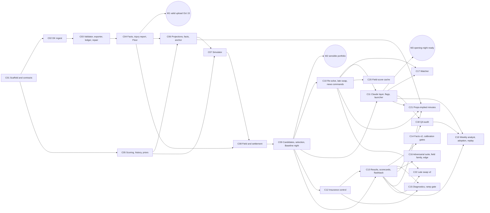

# Build plan

**Changelog:** 2026-10-14 created (Stage 3 of the adjudication session). **Reads with:** `docs/build/PROGRESS.md` (the tracker), `docs/build/CONTRACTS.md` (the interfaces), `docs/build/chunks/` (one file per chunk), `CLAUDE.md` (the session protocol). **Design:** `docs/ARCHITECTURE.md` v4, `docs/BRIEF.md`, `docs/review/ADJUDICATION.md`.

## The short version

The engine is built in **chunks**, one per fresh Claude Code session, each started with one line: `/run-chunk C04`. Every chunk ends with tests passing, the engine working, a commit, and a tracker update. The first milestone is a **valid DraftKings upload from real NBA files** (the Floor, chunk C04), targeted for Thursday Oct 15. The **Baseline** (simulation, field, settlement, selection, live re-solve, late swap, brief) is chunks C05 to C11, drilled on saved files over the weekend and run live on Monday Oct 19 evening on the real opening-night slates, with the Floor already uploaded underneath it. The **Optimizer** chunks (insurance control, results and flashback, watcher, QA, learning) come after opening night, one at a time.

Eleven MVP chunks in five days is tight. The plan has a floor: if the Baseline is not drilled and sane by Monday Oct 19, opening night runs the Floor plus your manual news commands, and the brief says so. That is a rehearsed product, not a failure.

## Milestones

| Milestone | What exists | Chunks | Target | Live check |
|---|---|---|---|---|
| **M0: contracts** | Repo scaffold, every interface as code, fixtures, test harness, the CLI skeleton | C01 | Wed Oct 14 evening | `uv run dfs --help` lists every command; `uv run pytest -m smoke` passes |
| **M1: valid upload (Floor)** | Real entries files parsed, validated, exported; contest facts; injury-scrubbed projection-ranked lineups; brief-lite; `dfs uploaded`; `dfs repair` | C02, C03, C04 | Thu Oct 15 by 5:00 pm CT | **Rehearsal 1 (Oct 15, 2 games, tips 6:30 and 7:30 pm CT):** `dfs night --floor` on your real $0.25 Classic and Showdown entries; upload; DraftKings reports "uploaded N of N"; `dfs uploaded`; re-download before each lock; completeness check passes; after the first lock, test the `(LOCKED)` format and a post-lock fill |
| **M2: sensible portfolio (Baseline model)** | Scoring, history, priors, projections, the bottom-up simulator, the field, the settlement, candidates, greedy selection on Goal 1, the sanity check, the full brief | C05, C06, C07, C08, C09 | Sat Oct 17 evening | **Rehearsal 2 (Oct 16, 12 games):** Floor at scale, plus the news and swap drills in Floor mode with your actions timed (the Baseline is not ready yet). **Drill A (Oct 17 to 18):** `dfs night` on the saved Oct 16 files reproduces a sane Baseline portfolio inside the budget |
| **M3: opening-night ready (Baseline night)** | The live re-solve, `dfs start`, the open-slot late swap, the Claude layer (skills, hooks, researcher flag, `--game-day`), the launcher, capability flags | C10, C11 | Sun Oct 18 evening | **Drill B (Oct 18 to 19):** news drill and swap drill on saved Oct 16 files, timed; the determinism test; the launcher with Claude closed. **Live (Mon Oct 19 evening):** the Baseline's first real run on the Oct 20 slates with the Floor already uploaded; the Baseline file replaces the Floor only if the sanity check and the drill bar pass |
| **Opening night** | Whatever was rehearsed | | Tue Oct 20, 12:30 to 2:00 pm CT | `dfs night --game-day` at 12:45 pm; upload by 1:30 pm; first lock 2:00 pm CT |
| **M4: Optimizer, week 1** | Insurance control, results ingest, scorecards, flashback, contest facts v2, adversarial suite, watcher | C12, C13, C14, C16, C17 | Oct 21 to Oct 31 | Each chunk ships with a real-standings comparison or a rehearsal |
| **M5: learning loop** | QA audit, weekly analyst, adoption, replay, diagnostics, ramp-gate readout | C15, C18, C19 | By Nov 3 | The Nov 3 readout exists and the gate is computed |

**What the milestones test against the edge hypotheses (BRIEF, ADJUDICATION entry 20).** M1 and M3 test execution reliability (no blank, late or rejected entry on Oct 15, 16, 19 and 20); Drill B and the Oct 16 timing drill test late-news reaction (detection to confirmed upload inside the window); M2 and C13's scorecards test minutes and role on rotation changes against the 75/25 baseline.

**Saved-night mode.** Every drill on saved files uses `--night <date> --as-of <datetime>` (CONTRACTS section 1.1, built in C03), which points the engine at that night's files and freezes the clock at that moment, so lock rules behave as they did live. Without it the weekend drills would drop every row as locked.

**What "rehearsed" means per release state (ADR-023, as the calendar allows):** the Floor is rehearsed live with a real upload on Oct 15 and at scale on Oct 16. The Baseline's modeling path cannot be live before it exists, so it is drilled on saved real files (Drills A and B) against a written bar, and its first live run is Monday Oct 19 evening on the real slates with the Floor already uploaded. The upload mechanics (validator, exporter, ledger, read-back, re-download) are one code path shared by both states and are live-rehearsed on Oct 15 and 16. The re-solve's 3-minute budget is timed in Drill B and on Oct 19; if it misses, the legal repair is the opening-night late-news path and the re-solve ships flagged off (ADJUDICATION entry 10).

## The chunks

| ID | Name | State | Depends on | Size | Parallel with |
|---|---|---|---|---|---|
| C01 | Scaffold and contracts | M0 | none | M | none |
| C02 | DraftKings ingest and slate state | F | C01 | M | none |
| C03 | Validator, exporter, ledger, repair | F | C02 | L | none |
| C04 | Contest facts, injury report, Floor portfolio, brief-lite | F | C03 | L | none |
| C05 | Scoring adapter, history, priors | B | C01 | M | none (see below) |
| C06 | Projections, facts translation, market anchor, news state | B | C04, C05 | L | none |
| C07 | Night simulator | B | C05, C06 | L | none |
| C08 | Field model and settlement | B | C04, C07 | L | none |
| C09 | Candidates, selection, Baseline night, full brief | B | C08 | L | none |
| C10 | Live re-solve, late swap, news commands | B | C09 | L | none |
| C11 | Claude layer, capability flags, launcher, opening-night readiness | B | C09, C10 | L | none |
| C12 | Insurance control | O | C09 | M | none |
| C13 | Results ingest, scorecards, contest flashback | O | C09, C12 | L | none |
| C14 | Contest facts v2 and calibration gates | O | C13 | M | none |
| C15 | Economic diagnostics, ramp-gate readout, hunch report | O | C13, C12 | M | none |
| C16 | Adversarial suite, field family, edge uncertainty, Showdown audit | O | C13 | L | none |
| C17 | News watcher | O | C10, C11 | M | none |
| C18 | QA coherence audit | O | C11, C13 | M | none |
| C19 | Weekly analyst, adoption workflow, replay | O | C11, C13, C18 | M | none |
| C20 | Incremental field-score cache (only if the re-solve misses budget on 12 games) | O | C10 | M | none |
| C21 | Market-implied minutes from props; value-of-information digest | O | C06, C10, C11, C13 | M | none |
| C22 | Late swap v2: live-score conditioning | O | C10, C13 | M | none |

Size: M = one session of about 1 to 2 hours with a reading list under 25,000 tokens; L = one session of about 2 to 3 hours with checkpoints, reading list under 35,000 tokens. No chunk's required reading plus expected work exceeds half the context window; every L chunk has checkpoints where a session can stop, write handoff notes, and resume in a new session.

**Parallel runs: none.** The whole plan runs one chunk at a time. The independent checks showed that every chunk from C04 onward touches `src/nbadfs/cli.py`, `docs/build/CONTRACTS.md`, `config/settings.toml` and `PROGRESS.md`, so no two chunks are safely parallel for a non-engineer to merge. The column is kept at "none" so nobody reintroduces it without checking file overlap.

## Dependency graph

**Critical path to opening night:** C01 → C02 → C03 → C04 (M1) → C05 → C06 → C07 → C08 → C09 (M2) → C10 → C11 (M3). Every MVP chunk is on it.

## Calendar

| Day | Chunks (sequential) | You | Live |
|---|---|---|---|
| Wed Oct 14, evening | C01 | Approve the plan. Tonight: check the DraftKings lobby for Thursday's slates (a 2-game Thursday may have only Showdowns; if there is no Classic slate, enter a Showdown Thursday and a Classic Friday); enter one $0.25 Classic and one $0.25 Showdown contest, **build the lineups by hand in the DraftKings browser page** (so a validate-and-export round trip of your own lineups exists even if C04 slips), then export their entries files and salary exports tonight. Export the Oct 20 salary files. | none |
| Thu Oct 15 | C02, C03, C04, sequentially; you start each session (about 15 minutes of your attention each, during your afternoon desk time); run the build on the Team seat and keep the Pro plan for the evening so a five-hour cap cannot block the rehearsal | Payout tables for the two test contests (45 seconds each). From about 5:00 pm CT: rehearsal 1. | **Rehearsal 1:** Floor upload (or, if C04 slipped, the round trip of your hand-built lineups through `dfs repair`), read-back, `dfs uploaded`, re-download, completeness; after the 6:30 lock, the `(LOCKED)` test and a post-lock fill |
| Fri Oct 16 | C05, C06, C07 | Enter $0.25 Classic and Showdown on the 12-game slate; export files; from about 5:00 pm CT: rehearsal 2 in Floor mode; time every action. | **Rehearsal 2:** Floor at scale; `dfs out` drill (which runs the repair while the re-solve is off) with upload and re-download timed at about 30, 10 and 2 minutes before a tip; a post-lock Floor-mode swap (repair rule) that DraftKings accepts |
| Sat Oct 17 | C08, C09 | Nothing live. Drill A at the end of C09: the Baseline on the saved Oct 16 files in saved-night mode (`--night 2026-10-16 --as-of "2026-10-16T17:00-05:00"`). | none (no NBA games) |
| Sun Oct 18 | C10, C11 | Nothing live. Drill B at the end of C11: news and swap drills on saved files in saved-night mode, timed; the opening-night fallback sequence rehearsed on a Baseline file (`dfs out --no-run`, `dfs repair`, upload, `dfs uploaded`, `dfs status`); the determinism test; the launcher with Claude closed. | none |
| Mon Oct 19 | Fixes only until noon; injury-report parser fixes allowed in the evening | Enter the Oct 20 contests; paste payout tables. Evening, after the day-before reports: `dfs night` on the real slates; upload the Floor file; then the Baseline file if the sanity check and drill bar passed; `dfs uploaded`; re-download; `/status`. Record usage. | **The Baseline's first live run,** with the Floor underneath |
| Tue Oct 20 | none (code freeze from 1:00 pm CT) | 12:30 download; 12:45 `dfs night --game-day`; upload by 1:30; re-download the 3:00 pm Showdown and main Classic files; first lock 2:00 pm CT; evening routine for the 7:00 and 9:30 pm ET games. **If news breaks and the re-solve is off or misses its budget:** `uv run dfs out "Name" --no-run`, then `uv run dfs repair --slate <slate>` for each affected slate, upload in the browser, `uv run dfs uploaded <file>`, `uv run dfs status` | **Opening night** |
| Oct 21 to 31 | C12, C13, C14, C16, C17, C15, in that order (one or two a day) | Nightly runs; morning flagship standings downloads | Real nights |
| By Nov 3 | C18, C19 | The Nov 3 readout | |

**If the calendar slips:** the order never changes; the Floor is always the opening-night fallback. If C09 is not done by Sunday evening, skip C10's open-slot swap and C11's researcher (keep flags off) and spend Sunday on C09 and the drills; opening night then runs the Floor with `dfs out`, `dfs in`, `dfs repair`, which were rehearsed on Oct 16.

## Build usage budget (ADJUDICATION entry 36)

Run build sessions on the Team seat and keep the Pro plan for rehearsals and nights, so a five-hour cap hit by three sessions in an afternoon cannot block an evening rehearsal. Every session records its Claude usage at the end in `PROGRESS.md` (the five-hour window share, and the weekly share where readable). If C01 to C04 together use more than about 40% of a weekly window, the plan switches to the "Floor only" branch: C05 to C09 move after opening night, and C10 and C11 are built in Floor mode only (news commands, repair, hooks, launcher). Nightly runs target at most about 50% of one Pro five-hour window; the Monday Oct 19 build measures it.

## What you provide, and when

| What | When | Why |
|---|---|---|
| Approval of this plan | Now | C01 starts |
| One $0.25 Classic entry and one $0.25 Showdown entry on the Oct 15 slates (check the lobby first; a 2-game Thursday may have no Classic slate, in which case Showdown Thursday and Classic Friday), with the lineups built by hand in the browser, and their entries files and salary exports in your Downloads folder | Wednesday night, before C02 | The parsers and validator are tested on real 2026-27 NBA files; a round trip of your own lineups is the minimum rehearsal even if the Floor slips |
| The post-lock re-download of the Oct 15 entries files (after 6:30 pm CT) | Thursday evening | The `(LOCKED)` cell format fixture for the late-swap tests |
| Payout tables pasted for each test contest (and each opening-night contest) | With each entry | Both goals are settled on them |
| The same two test entries and exports on the Oct 16 slates | Friday afternoon | Rehearsal 2 and the saved files that Drills A and B run on |
| A free The Odds API key in `config/secrets.toml` (never committed) | Before C06 | Game lines for the market anchor |
| The Oct 20 contests entered, with payout tables and entries files | Monday Oct 19 evening | The Baseline's first live run |
| Your presence at the laptop | Oct 15 evening, Oct 16 evening, Oct 20 12:30 to 2:00 pm CT (answered yes) | Rehearsals and opening night |
| Usage readings | End of every session (`/usage`) | The build budget rule |
| Morning flagship standings downloads and the weekly entry-history export | From Oct 16 onward | C13 and the learning loop |

## Rules every chunk follows

1. Read `docs/build/PROGRESS.md` first and the chunk file second; nothing else unless the chunk's reading list names it.
2. Build only the chunk's scope; log anything else found as a note in PROGRESS.md.
2a. Research budget per chunk (ADJUDICATION entry 26): at most 20 minutes and 5 web searches, only to settle a contract or a tool question; no new research memos; an unresolved question goes to PROGRESS.md and the advisor consultation.
3. Contracts in code before behavior: every chunk starts by checking its consumed contracts exist in `src/nbadfs/schemas/` and produces its own as code and fixtures.
4. Tests pass (`uv run pytest -m smoke` under 60 seconds; the chunk's own tests; the full suite under 5 minutes where it exists).
5. Consult the advisor when stuck for more than 20 minutes on one problem, and once before declaring the chunk done, with one named question; log it in `docs/research/advisor-log.md`.
6. Update PROGRESS.md (status, deviations, handoff notes, usage), commit with the chunk ID in the message, stop. Never start the next chunk.
7. On a game night, no edits to `src/` from 60 minutes before the first lock to the last lock.

## Backlog (accepted in principle, not scheduled)

- B-D-02 locked-field conditioning for late swap (after C22 and the late-swap scorecard).
- B-D-03 game-script rotation regimes from play-by-play stints (trigger: minutes coverage fails for starters or deep bench in games decided by 16 or more).
- A-D-03 valuing swap flexibility as a decision sequence (trigger: the late-swap scorecard shows pre-lock portfolios regularly lacked an affordable pivot).
- A draft-slot rookie prior, if a permitted source is found.
- The advisory contest-mix report at equal spend.
