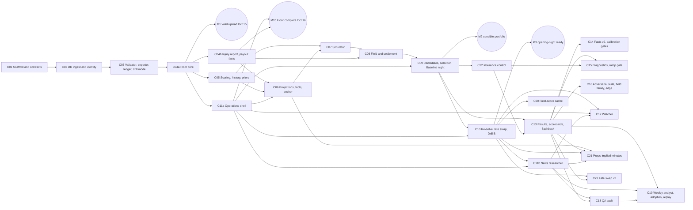

# Build plan

**Changelog:** 2026-10-14 (ADJUDICATION-R2 entry R2-34, final audit): the Sunday calendar row ends by enabling each capability whose drill passed (`dfs enable`). 2026-10-14 (ADJUDICATION-R2 entry R2-34, final audit): C05 depends on C04a (it consumes `score_line` and `identity.match`) and C06 also on C11a (its definition of done runs `dfs start`), in the chunk table and the graph; the calendar puts each standings download on the morning after its test night. 2026-10-14 (v2.1; ADJUDICATION-R2 entry R2-33): the owner's real Oct 14 files are archived and used by C01 to C04a; salary files are downloaded with every entries file; tonight's capture steps; real files stay out of git because the repository is public. 2026-10-14 (v2, design final; ADJUDICATION-R2): C04 split into C04a (the Floor core, M1) and C04b (injury report and payout facts); C11 split into C11a (the operations shell, depends on C04a only, rehearsed live on Oct 16) and C11b (the news researcher, after opening night); C10 depends on C11a and has a Sunday 10:00 pm CT hard cut; C09 depends on C11a for the capability gate; a `deferred` status makes the Floor-only branch an ordinary dependency chain; the usage trigger is measured at M1 (C01 to C04a) at about 35%; drill mode replaces saved-night mode for writes; the owner's tonight capture and morning standings downloads added; backlog gains the sampling challenger and the alert-only line-move flag (R2-1, R2-7, R2-22, R2-25, R2-29). 2026-10-14 (v1): created. **Reads with:** `docs/build/PROGRESS.md` (the tracker), `docs/build/CONTRACTS.md` (the interfaces), `docs/build/chunks/` (one file per chunk), `docs/build/OWNER_CHECKLIST.md` (your work plan), `CLAUDE.md` (the session protocol). **Design:** `docs/ARCHITECTURE.md` v5 (final), `docs/BRIEF.md`, `docs/review/ADJUDICATION.md` and `docs/review/ADJUDICATION-R2.md`.

## The short version

The engine is built in **chunks**, one per fresh Claude Code session, each started with one line: `/run-chunk C04a`. Every chunk ends with tests passing, the engine working, a commit, and a tracker update. The first milestone is a **valid DraftKings upload from real NBA files** (the Floor core, chunk C04a), targeted for Thursday Oct 15. On Friday Oct 16 the **operations shell** (launcher, hooks, capability flags, slash commands; C11a) and the **injury report and payout facts** (C04b) complete the Floor, and you rehearse the shell live that evening. The **Baseline** (scoring and history, projections, simulation, field, settlement, selection, live re-solve, late swap) is chunks C05 to C10, built over the weekend, drilled on saved files, and run live on Monday Oct 19 evening on the real opening-night slates, with the Floor already uploaded underneath it. The **Optimizer** chunks (the news researcher, insurance control, results and flashback, watcher, QA, learning) come after opening night, one at a time.

Twelve MVP chunks in five days (Wednesday evening to Sunday night) is tight. The plan has a floor: the Floor-only route (C01, C02, C03, C04a, C11a, C04b) is complete by Friday night, and if the Baseline is not drilled and sane by Sunday evening, opening night runs the Floor plus your manual news commands and the repair, and the brief says so. That is a rehearsed product, not a failure.

## Milestones

| Milestone | What exists | Chunks | Target | Live check |
|---|---|---|---|---|
| **M0: contracts** | Repo scaffold, every interface as code, fixtures (including the hand-computed tiny contests), test harness, the CLI skeleton, the docs checker in the smoke suite | C01 | Wed Oct 14 evening | `uv run dfs --help` lists every command; `uv run pytest -m smoke` passes |
| **M1: valid upload (Floor core)** | Real entries files parsed, validated, exported; drill mode; default contest facts; fantasy points from last season; projection-ranked lineups; brief-lite; `dfs uploaded`; `dfs repair`; `dfs out` and `dfs in` through the repair | C02, C03, C04a | Thu Oct 15 by 5:00 pm CT | **Rehearsal 1 (Oct 15, 2 games, tips 6:30 and 7:30 pm CT):** `dfs night --floor` on your real $0.25 Classic and Showdown entries; upload; DraftKings reports "uploaded N of N"; `dfs uploaded`; re-download before each lock; completeness check passes; after the first lock, save the post-lock re-download |
| **M1b: Floor complete** | The operations shell (launcher, slash commands, hooks, capability flags with versioned rehearsals, `dfs start`, `--game-day`, the drill timer, repair stage 2); the injury report with the per-team merge and `dfs status --apply`; payout pastes, entry history, the facts cache | C11a, C04b | Fri Oct 16 by 5:00 pm CT (C04b may slip to Saturday) | **Rehearsal 2 (Oct 16, 12 games):** Floor at scale from the launcher and `/night`; the `dfs out` drill (repair) with upload and re-download timed at about 30, 10 and 2 minutes before a tip; a post-lock repair DraftKings accepts; the launcher with Claude closed; `dfs rehearsed floor` |
| **M2: sensible portfolio (Baseline model)** | Scoring and history, projections, the bottom-up simulator, the field with the exact top tail, the corrected settlement, candidates, greedy selection on Goal 1, the sanity check, the full brief | C05, C06, C07, C08, C09 | Sun Oct 18 afternoon | **Drill A:** `dfs night` in drill mode on the saved Oct 16 files reproduces a sane Baseline portfolio inside the budget; `dfs rehearsed baseline_model` |
| **M3: opening-night ready (Baseline night)** | The live re-solve, the Baseline late swap, the re-solve path of the news commands, the Baseline readiness drills | C10 | Sun Oct 18, 10:00 pm CT hard cut | **Drill B:** news and swap drills in drill mode, timed; the fallback sequence and the launcher drill on a Baseline file. **Live (Mon Oct 19 evening):** the Baseline's first real run on the Oct 20 slates with the Floor already uploaded; the Baseline file replaces the Floor only if the sanity check and the drill bar pass |
| **Opening night** | Whatever was rehearsed | | Tue Oct 20, 12:30 to 2:00 pm CT | `dfs night --game-day` at 12:45 pm; upload by 1:30 pm; first lock 2:00 pm CT |
| **M4: Optimizer, week 1** | The news researcher, insurance control, results ingest, scorecards, flashback, contest facts v2, adversarial suite, watcher | C11b, C12, C13, C14, C16, C17 | Oct 21 to Oct 31 | Each chunk ships with a real-standings comparison or a rehearsal |
| **M5: learning loop** | QA audit, weekly analyst, adoption, replay, diagnostics, ramp-gate readout | C15, C18, C19 | By Nov 3 | The Nov 3 readout exists and the gate is computed |

**What the milestones test against the edge hypotheses (BRIEF, ADJUDICATION entry 20).** M1, M1b and M3 test execution reliability (no blank, late or rejected entry on Oct 15, 16, 19 and 20); Drill B and the Oct 16 timing drill test late-news reaction (detection to confirmed upload inside the window); M2 and C13's scorecards test minutes and role on rotation changes against the 75/25 baseline.

**Drill mode (CONTRACTS section 1.1, built in C03).** Every drill on saved files uses `--night <date> --as-of <datetime>`, which reads that night's archived files read-only, freezes the clock at that moment so lock rules behave as they did live, and writes everything (ledgers, news state, upload-shaped files, simulated confirmations) under `runs/drills/<drill_id>/`. A drill can never change the live records of the night it replays (ADJUDICATION-R2 R2-7).

**What "rehearsed" means per release state (ADR-023, ADR-030):** the Floor core is rehearsed live with a real upload on Oct 15, and the whole Floor (with its operations shell) at scale on Oct 16. The Baseline's modeling path cannot be live before it exists, so it is drilled on saved real files (Drills A and B) against a written bar, and its first live run is Monday Oct 19 evening on the real slates with the Floor already uploaded. The upload mechanics (validator, exporter, ledger, read-back, re-download) are one code path shared by both states and are live-rehearsed on Oct 15 and 16. `dfs rehearsed <capability>` records the date, commit, source paths and drill artifact; a capability whose source changes afterward is `stale` and needs a replay drill (a few minutes on saved files) before it can be enabled on a game night. The re-solve's 3-minute budget is timed in Drill B and on Oct 19; if it misses, the legal repair is the opening-night late-news path and the re-solve ships flagged off (ADJUDICATION entry 10).

## The chunks

| ID | Name | State | Depends on | Size | Parallel with |
|---|---|---|---|---|---|
| C01 | Scaffold and contracts | M0 | none | L | none |
| C02 | DraftKings ingest, identity and slate state | F | C01 | M | none |
| C03 | Validator, exporter, ledger, drill mode, legal repair | F | C02 | L | none |
| C04a | The Floor core: scoring, simple points, solver, Floor portfolio, brief-lite, news facts with the repair | F | C03 | L | none |
| C04b | Injury report, `dfs status --apply`, payout pastes, entry history, facts cache | F | C04a | M | none |
| C05 | Scoring adapter (versioned), history, priors | B | C04a | M | none |
| C06 | Projections, fact translation, market anchor | B | C04b, C05, C11a | L | none |
| C07 | Night simulator | B | C05, C06 | L | none |
| C08 | Field model and settlement | B | C04b, C07 | L | none |
| C09 | Candidates, selection, Baseline night, full brief | B | C08, C11a | L | none |
| C10 | Live re-solve, Baseline late swap, the re-solve path, Drill B | B | C09, C11a | L | none |
| C11a | The operations shell: launcher, slash commands, hooks, preflight, capability flags, drill timer, repair stage 2 | F | C04a | L | none |
| C11b | The news researcher: agent, allowlisted fetch, fact validator, game-day pass | O | C10, C11a | M | none |
| C12 | Insurance control | O | C09 | M | none |
| C13 | Results ingest, scorecards, contest flashback | O | C09, C12 | L | none |
| C14 | Contest facts v2 and calibration gates | O | C13 | M | none |
| C15 | Economic diagnostics, ramp-gate readout, hunch report | O | C13, C12 | M | none |
| C16 | Adversarial suite, field family, edge uncertainty, Showdown audit | O | C13 | L | none |
| C17 | News watcher | O | C10, C11a, C11b | M | none |
| C18 | QA coherence audit | O | C11b, C13 | M | none |
| C19 | Weekly analyst, adoption workflow, replay | O | C11b, C13, C18 | M | none |
| C20 | Incremental field-score cache (only if the re-solve misses budget on 12 games) | O | C10 | M | none |
| C21 | Market-implied minutes from props; value-of-information digest | O | C06, C10, C11b, C13 | M | none |
| C22 | Late swap v2: live-score conditioning | O | C10, C13 | M | none |

State: M0 = contracts; F = Floor; B = Baseline; O = Optimizer (after opening night). Size: M = one session of about 1 to 2 hours with a reading list under 25,000 tokens; L = one session of about 2 to 3 hours with checkpoints and a reading list under 35,000 tokens. No chunk's required reading plus expected work exceeds half the context window; every chunk has checkpoints where a session can stop, write handoff notes, and resume in a new session. Every chunk file carries a usage budget; a session that passes it stops at the next checkpoint and hands off.

**Parallel runs: none.** Every chunk from C04a onward touches `src/nbadfs/cli.py`, `docs/build/CONTRACTS.md`, `config/settings.toml` and `PROGRESS.md`, so no two chunks are safely parallel for a non-engineer to merge. The column is kept at "none" so nobody reintroduces it without checking file overlap.

## Dependency graph

**Critical path to opening night (Baseline):** C01 → C02 → C03 → C04a → C04b → C06 → C07 → C08 → C09 → C10, with C05 (after C04a) needed before C06 and C11a needed before C06, C09 and C10. **The Floor-only route:** C01 → C02 → C03 → C04a → C11a, plus C04b for the injury report and payout facts. Every chunk on the Floor-only route depends only on chunks on that route, so a session following the protocol can walk it with C05 to C10 marked `deferred (after opening night)` (checked by `scripts/check_docs.py`).

**Build order** (the sequence the calendar runs; every chunk depends only on chunks before it): C01, C02, C03, C04a, C11a, C04b, C05, C06, C07, C08, C09, C10, C11b, C12, C13, C14, C16, C17, C15, C18, C19, C20, C21, C22.

**Floor-only route:** C01, C02, C03, C04a, C11a, C04b. **Deferred in the Floor-only branch:** C05, C06, C07, C08, C09, C10, C11b.

## Calendar

| Day | Chunks (sequential) | You | Live |
|---|---|---|---|
| Wed Oct 14, evening | C01 | Approve the plan. Check the DraftKings lobby for Thursday's slates (a 2-game Thursday may have only Showdowns; if there is no Classic slate, enter a Showdown Thursday and a Classic Friday); enter one $0.25 Classic and one $0.25 Showdown contest on the Oct 15 slates, **build the lineups by hand in the DraftKings browser page**, then export their entries files and salary files. Export the Oct 20 salary files. **Tonight's test files are in** (one $0.25 Classic, 7 games; one $0.25 Showdown DEN@LAC; archived in `data/archive/2026-10-14/`): fill both lineups by hand before 6:30 pm CT; re-download the Classic salary file about 6:15 pm CT, the Classic entries file between about 6:45 and 9:15 pm CT, and the Showdown entries file after 9:30 pm CT | Tonight's post-lock capture |
| Thu Oct 15 | C02, C03, C04a, sequentially; you start each session (about 15 minutes of your attention each, during your afternoon desk time); run the build on the Team seat and keep the Pro plan for the evening | Morning: standings for the Oct 14 contests. Save the payout tables for the two test contests (45 seconds each; the parser arrives Friday). From about 5:00 pm CT: rehearsal 1. Record usage after C04a (the M1 reading) | **Rehearsal 1:** Floor upload (or, if C04a slipped, the round trip of your hand-built lineups through `dfs repair`), read-back, `dfs uploaded`, re-download, completeness; after the 6:30 pm lock, save the post-lock re-download |
| Fri Oct 16 | C11a first, then C04b (it may slip to Saturday); C05 in the evening after rehearsal 2 if usage allows | Morning: standings for the Oct 15 contests. Enter $0.25 Classic and Showdown on the 12-game slate; export files. From about 5:00 pm CT: rehearsal 2 from the desktop launcher and `/night`; time every action | **Rehearsal 2:** Floor at scale; `dfs out` drill (the repair) with upload and re-download timed at about 30, 10 and 2 minutes before a tip; a post-lock repair DraftKings accepts; the launcher with Claude closed; `dfs rehearsed floor` |
| Sat Oct 17 | C04b (if not done Friday), C05 (if not done Friday), C06, C07, C08 as far as they go | Morning: standings for the Oct 16 contests (into your private standings folder, about 2 minutes). Nothing live | none (no NBA games) |
| Sun Oct 18 | C08 (if not done Saturday), C09 (Drill A), C10 (Drill B). **Hard cut 10:00 pm CT for C10** | Start sessions; read Drill A's brief (5 minutes); at night, `uv run dfs enable` each capability whose drill passed (`baseline_model` after Drill A; `resolve` and `swap_open_slots` after Drill B); nothing live | none |
| Mon Oct 19 | No new chunks. Fixes only until noon; injury-report parser fixes allowed in the evening, followed by a replay drill because the parser changed | Enter the Oct 20 contests; paste payout tables. Evening, after the day-before reports: `/night` on the real slates; upload the Floor file; then the Baseline file if the sanity check and drill bar passed; `dfs uploaded`; re-download; `/status`. Record usage | **The Baseline's first live run,** with the Floor underneath |
| Tue Oct 20 | none (code freeze from 1:00 pm CT) | 12:30 download; 12:45 `dfs night --game-day`; upload by 1:30; re-download the 3:00 pm ET Showdown and main Classic files; first lock 2:00 pm CT; evening routine for the 7:00 and 9:30 pm ET games. **If news breaks and the re-solve is off or misses its budget:** `uv run dfs out "Name" --no-run`, then `uv run dfs repair --slate <slate>` for each affected slate, upload in the browser, `uv run dfs uploaded <file>`, `uv run dfs status` | **Opening night** |
| Oct 21 to 31 | C11b, C12, C13, C14, C16, C17, C15, in that order (one or two a day) | Nightly runs; morning flagship standings downloads | Real nights |
| By Nov 3 | C18, C19 (C20, C21, C22 when their triggers or the calendar allow) | The Nov 3 readout | |

**If the calendar slips.** The order never changes, and the Floor is always the opening-night fallback.
- C04a not done by 5:00 pm Thursday: rehearsal 1 is the round trip of your hand-built lineups through `dfs repair` (C03); C04a finishes Friday morning before C11a.
- C11a not done before rehearsal 2: rehearse with plain `uv run dfs` commands in a terminal; its checkpoint 3 carries into Saturday morning.
- Usage trigger at M1 (below): take the Floor-only branch.
- C09 not done by 6:00 pm Sunday: the Baseline stays off on opening night; C10 is marked `deferred`; the weekend's remaining time goes to Floor drills.
- C10 not done by 10:00 pm Sunday: C10 is marked `deferred`; if C09 passed Drill A, opening night runs the Baseline build with `resolve` and `swap_open_slots` off, and the repair (including post-lock) is the late-news path. C10 is never started on Monday.

## Build usage budget (ADJUDICATION entry 36, ADJUDICATION-R2 R2-1)

Run build sessions on the Team seat and keep the Pro plan for rehearsals and nights, so a five-hour cap hit by three sessions in an afternoon cannot block an evening rehearsal. Every session records its Claude usage at the end in `PROGRESS.md` (the five-hour window share, and the weekly share where readable); each chunk file states its own budget. **The trigger is measured at M1:** if C01 to C04a together use more than about 35% of a weekly window, the plan switches to the "Floor only" branch: C11a and C04b still run (they are on the Floor path), and C05 to C10 and C11b are marked `deferred (after opening night)` in PROGRESS.md. A deferred chunk counts as not done for dependency checks, so the protocol walks the Floor route without improvising. Nightly runs target at most about 50% of one Pro five-hour window; the Monday Oct 19 run measures it.

## What you provide, and when

| What | When | Why |
|---|---|---|
| Approval of this plan | Now | C01 starts |
| One $0.25 Classic entry and one $0.25 Showdown entry on the Oct 15 slates (check the lobby first), with the lineups built by hand in the browser, and their entries files and salary exports in your Downloads folder | Wednesday night, before C02 | The parsers and validator are tested on real 2026-27 NBA files; a round trip of your own lineups is the minimum rehearsal even if the Floor slips |
| Tonight's lineups filled by hand, then the Classic salary file (about 6:15 pm CT), the Classic entries file (between about 6:45 and 9:15 pm CT) and the Showdown entries file (after 9:30 pm CT) re-downloaded | Tonight | A real NBA file with both locked and open cells before C03 runs, and the first look at whether `Starting` fills near tip |
| The salary file with every entries download | Every run | Only the salary file carries DraftKings' injury `Status`, the only injury signal in preseason |
| The post-lock re-download of the Oct 15 entries files (after 6:30 pm CT) | Thursday evening | The `(LOCKED)` cell format fixture for the late-swap tests |
| Payout tables saved for each test contest (and each opening-night contest) | With each entry | Both goals are settled on them |
| The same two test entries and exports on the Oct 16 slates | Friday afternoon | Rehearsal 2 and the saved files that Drills A and B run on |
| Standings downloads for the Oct 14, Oct 15 and Oct 16 test contests | The morning after each (Oct 15, 16, 17) | The first real NBA standings fixtures for C13 |
| A free The Odds API key in `config/secrets.toml` (never committed) | Before C06 (Saturday) | Game lines for the market anchor |
| The Oct 20 contests entered, with payout tables and entries files | Monday Oct 19 evening | The Baseline's first live run |
| Your presence at the laptop | Oct 15 evening, Oct 16 evening, Oct 20 12:30 to 2:00 pm CT (answered yes) | Rehearsals and opening night |
| Usage readings | End of every session (`/usage`) | The build budget rule |
| Answers to change requests | Whenever a session stops on one | Nothing in the design changes without your approval |
| Morning flagship standings downloads and the weekly entry-history export | From Oct 21 onward | C13 and the learning loop |

Your full day-by-day list, with times and what to check, is `docs/build/OWNER_CHECKLIST.md`.

## Rules every chunk follows

1. Read `docs/build/PROGRESS.md` first and the chunk file second; nothing else unless the chunk's reading list names it.
2. Build only the chunk's scope; log anything else found as a note in PROGRESS.md.
2a. Research budget per chunk (ADJUDICATION entry 26): at most 20 minutes and 5 web searches, only to settle a contract or a tool question; no new research memos; an unresolved question goes to PROGRESS.md and the advisor consultation.
2b. Change control (design final): a design problem found during a chunk is logged as a change request in PROGRESS.md; if it blocks the chunk, the session stops and asks the owner; nothing in the design changes without the owner's approval (`CLAUDE.md`).
3. Contracts in code before behavior: every chunk starts by checking its consumed contracts exist in `src/nbadfs/schemas/` and produces its own as code and fixtures.
4. Tests pass (`uv run pytest -m smoke` under 60 seconds, which includes `scripts/check_docs.py`; the chunk's own tests; the full suite under 5 minutes where it exists).
5. Consult the advisor when stuck for more than 20 minutes on one problem, and once before declaring the chunk done, with one named question; log it in `docs/research/advisor-log.md`.
6. Update PROGRESS.md (status, deviations, handoff notes, usage), commit with the chunk ID in the message, stop. Never start the next chunk.
7. On a game night, no edits to `src/` from 60 minutes before the first lock to the last lock.

## Backlog (accepted in principle, not scheduled)

- B-D-02 locked-field conditioning for late swap (after C22 and the late-swap scorecard).
- B-D-03 game-script rotation regimes from play-by-play stints (trigger: minutes coverage fails for starters or deep bench in games decided by 16 or more).
- A-D-03 valuing swap flexibility as a decision sequence (trigger: the late-swap scorecard shows pre-lock portfolios regularly lacked an affordable pivot). Review B's "late-swap salvage score" for late-game Questionable stars belongs here (ADJUDICATION-R2 R2-28).
- A draft-slot rookie prior, if a permitted source is found.
- The advisory contest-mix report at equal spend.
- Stratified or importance sampling as a frozen challenger (ADJUDICATION-R2 R2-22; trigger: C16's paired standard errors show simulation noise, not model error, limiting portfolio decisions).
- An alert-only line-move flag in the news digest: a team whose implied total moved at least 2 points between The Odds API snapshots the engine already takes, with no change to play probabilities (ADJUDICATION-R2 R2-29; candidate for C21).
